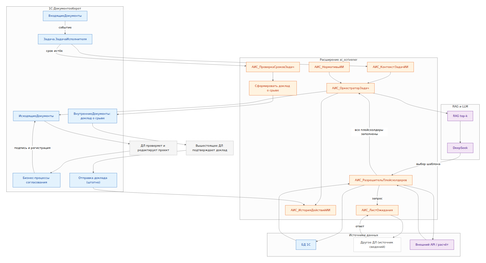
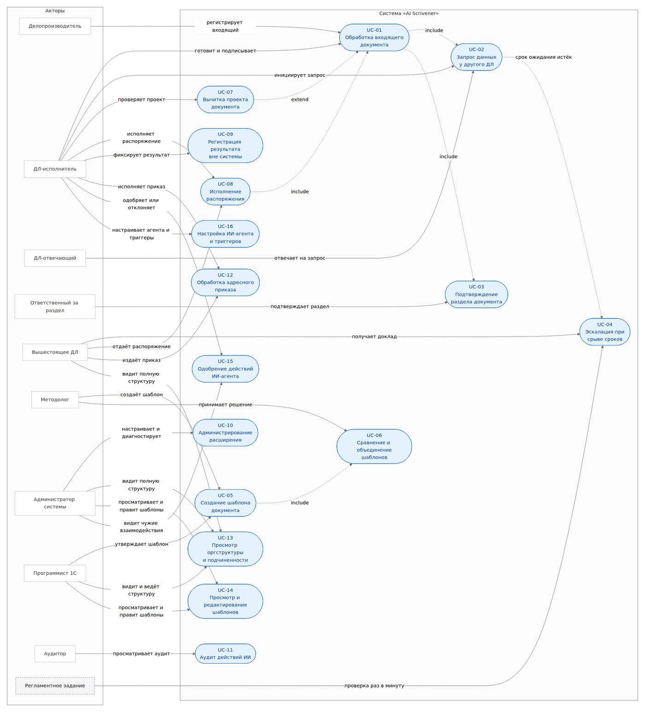
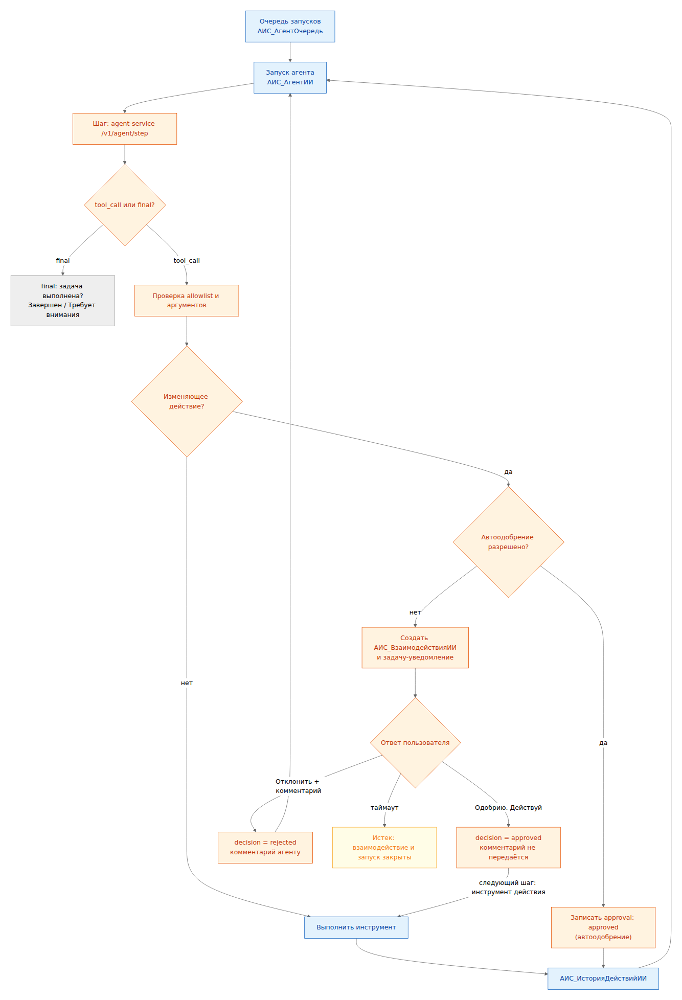
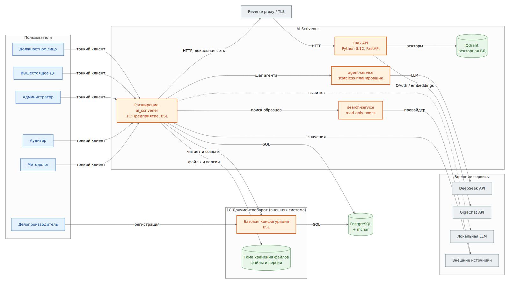
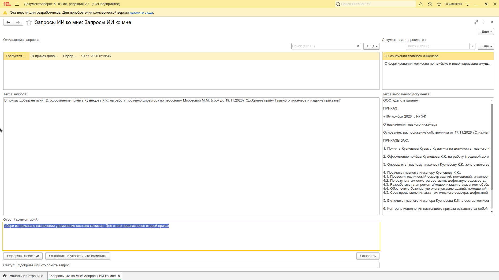
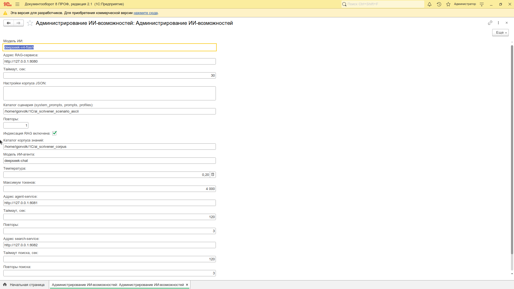

ФЕДЕРАЛЬНОЕ ГОСУДАРСТВЕННОЕ БЮДЖЕТНОЕ ОБРАЗОВАТЕЛЬНОЕ УЧРЕЖДЕНИЕ 
ДОПОЛНИТЕЛЬНОГО ПРОФЕССИОНАЛЬНОГО ОБРАЗОВАНИЯ 
«ИНСТИТУТ РАЗВИТИЯ ПРОФЕССИОНАЛЬНОГО ОБРАЗОВАНИЯ» 
(ФГБОУ ДПО ИРПО)

ДОПОЛНИТЕЛЬНАЯ ПРОФЕССИОНАЛЬНАЯ ПРОГРАММА — 
ПРОГРАММА ПРОФЕССИОНАЛЬНОЙ ПЕРЕПОДГОТОВКИ 
«СИСТЕМНЫЙ АНАЛИТИК»

ИТОГОВАЯ АТТЕСТАЦИОННАЯ РАБОТА

Разработка программного обеспечения для автоматизированного анализа неструктурированных документов на основе гибридного RAG и агентной оркестрации (на примере 1С:Документооборот)

<table class="cover-fields">
<tr><td>Слушатель:</td><td>________________ / ______________________ /</td></tr>
<tr><td>Группа:</td><td>________________</td></tr>
<tr><td>Руководитель ИАР:</td><td>________________ / ______________________ /</td></tr>
<tr><td>Нормоконтроль:</td><td>________________ / ______________________ /</td></tr>
</table>

Москва, 2026

## Аннотация

Итоговая аттестационная работа посвящена разработке программного обеспечения для автоматизированного анализа неструктурированных документов и подготовки проектов управленческих решений в контуре 1С:Документооборот. Актуальность работы определяется ростом объёма документов, сложностью поиска прецедентов и высокими трудозатратами на подготовку черновиков, при одновременном ужесточении требований к контролю действий ИИ и прослеживаемости.

Решаются задачи анализа предметной области, требований, алгоритма, архитектуры и модели данных, реализации и оценки качества. В качестве основного алгоритма выбран гибридный поиск (плотные и разреженные представления, переранжирование) в сочетании с агентным циклом, в котором каждое изменяющее действие в 1С выполняется только после одобрения пользователя или по разрешённому правилу автоодобрения. Такой выбор обеспечивает не только генерацию текста, но и интерпретируемый результат: найденные источники, цитаты, решение пользователя и полный след действий.

Объект исследования — процессы работы с документами в 1С:Документооборот; предмет — методы и программные средства автоматизированного анализа неструктурированных документов и контроля действий ИИ-агента. Методы: системный анализ, моделирование процессов AS-IS/TO-BE, объектно-ориентированное проектирование, прототипирование, экспериментальная оценка поиска и ответов, экспертная интерпретация метрик.

Полученный результат — работающее расширение 1С с подсистемой «ИИ-Помощник» и сервисами `agent-service`, `search-service`, RAG. Это MVP целевой системы: шаблоны с плейсхолдерами и поиском с фильтрами. В MVP агент готовит документ свободно, человек контролирует результат; свободная генерация и временное автоодобрение нужны для накопления синтетического корпуса. В целевой системе автоодобрения нет. В оценке на наборе из 70 кейсов (60 отвечаемых, 10 без ответа) получены: Recall@10 — 1,00; citation precision — 0,88; correctness — 0,94; groundedness — 0,95; no-answer precision — 0,91; ноль галлюцинаций по оценке судьи; E2E p50 — 3,18 с. Результаты интерпретированы с учётом ограничений: небольшой курируемый набор, судья на той же модели, демонстрационный корпус.

Практическая значимость — сокращение времени поиска и подготовки черновиков, повышение контролируемости действий ИИ за счёт approval, аудита и атрибуции пользователя. Направления развития: маскирование ПДн, лицензия и поддержка, UX, отчётность, 1С:ДО 3.0.

[TOC]

# 1. Введение

## 1.1. Актуальность

Документооборот современной организации остаётся преимущественно текстовым: приказы, распоряжения, заявки, договоры, претензии, служебные записки и приложения к ним. Даже при наличии электронного документооборота значительная часть работы выполняется вручную: сотрудник ищет прецеденты, сверяет условия, переносит фрагменты из предыдущих документов и готовит черновик. Чем больше организация, тем выше стоимость поиска и тем сильнее зависимость результата от опыта конкретного исполнителя.

Классические средства 1С:Документооборот решают задачи хранения, прав, маршрутов и контроля сроков, но не выполняют смысловой анализ текста. Встроенные функции новых версий закрывают отдельные сценарии (распознавание, транскрибация), однако не заменяют поиск по корпусу и подготовку проекта документа на основе прецедентов. Коммерческие ИИ-решения для документооборота, как правило, предлагаются «как коробка» и ограничивают настройку под конкретные процессы.

При этом применение больших языковых моделей без контроля порождает новые риски: модель может сформировать правдоподобный, но неверный ответ, сослаться на несуществующий источник или выполнить изменяющее действие без согласия пользователя. Для документооборота это недопустимо: ошибка в приказе или заявке имеет юридические и организационные последствия. Следовательно, актуальна не просто «генерация текста», а программное обеспечение, которое сочетает смысловой поиск, проверяемые цитаты и контролируемые действия.

## 1.2. Цель и задачи

**Цель работы** — разработать программное обеспечение для автоматизированного анализа неструктурированных документов и подготовки проектов решений в 1С:Документооборот, обеспечивающее интерпретируемый результат и контроль действий ИИ.

**Задачи:**

1. Проанализировать предметную область, процессы работы с документами и стейкхолдеров.
2. Сформулировать функциональные и нефункциональные требования, построить матрицу трассируемости.
3. Обосновать алгоритм обработки: гибридный поиск, генерация с цитатами, агентный цикл и approval.
4. Спроектировать архитектуру расширения и внешних сервисов, модель данных и интеграции.
5. Реализовать прототип: расширение 1С, сервисы `agent-service`, `search-service`, RAG, пользовательские и административные экраны.
6. Провести оценку качества поиска и ответов, интерпретировать результаты.
7. Определить целевую модель шаблонов и границы MVP: триггеры, синтетический корпус, временное автоодобрение.
8. Определить практическую значимость, ограничения и направления развития.

## 1.3. Объект, предмет и методы

**Объект:** процессы работы с документами в 1С:Документооборот ПРОФ 2.1.38.11.

**Предмет:** методы и программные средства автоматизированного анализа неструктурированных документов, генерации проектов и контроля действий ИИ-агента.

**Методы:** системный анализ и интервью со стейкхолдерами (в демонстрационном контуре — моделирование ролей), моделирование AS-IS/TO-BE, C4-моделирование, объектно-ориентированное проектирование, прототипирование, экспериментальная оценка retrieval/answer-метрик, экспертная интерпретация.

## 1.4. Практическая значимость

Работа показывает, как встраиваемый в 1С контур может сократить время поиска и подготовки черновика, сохранить штатную модель прав и документов и сделать действия ИИ проверяемыми. Значимость для системного аналитика состоит в том, что требования, архитектура, алгоритм и оценка связаны в один проверяемый пакет артефактов, а не существуют как набор разрозненных диаграмм.

# 2. Анализ предметной области и требований

## 2.1. Процесс работы с документами

В типовом процессе можно выделить пять групп операций: регистрация документа, определение исполнителя и срока, поиск основания и прецедентов, подготовка проекта, согласование и контроль исполнения. На демонстрационном контуре эти операции моделируются для должностных лиц (ДЛ): собственника, генерального директора, главного инженера, главного бухгалтера, директора по персоналу и программиста 1С.

Основные проблемы AS-IS:

- поиск прецедентов выполняется вручную по папкам, регистрам и почте;
- знания о типовых формулировках хранятся у сотрудников, а не в системе;
- подготовка черновика занимает время и зависит от квалификации;
- контроль действий ИИ (если он применяется) не формализован;
- результаты поиска и решения не образуют единого аудируемого следа.

На рисунке 2.1 приведена целевая схема обработки входящего документа: от регистрации до подготовки проекта и согласования.

<figure>

<figcaption>Рисунок 2.1. TO-BE процесса обработки входящего документа (целевая модель)</figcaption>
</figure>

## 2.2. Стейкхолдеры

| Стейкхолдер | Интерес | Влияние на требования |
|---|---|---|
| Должностное лицо (ДЛ) | Быстро получить проект и быть уверенным в источнике | Понятный UI, цитаты, одобрение действий |
| Вышестоящее ДЛ | Контроль решений и сроков | Атрибуция, история, отчёты |
| Администратор системы | Управляемость, диагностика, безопасность | Настройки, монитор, журналы, права |
| Аудитор | Прослеживаемость и воспроизводимость | Неизменяемая история, фильтры и сортировка |
| ИТ-служба | Развёртывание, поддержка, интеграции | Локальные сервисы, конфигурация, логи |
| Методолог / HR | Качество шаблонов и регламентов | Библиотека сценариев, шаблоны, обучение |

Карта стейкхолдеров и глоссарий вынесены в `docs/system-analysis/stakeholder-map.md` и `docs/system-analysis/glossary.md`; в работе они использованы как источники требований и терминологии.

## 2.3. Требования

Требования ведутся в машиночитаемом виде (`docs/requirements/requirements.yaml`), из которого генерируются функциональные, нефункциональные требования и матрица трассируемости. На дату среза в реестре 74 функциональных и 36 нефункциональных требований. Часть требований относится к post-MVP и имеет статус `planned`; это отражено в матрице и не скрывается.

Ключевые функциональные группы:

1. **Документы и задачи**: поиск, чтение, проверка доступа, создание черновика и документа, согласование и отмена.
2. **Взаимодействие с пользователем**: запрос одобрения, уточняющий вопрос, вопрос по примеру, решение, таймауты.
3. **Агент и инструменты**: allowlist, ограничение шагов, идемпотентность, аудит.
4. **Кадры и оргструктура**: найм, должностные инструкции, подразделения.
5. **Разделы и замечания**: управление разделами, возврат на доработку, маршрутизация замечаний.
6. **Корпус знаний**: каталог материалов, регистрация, скачивание с ограничениями.
7. **Администрирование**: настройки модели и сервисов, монитор запусков, история, триггеры.

Ключевые нефункциональные требования: локальное/частное развёртывание, отсутствие секретов в 1С, устойчивость к сбоям внешних сервисов, ограничение времени ответа, воспроизводимость аудита, разграничение прав.

## 2.4. Границы MVP

В текущий MVP входят: контур агента с очередью запусков и инструментами, approval и временное автоодобрение, история действий, настройки и триггеры, RAG по документам и знаниям, поиск внешних образцов, папки документов, административные экраны, накопление синтетического корпуса. Работают два типа триггеров: документ (внутренний или входящий — для расширения это одно событие) и задача, в том числе поставленная самому себе. Вне MVP остаются: целевые шаблоны с поиском и фильтрами, регламентный триггер по должностным обязанностям, мастер шаблонов, автогенерация правил, сравнение шаблонов, глубокая вычитка, отчёты, маскирование PII (последнее — критичный риск, см. раздел 9).

<figure>

<figcaption>Рисунок 2.2. Системная диаграмма вариантов использования (включая UC-15 «Одобрение действий ИИ-агента» и UC-16 «Настройка ИИ-агента и триггеров»)</figcaption>
</figure>

## 2.5. Триггеры и границы MVP

| Триггер | Как возникает | Статус в MVP |
|---|---|---|
| Документ | Внутренний или входящий документ адресован сотруднику | Работает; для расширения это одно событие, тип — атрибут |
| Задача | Поставлена самому себе или пришла из процесса | Штатный путь 1С:ДО; отдельного сценария агента нет |
| Регламентное событие | Таймер по должностным обязанностям | Не реализовано; цель |

Сценарии работы Собственника не используют ИИ-агента: они показывают штатный процесс 1С:ДО и то, как возникают события для агента. Внутренний и внешний документ должны приводиться к одному нормализованному событию, чтобы правила доступа, approval, аудит и очередь не зависели от источника.

## 2.6. Выводы по разделу

Анализ показал, что организациям нужен не «чат с ИИ», а встроенный в документооборот контур, который умеет находить контекст, готовить проект и выполнять действия с контролем. Это определило выбор алгоритма и архитектуры: RAG для анализа корпуса и агентный цикл с approval для действий. При этом текущий контур — MVP: целевая модель с шаблонами и регламентными триггерами требует зрелого RAG и накопленного корпуса.

# 3. Обоснование алгоритма обработки

## 3.1. Выбор алгоритма

Рассматривались четыре варианта:

| Вариант | Суть | Ограничения |
|---|---|---|
| Полнотекстовый поиск | Ключевые слова, BM25 | Не учитывает смысл, плохо работает с перефразированием |
| Чистая LLM без поиска | Генерация по параметрам модели | Нет опоры на корпус, высокий риск галлюцинаций |
| Плотный векторный поиск | Эмбеддинги и косинусная близость | Пропускает точные термины, требует качественной модели |
| Гибридный поиск + rerank | Dense + sparse, затем переранжирование | Сложнее в настройке, но лучше по качеству |

Выбран гибридный поиск с переранжированием и генерацией ответа с цитатами. Для действий выбран агентный цикл: модель предлагает один шаг, 1С проверяет allowlist и аргументы, изменяющие действия проходят approval. Такое разделение сохраняет контроль в 1С и не передаёт внешнему сервису права на изменение данных.

## 3.2. Гибридный поиск

Конвейер поиска:

1. Нормализация запроса и определение доступного контура: права и коллекция — база знаний или документы 1С:ДО.
2. Плотный поиск по эмбеддингам и разреженный поиск (BM25-подобный) по корпусу.
3. Объединение кандидатов (candidate pool), группировка по источнику.
4. Переранжирование кросс-энкодером (BGE reranker) и отбор top-k.
5. Формирование контекста с метками источников и ограничением объёма.

В проекте используются коллекции `ai_scrivener_documents_current` и `ai_scrivener_examples_current`, named vectors `dense`/`sparse`, параметры `top_k`, `candidate_k`, `group_by_source`, `rerank` и лимиты контекста. ACL-фильтр применяется до выдачи фрагментов: документы, недоступные исполнителю, не попадают в контекст.

## 3.3. Генерация ответа с цитатами

Ответ формируется по схеме «источник → фрагмент → цитата». Модель обязана вернуть массив меток источников; слой 1С проверяет метки, сопоставляет их с результатами поиска и формирует таблицу цитат. Если цитат нет или они не соответствуют контексту, ответ не считается подтверждённым.

Такой подход важен для интерпретации: пользователь видит не только текст, но и основание. Для аудита сохраняются запрос, ответ, модель, токены, длительность и ошибки.

## 3.4. Агентный цикл

`agent-service` — stateless-планировщик. Один HTTP-запрос возвращает один шаг: `tool_call` или `final`. 1С передаёт снимок задачи, роль-промпт, историю сообщений, allowlist и политику. Роль-промпт формируется на основе должностных обязанностей сотрудника; триггер (документ или задача) определяет момент запуска, а не содержание роли. Ответ содержит `protocol_version` и `run_version`; устаревшие ответы отклоняются.

Цикл:

1. Запуск берётся из очереди.
2. 1С вызывает `POST /v1/agent/step`.
3. Если получен `tool_call`, проверяются имя инструмента и аргументы.
4. Если действие изменяющее, проверяется approval: совпадение инструмента и хеша аргументов.
5. Инструмент выполняется в 1С; результат и ошибка пишутся в историю.
6. Следующий шаг продолжает run; `final` завершает run только при выполненной задаче, иначе переводит в «Требует внимания».

<figure>

<figcaption>Рисунок 3.1. Цикл ИИ-агента: шаг, инструмент, approval и аудит</figcaption>
</figure>

## 3.5. Approval и идемпотентность

Approval хранится в `АИС_ЗапускиАгентов.ОдобрениеJSON`: вид (`documents` или `action`), инструмент, хеш аргументов, решение, текст, идентификатор взаимодействия и признак использования. Для документных действий допускается автоодобрение по правилам и allowlist; для произвольных действий — только явное решение пользователя.

Идемпотентность обеспечивается ключом «запуск + шаг + инструмент + хеш аргументов». Повторный вызов возвращает сохранённый результат и не создаёт дубль. Это критично для сетевых повторов и перезапусков.

## 3.6. Аудит

Каждый вызов инструмента фиксируется в `АИС_ИсторияДействийИИ`: запуск, задача, шаг, инструмент, группа, хеш аргументов, входные данные, статус, результат, ошибка, длительность и сотрудник — владелец агента. В интерфейсе истории есть колонка «Пользователь» и сортировка по дате и по пользователю с датой. Это позволяет ответить на вопросы «кто», «что», «когда» и «с каким результатом» без реконструкции переписки.

## 3.7. Целевая модель шаблонов

Целевая система отличается от MVP не «более умной моделью», а способом подготовки документа. В штатных шаблонах 1С:ДО значение копируется из заранее заданного поля другого документа. Это работает, пока структура документов стабильна; при изменении структуры привязки ломаются, а поддержка становится трудоёмкой.

В целевой модели шаблон задаёт:

- структуру документа и разделы;
- плейсхолдеры — что именно требуется найти;
- для каждого плейсхолдера — запрос и фильтры: тип документа, период, автор, статус, доступ, связи;
- правила проверки: обязательность, допустимые источники, минимальное число подтверждений.

Значение не копируется по жёсткой ссылке, а находится гибридным поиском; фильтры ограничивают область поиска. Найденные источники и цитаты сохраняются, чтобы человек мог проверить основание. Это снижает хрупкость шаблонов и позволяет развивать их без тотальной перестройки связей между полями.

Для перехода к целевой модели нужны два условия: зрелый RAG (в перспективе — агентский RAG, который сам планирует поиск по плейсхолдерам) и большой корпус документов. Именно поэтому текущий проект решает две промежуточные задачи: отрабатывает RAG и накапливает корпус.

## 3.8. Синтетический корпус и автоодобрение

Свободная генерация агентом — не целевой режим, а способ быстрее накопить синтетический корпус. Агент предлагает документы без жёсткой схемы, человек одобряет или возвращает их на доработку. Такой контур одновременно:

- создаёт материал для RAG и будущих шаблонов;
- проверяет качество генерации;
- даёт обратную связь для настройки промптов и инструментов.

Автоодобрение — временный ускоритель: оно позволяет быстрее набрать корпус, когда качество генерации уже приемлемо. В целевой системе автоодобрения быть не должно: изменяющие действия подтверждает человек. Поэтому автоодобренные документы должны быть отличимы от проверенных вручную, чтобы их можно было исключить из оценки или повторно проверить.

## 3.9. Выводы по разделу

Выбранный алгоритм сочетает интерпретируемость и контроль: поиск даёт основание, генерация — проект, approval — право на действие, аудит — доказательство. Для системного аналитика это означает, что качество решения оценивается не только текстом ответа, но и поведением системы в целом, а целевая модель шаблонов требует зрелого RAG и накопленного корпуса.

# 4. Архитектура и модель данных

## 4.1. Контейнеры

Решение состоит из расширения 1С и трёх внешних сервисов. Расширение хранит состояние, права и аудит; сервисы stateless и не имеют доступа к базе 1С.

<figure>

<figcaption>Рисунок 4.1. C4-диаграмма контейнеров: расширение, RAG, agent-service, search-service, Qdrant</figcaption>
</figure>

| Контейнер | Ответственность |
|---|---|
| Расширение `ai_scrivener` | Очередь, инструменты, approval, история, настройки, UI, права |
| `agent-service` | Один шаг агента, вызов LLM, без хранения состояния |
| `search-service` | Read-only поиск внешних образцов |
| RAG-сервис | Retrieval, индексация, цитаты, PDF-ссылки |
| Qdrant | Векторные коллекции документов и образцов |
| 1С:Документооборот | Штатные документы, задачи, права, файлы |

## 4.2. Компоненты расширения

Ключевые общие модули: `АИС_АгентИИ` (оркестрация, состояние, approval, история), `АИС_ИнструментыАгента` (dispatcher и проверки), `АИС_ИнтеграцияСАгентом`, `АИС_ИнтеграцияСПоиском`, `АИС_ИнтеграцияСRAG`, `АИС_ОтветПоБазеЗнаний`, `АИС_Промпты`, `АИС_ОбщегоНазначения`, `АИС_ПапкиДокументов`, `АИС_ПраваДоступа`, `АИС_КорпусЗнаний`.

Пользовательские и административные обработки: `АИС_МоиНастройкиАгента`, `АИС_ТриггерыАгента`, `АИС_МоиЗапросыИИ`, `АИС_МониторЗапусковИИ`, `АИС_АдминистрированиеИИ`, `АИС_ИндексацияДокументов`, `АИС_ПапкиДокументов`, `АИС_Шаблоны`, `АИС_Оргструктура`.

## 4.3. Модель данных

Собственные объекты расширения (на 2026-11-18): 17 перечислений, 25 справочников, 9 регистров сведений, 5 ролей, 6 регламентных заданий, 15 обработок, 28 общих модулей, 28 констант, 10 подписок на события и HTTP-сервис. Приняты и расширены 11 базовых справочников и 8 базовых регистров.

| Объект | Назначение |
|---|---|
| `АИС_ЗапускиАгентов` | Состояние запуска, шаги, попытки, сообщения, approval |
| `АИС_ВзаимодействияИИ` | Запросы пользователю, ответы, автор, срок |
| `АИС_ИсторияДействийИИ` | Аудит вызовов инструментов и LLM |
| `АИС_НастройкиАгента` | Персональные настройки агента |
| `АИС_НастройкиАвтоодобрения` | Правила и allowlist автоодобрения |
| `АИС_ДокументыВПапках` | Связь документа, папки и сотрудника |
| `АИС_КонтекстЗадачИИ` | Контекст задачи, кандидаты шаблонов |
| `АИС_Замечания` | Структурированные замечания |
| `АИС_ЧекЛисты` | Чек-листы и пункты |

## 4.4. Интеграции и развёртывание

Сервисы запускаются локально или в частном контуре (Docker Compose), ключи LLM и Qdrant хранятся в `.env` сервисов. 1С обращается к сервисам по HTTP; service-token в текущей конфигурации не используется, доступ ограничивается сетевым контуром. Для production необходимы reverse proxy, TLS и формализация аутентификации.

## 4.5. Безопасность и права

Используется штатная модель прав 1С и RLS расширения. Инструменты чтения проверяют доступ к документу; изменяющие действия требуют approval. Запросы истории выполняются в привилегированном режиме только для отображения, с фильтрацией по сотруднику для пользователей без административных прав. Ограничения: маскирование PII не реализовано, ключи и сетевой контур требуют организационных мер.

# 5. Реализация программного обеспечения

## 5.1. Технологический стек

- 1С:Предприятие 8.3.27, расширение для 1С:Документооборот ПРОФ 2.1.38.11, BSL.
- Python 3.12, FastAPI, httpx для `agent-service`, `search-service`, RAG.
- Qdrant как векторное хранилище; GigaChat/Cloud.ru/DeepSeek как модели (в зависимости от конфигурации).
- Docker Compose для локального стенда; PostgreSQL или файловая база для 1С.

## 5.2. Пользовательские сценарии

1. **Одобрение действия.** Пользователь видит, что сделано и что планируется, проверяет документы и нажимает «Одобрию. Действуй» либо «Отклонить и указать, что изменить». Комментарий при одобрении не передаётся агенту; для указаний используется отклонение.
2. **Настройка агента.** Включение, роль-промпт на основе должностных обязанностей, автотриггеры, интервал проверки, максимум шагов; переход к триггерам и истории.
3. **История действий.** Колонки: дата, пользователь, задача, инструмент, шаг, длительность, статус, ошибка, результат; сортировка по дате и по пользователю с датой.
4. **Администрирование.** Модель, адреса и таймауты сервисов, RAG-индексация, монитор запусков, взаимодействия.

<figure>

<figcaption>Рисунок 5.1. Запрос ИИ с комментарием и кнопкой «Отклонить и указать, что изменить»</figcaption>
</figure>

<figure>

<figcaption>Рисунок 5.2. Административная форма: модель, RAG, agent-service, search-service</figcaption>
</figure>

## 5.3. Реализация агентного контура

Очередь запусков обрабатывается регламентным заданием; каждый шаг фиксируется в истории, блокировка запуска защищает от параллельной обработки. Инструменты разделены на группы (документы, знания, интернет, персонал, разделы, замечания, корпус), которые включаются константами. Allowlist пересекается с фактически реализованными инструментами, чтобы включение группы не приводило к вызову несуществующего метода.

## 5.4. Ограничения реализации

- мастер шаблонов, сравнение шаблонов, глубокая вычитка и отчёты не реализованы;
- PII-маскирование отсутствует;
- лицензия на исходный код не зафиксирована;
- поддержка и SLA не сформированы;
- совместимость с 1С:ДО 3.0 не подтверждена.

# 6. Тестирование и оценка качества

## 6.1. Методика

Оценка проводилась на золотом наборе из 70 кейсов: 60 отвечаемых и 10 без ответа. Для каждого кейса заданы ожидаемые источники, пункты и страницы. Retrieval оценивался по Recall@k, MRR@k и nDCG@k; ответ — по citation precision/recall, correctness, groundedness, no-answer precision/recall; дополнительно измерялись задержки.

Использован полный прогон `full-gigachat3pro.md` (модель ответа и судья — GigaChat-3-Pro, top-k = 10). Ограничение: судья на той же модели, что и генератор, поэтому метрики отражают согласованность, а не независимую экспертную оценку.

## 6.2. Результаты

| Метрика | Значение |
|---|---:|
| Кейсов | 70 |
| Answerable / No-answer | 60 / 10 |
| Recall@10 | 1,0000 |
| MRR@10 | 1,0000 |
| nDCG@10 | 1,0000 |
| Citation precision | 0,8804 |
| Citation recall | 0,8833 |
| Correctness | 0,9417 |
| Groundedness | 0,9536 |
| No-answer precision | 0,9091 |
| No-answer recall | 1,0000 |
| Галлюцинации (по судье) | 0 |
| E2E p50 | 3,18 с |
| E2E p95 | 6,22 с |

## 6.3. Функциональные проверки агентного контура

Проверялись сценарии: успешный вызов инструмента; отказ по ACL; отказ по approval; повторный вызов с тем же ключом; просроченное взаимодействие; отмена запуска; автоодобрение документного действия. Отдельно проверяется единство обработки внутреннего и входящего документа: одинаковый жизненный цикл, approval и запись в историю. Для каждого сценария ожидается запись в истории с корректным статусом и отсутствие дублей. Результаты фиксируются в тестовых сценариях `tests/1c/test_agent.md`, `test_access.md`, `test_obligations.md`, `test_prompts.md`, `test_triggers.md`.

## 6.4. Угрозы валидности

- 70 кейсов — ограниченный набор; корпус демонстрационный.
- Судья совпадает с моделью ответа; возможна систематическая ошибка.
- Метрики retrieval высоки из-за курируемого набора и top-k = 10; они не доказывают качество на «сырых» документах.
- Задержки зависят от внешнего провайдера и сети.
- Нет нагрузочного тестирования на 100 активных задачах.

# 7. Интерпретация результатов

## 7.1. Что означают метрики

Recall@10 = 1,00 означает, что в каждом кейсе ожидаемый источник попал в десятку кандидатов. Это подтверждает работоспособность конвейера, но не гарантирует, что модель использовала именно его: citation precision 0,88 показывает, что около 12% цитат были лишними или неточными. Correctness 0,94 и groundedness 0,95 говорят о высокой согласованности ответа с контекстом, а no-answer recall 1,00 — о том, что система отказывается отвечать, когда ответа нет, хотя precision 0,91 означает отдельные ложные отказы.

## 7.2. Решения, вытекающие из метрик

1. Усилить валидатор цитат и убрать «лишние» ссылки — это дешевле, чем повышать top-k.
2. Расширить набор no-answer и сложных кейсов, чтобы проверить устойчивость отказа.
3. Ввести независимую экспертную оценку 20–30 ответов, чтобы снизить зависимость от судьи.
4. Сохранить approval обязательным для изменяющих действий: метрики текста не гарантируют корректность действий.
5. Для UX учесть p95 6,2 с: показывать прогресс и не блокировать интерфейс.

## 7.3. Вывод для заказчика

Система пригодна для пилота в контролируемом контуре: она находит источники и готовит проекты, но требует выборочной экспертной проверки и обязательного approval. Заявлять о «полной автоматизации» по этим метрикам нельзя; корректная формулировка — «ассистент с подтверждаемыми источниками и контролем действий».

# 8. Практическая значимость и потенциал применения

## 8.1. Эффекты

- Сокращение времени на поиск прецедентов и подготовку черновика (оценивается в пилоте, а не по демо-метрикам).
- Снижение зависимости от опыта конкретного исполнителя за счёт корпуса и типовых сценариев.
- Повышение контролируемости: решение, автор, инструмент и результат фиксируются.
- Снижение риска «молчаливых» ошибок: цитаты и approval вынуждают проверять основание.

## 8.2. Сценарии применения

1. Подготовка приказов и распоряжений по прецедентам.
2. Ответы на претензии и обращения с опорой на договоры.
3. Кадровые заявки и должностные инструкции.
4. Методологическая поддержка: поиск образцов и чек-листов.
5. Внутренний аудит: разбор действий ИИ по истории.

## 8.3. Экономика и риски

Прямой ROI без пилота не рассчитывается: неизвестны стоимость часа, объём документов и доля автоматизируемых операций. Качественно решение снижает трудозатраты на поиск и перенос текста, но требует затрат на инфраструктуру LLM, сопровождение и обучение. Основные риски — утечка PII, ошибка модели, рост стоимости токенов, зависимость от внешнего провайдера.

Ценность MVP шире одной функции: он создаёт фундамент для целевой системы. Накопленный синтетический корпус и отработанный RAG сокращают путь к шаблонам с поиском и фильтрами; контур approval и аудита остаётся в целевой системе, а автоодобрение — только временный инструмент набора данных.

## 8.4. Условия успешного внедрения

- пилот на ограниченном подразделении и наборе типов документов;
- согласование политики использования ИИ и ответственности;
- маскирование PII и журналирование;
- обучение пользователей и поддержка;
- метрики пилота: время подготовки, доля принятых черновиков, число инцидентов.

# 9. Направления дальнейшей проработки

| Приоритет | Направление | Ожидаемый результат |
|---|---|---|
| P0 | Лицензия и модель поддержки | Понятные условия поставки и SLA |
| P0 | Маскирование PII до LLM | Допуск в регулируемые отрасли |
| P0 | UX: сценарии в форме документа | Снижение порога входа |
| P1 | Пилоты и публичные кейсы | Доказательства для тендеров |
| P1 | Независимая экспертная оценка | Снижение зависимости от судьи |
| P1 | Единый обработчик внутренних и внешних документов | Одинаковый жизненный цикл и аудит |
| P1 | Регламентный триггер по должностным обязанностям | Проактивные сценарии |
| P2 | Целевые шаблоны с поиском и фильтрами | Устойчивость к изменению структуры |
| P2 | Отчёты и мастер шаблонов | Закрытие сценариев методологов |
| P2 | Поддержка 1С:ДО 3.0 | Расширение рынка |

Отдельно требуется формализовать модель угроз: какие данные можно отправлять во внешнюю LLM, как хранить ключи, как реагировать на инциденты. Для системы, работающей с приказами и кадровыми решениями, это не «улучшение», а условие эксплуатации.

# 10. Заключение

В работе разработано программное обеспечение для автоматизированного анализа неструктурированных документов и подготовки проектов решений в 1С:Документооборот. Достигнуты цель и задачи: проанализированы процессы и стейкхолдеры, сформулированы требования, обоснован гибридный RAG и агентный цикл с approval, спроектированы архитектура и модель данных, реализован прототип и проведена оценка.

Главный результат — не «генератор текста», а контролируемый контур: поиск даёт основание, ответ содержит цитаты, изменяющие действия требуют решения, история фиксирует автора и результат. Метрики на наборе из 70 кейсов подтверждают работоспособность подхода, но ограничены курируемым набором и совпадением судьи с моделью; поэтому корректная интерпретация — «ассистент для пилота с обязательной выборочной проверкой».

При этом работа — MVP, а не финальная система. Целевая модель предполагает шаблоны с плейсхолдерами и поиском с фильтрами вместо жёстких ссылок между полями, регламентный триггер по должностным обязанностям и обязательный approval без автоодобрения. Свободная генерация и автоодобрение в MVP — временные инструменты накопления синтетического корпуса и проверки RAG. Внутренний и входящий документ должны обрабатываться как одно событие; тип документа — атрибут источника.

Для перехода к промышленной эксплуатации необходимо закрыть P0-пробелы: лицензия и поддержка, маскирование PII, UX и независимая оценка качества. Эти направления определены как дорожная карта развития.

# 11. Список источников

1. ГОСТ Р 7.0.5-2008. Библиографическая ссылка. Общие требования и правила составления.
2. Официальная документация «1С:Документооборот». — М.: фирма «1С».
3. `docs/raw_specification.md` — исходная спецификация проекта.
4. `docs/system-analysis/view-and-scope.md` — видение и границы.
5. `docs/system-analysis/use-cases.md` — варианты использования.
6. `docs/system-analysis/c4-model.md` — C4-модель.
7. `docs/process-diagrams.md` — процессные диаграммы AS-IS/TO-BE.
8. `docs/data-model.md` — модель данных.
9. `docs/requirements/` — требования и матрица трассируемости.
10. `docs/ai-agent-protocol.md` — протокол внешнего ИИ-агента.
11. `docs/system-analysis/competitive_analysis.md` — анализ конкурентов и позиционирование.
12. `artifacts/llm-eval/full-gigachat3pro.md` — протокол оценки RAG.
13. Lewis P. et al. Retrieval-Augmented Generation for Knowledge-Intensive NLP Tasks. — NeurIPS, 2020.
14. Robertson S., Zaragoza H. The Probabilistic Relevance Framework: BM25 and Beyond. — 2009.
15. Публичные материалы вендоров: «Неонис» (`neonis.rf/ai/dokumentooborot/`), «ИИкона» (KII).

# 12. Приложения

Приложения вынесены в отдельный документ `06_appendices.md` и включают: сводные метрики, перечень инструментов агента, структуру требований, ключевые сущности данных, экранные формы и ограничения. В комплект также входят реестр артефактов системного аналитика (`05_analyst_package.md`) и сценарий демонстрации (`03_demo_scenario.md`).
