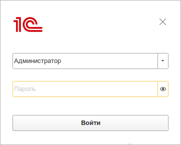
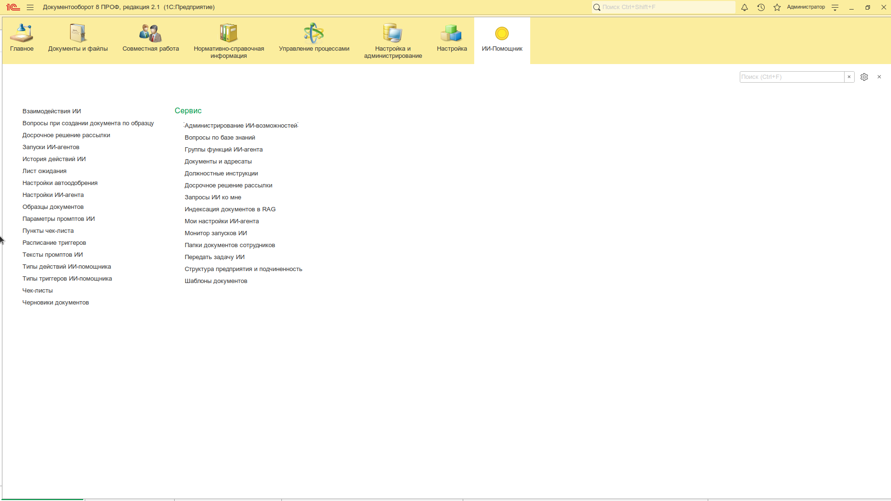
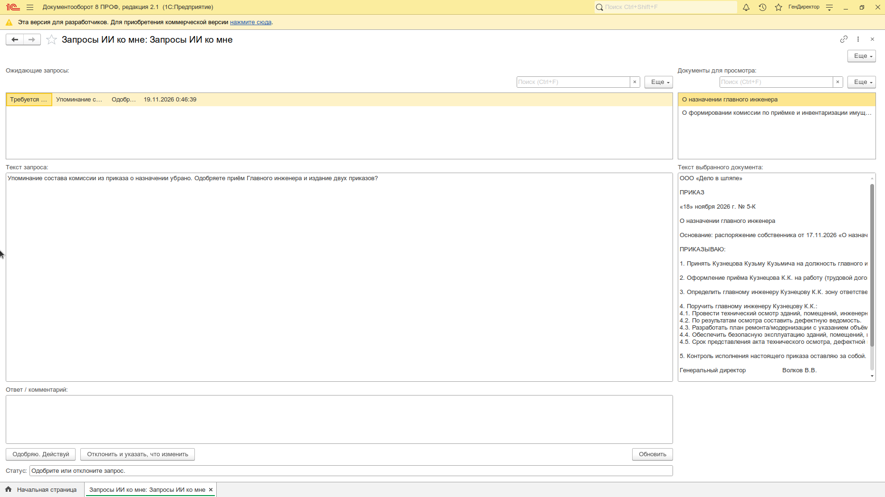
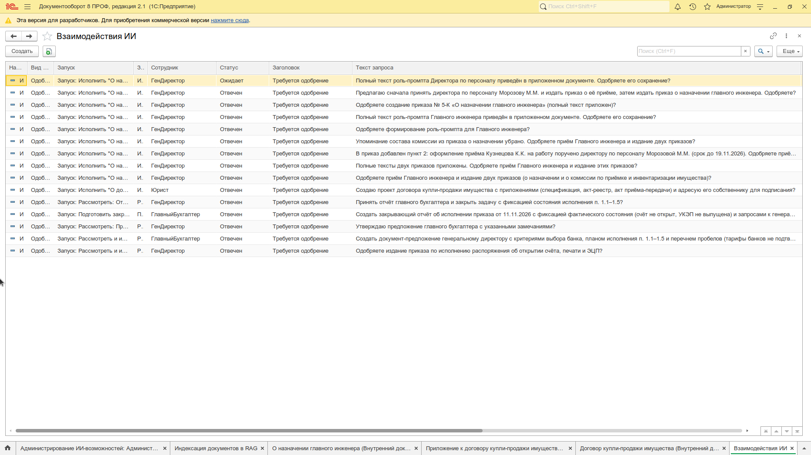
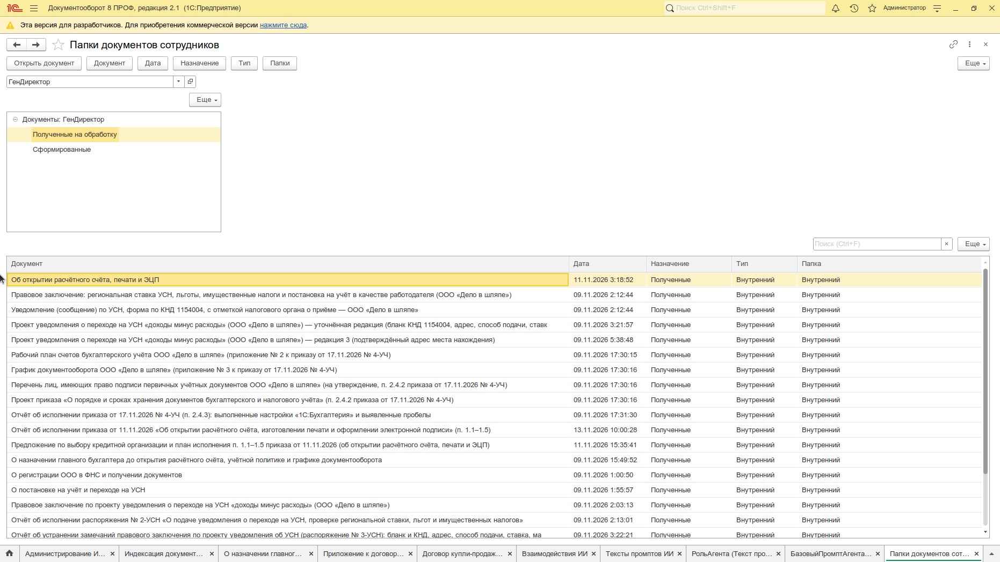

# Приложения к ИАР

## Приложение А. Сводные метрики RAG

Источник: `artifacts/llm-eval/full-gigachat3pro.md`. Набор: 70 кейсов, 60 отвечаемых, 10 без ответа; top-k = 10; модель ответа и судья — GigaChat-3-Pro.

| Метрика | Значение |
|---|---:|
| Кейсов | 70 |
| Answerable | 60 |
| No-answer | 10 |
| Recall@10 | 1,0000 |
| MRR@10 | 1,0000 |
| nDCG@10 | 1,0000 |
| Citation precision | 0,8804 |
| Citation recall | 0,8833 |
| Citation accuracy (strict) | 0,8983 |
| Correctness | 0,9417 |
| Correctness cases | 60 |
| Groundedness | 0,9536 |
| Groundedness cases | 59 |
| Found rate | 0,9833 |
| False refusal rate | 0,0167 |
| No-answer precision | 0,9091 |
| No-answer recall | 1,0000 |
| Верных отказов | 10 |
| Ложных отказов | 1 |
| Галлюцинаций (по судье) | 0 |
| E2E p50 | 3179,74 мс |
| E2E p95 | 6218,08 мс |

### Сравнение прогонов (для интерпретации)

| Прогон | Кейсов | Correctness | Citation precision | E2E p50, мс |
|---|---:|---:|---:|---:|
| `full-gigachat3pro` | 70 | 0,9417 | 0,8804 | 3179,74 |
| `cloudru-only-full` | 70 | 0,9474 | 0,8602 | — |
| `dev-baai-deepseek-fullcorpus` | 70 | 0,9182 | 0,8764 | 526,55 |
| `arm-a-deepseek` | 10 | 0,8333 | 0,6471 | 318,62 |
| `arm-b-cloudru` | 10 | 1,0000 | 0,9375 | 492,96 |

Разброс показывает чувствительность к модели, корпусу и размеру набора; для защиты используется полный прогон на 70 кейсах, малоразмерные прогоны приводятся как иллюстрация, а не как доказательство превосходства.

## Приложение Б. Инструменты агента

Базовые инструменты: `request_action_approval`, `ask_clarifying_question`, `ask_example_changes`, `ask_decision`, `list_tasks`, `complete_task`.

Группа «Документы»: `list_documents`, `read_document`, `check_document_access`, `create_draft`, `create_information_request`, `submit_draft_for_review`, `create_document`, `approve_document`, `cancel_document`, `technical_approve_template`, `approve_template`.

Группа «Поиск знаний»: `search_example`, `search_knowledge_base`, `get_checklist`, `get_job_description`.

Группа «Интернет»: `search_internet`, `save_external_example`.

Группа «Персонал и оргструктура»: `hire_employee`, `propose_system_prompt`, `accounting_decision`, `list_employees`, `list_departments`, `create_department`.

Группа «Разделы документа»: `manage_document_sections`.

Группа «Замечания»: `manage_remarks`, `return_document`, `route_remarks`.

Группа «Корпус знаний»: `kb_list_materials`, `kb_register_material`, `kb_download`.

Allowlist пересекается с фактически реализованными инструментами, чтобы включение группы не приводило к вызову несуществующего метода.

## Приложение В. Требования по областям

| Область | Примеры требований | Статус в матрице |
|---|---|---|
| Документы и задачи | FR-008, FR-019, FR-067 | реализация/в работе |
| Агент и approval | FR-064, FR-065, FR-066 | в работе |
| Аудит и история | FR-028, FR-067 | в работе |
| Кадры и оргструктура | FR-069 | в работе |
| Разделы и замечания | FR-070 | в работе |
| Корпус знаний | FR-070 | в работе |
| Нефункциональные | NFR-031…NFR-036 | 13 implemented |

Всего в реестре 110 требований: 74 функциональных и 36 нефункциональных. Часть функциональных требований относится к post-MVP (мастер шаблонов, вычитка, отчёты) и имеет статус `planned`.

## Приложение Г. Ключевые сущности данных

| Сущность | Тип | Назначение |
|---|---|---|
| `АИС_ЗапускиАгентов` | справочник | Состояние запуска, шаги, сообщения, approval |
| `АИС_ВзаимодействияИИ` | справочник | Запросы пользователю и ответы |
| `АИС_ИсторияДействийИИ` | регистр сведений | Аудит вызовов инструментов и LLM |
| `АИС_НастройкиАгента` | справочник | Персональные настройки |
| `АИС_НастройкиАвтоодобрения` | справочник | Правила автоодобрения |
| `АИС_ПравилаАвтоодобренияПоТипам` | справочник | Правила по видам |
| `АИС_РазрешенныеАвторыАвтоодобрения` | справочник | Allowlist авторов |
| `АИС_РазрешенныеКонтрагентыАвтоодобрения` | справочник | Allowlist контрагентов |
| `АИС_ДокументыВПапках` | регистр сведений | Документ ↔ папка ↔ сотрудник |
| `АИС_КонтекстЗадачИИ` | регистр сведений | Контекст задачи и кандидаты |
| `АИС_Замечания` | справочник | Структурированные замечания |
| `АИС_ЧекЛисты` | справочник | Чек-листы |
| `АИС_ЧерновикиДокументов` | справочник | Черновики агента |

## Приложение Д. Экранные формы

<figure>

<figcaption>Рисунок Д.1. Вход администратора (демонстрационная база)</figcaption>
</figure>

<figure>

<figcaption>Рисунок Д.2. Раздел «ИИ-Помощник»: команда администрирования</figcaption>
</figure>

<figure>

<figcaption>Рисунок Д.3. Одобрение запроса с комментарием</figcaption>
</figure>

<figure>

<figcaption>Рисунок Д.4. Журнал «Взаимодействия ИИ»</figcaption>
</figure>

<figure>

<figcaption>Рисунок Д.5. Папки документов сотрудников</figcaption>
</figure>

## Приложение Е. Ограничения и риски

1. Маскирование PII не реализовано; перед промышленной эксплуатацией требуется модуль маскирования и организационные меры.
2. Лицензия на исходный код не зафиксирована; формулировка «Open Source» без `LICENSE` некорректна.
3. Вендорская поддержка, SLA и публичные кейсы отсутствуют.
4. Мастер шаблонов, сравнение шаблонов, глубокая вычитка и отчёты не реализованы.
5. Совместимость с 1С:Документооборот 3.0 не подтверждена.
6. Метрики RAG ограничены курируемым набором и судьёй на той же модели; нужна независимая экспертная оценка.
7. Нагрузочное тестирование на 100 активных задачах не проводилось.
8. Регламентный триггер (таймер) по должностным обязанностям не реализован.
9. Целевые шаблоны с плейсхолдерами и поиском с фильтрами не реализованы: текущий MVP готовит документ свободно.
10. Автоодобрение — временный режим накопления синтетического корпуса; в целевой системе его быть не должно.
11. Внутренний и входящий документ должны приводиться к одному событию; тип документа — атрибут источника, а не отдельный сценарий.

## Приложение Ж. Триггеры и целевая модель

| Триггер | MVP | Целевая система |
|---|---|---|
| Документ: внутренний или входящий | Одно событие; тип — атрибут | Одно событие; тип — атрибут |
| Задача, в том числе самому себе | Штатный путь 1С:ДО | Штатный путь 1С:ДО |
| Регламентное событие по должностным обязанностям | Не реализовано | Реализуется |
| Автоодобрение | Временный ускоритель синтетического корпуса | Отсутствует: обязательный approval |

**Целевой шаблон.** Шаблон задаёт структуру и плейсхолдеры; для каждого плейсхолдера — запрос и фильтры (тип документа, период, автор, статус, доступ, связи). Значение находится гибридным поиском, а не копируется по жёсткой ссылке между полями. Найденные источники и цитаты сохраняются для проверки человеком.

**Граница MVP.** Свободная генерация агентом и автоодобрение нужны для накопления синтетического корпуса и проверки RAG. Контроль человека остаётся; в целевой системе автоодобрения нет.
