# Процессные диаграммы AS-IS и TO-BE

Документ описывает текущий процесс работы с документами в 1С:Документооборот (AS-IS) и целевой процесс с расширением `ai_scrivener` (TO-BE). AS-IS — типовая модель без ИИ-помощника; конкретные регламенты заказчика уточняются на обследовании.

Обновлено 2026-10-30: §12 приведён к фактическому состоянию кода, §13 — текущий контур обработки адресного внутреннего документа (приказа) через симулятор, включая штатные связи документов и статус приказа.

## 1. Участники и системы

| Обозначение | Роль или система |
|---|---|
| Делопроизводитель | регистрация входящих и исходящих документов |
| ДЛ | должностное лицо, готовящее и подписывающее документ |
| Вышестоящее ДЛ | согласование, утверждение, получение докладов |
| Коллеги / внешние адресаты | источники данных и ответов на запросы |
| 1С:Документооборот | штатные документы, задачи, бизнес-процессы, файлы, права |
| Расширение `ai_scrivener` | ИИ-оркестрация, плейсхолдеры, лист ожидания, аудит |
| RAG-сервис | поиск шаблонов и нормативного контекста в Qdrant |
| DeepSeek | выбор шаблона, анализ, генерация текста |
| Внешние источники | БД 1С, другое ДЛ, внешний API, расчётный сервис |

### 1.1. Условные обозначения

Цветом выделены операции; участники процесса и объекты показаны нейтрально.

| Обозначение | Категория |
|---|---|
| Синий | Операция, реализуемая штатной конфигурацией 1С:Документооборот |
| Оранжевый | Операция, реализуемая расширением `ai_scrivener` |
| Серый пунктир | Ручная операция |
| Фиолетовый | Внешний AI-сервис или источник, вызываемый расширением |
| Белый | Участник процесса, не операция |

## 2. Процесс 1. Обработка входящего документа

### 2.1. AS-IS

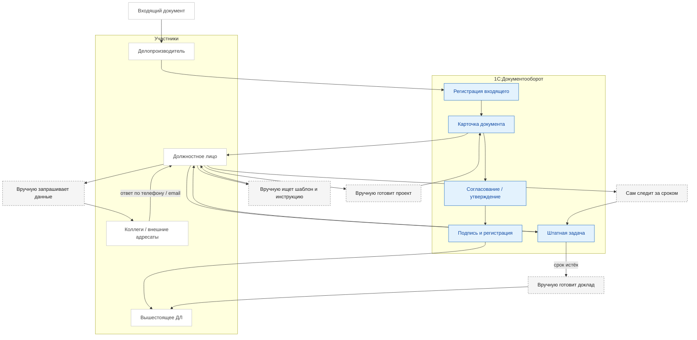

Типовые потери AS-IS:

- поиск шаблона и инструкции вручную;
- многократные запросы к коллегам без единого реестра ожидания;
- данные переносятся в документ вручную;
- сроки контролируются глазами, эскалация зависит от дисциплины;
- причина срыва восстанавливается по переписке и памяти.

### 2.2. TO-BE

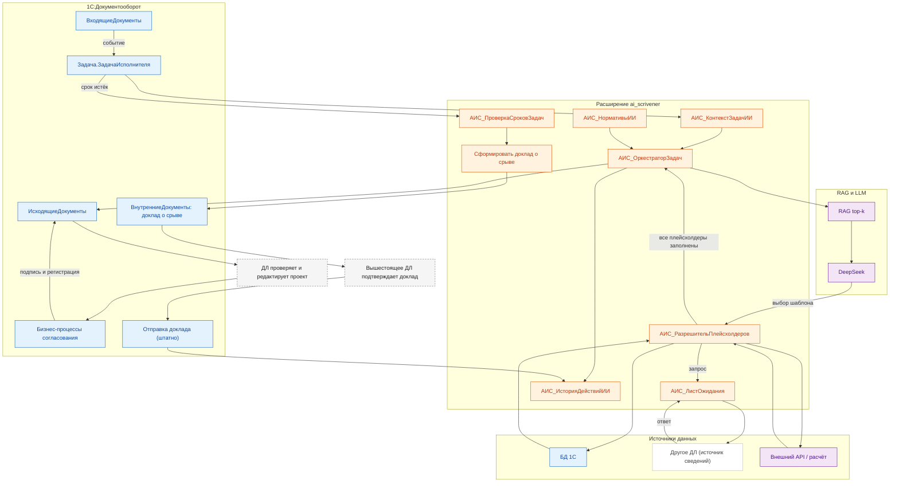

### 2.3. Различия

| Шаг | AS-IS | TO-BE |
|---|---|---|
| Создание задачи | вручную или по регламенту | автоматически при событии |
| Выбор шаблона | вручную | RAG top-k + DeepSeek + валидация |
| Сбор данных | письма, звонки, память | БД, лист ожидания, API, расчётный сервис |
| Подготовка проекта | вручную | генерация в `ИсходящиеДокументы` |
| Сроки | ручной контроль | `СрокИсполнения` задачи + `АИС_НормативыИИ` |
| Эскалация | вручную | регламентное задание + `ВнутреннийДокумент` + подтверждение |
| Аудит | история задач и переписка | `АИС_ИсторияДействийИИ` + история задачи |

## 3. Процесс 2. Выбор шаблона и заполнение плейсхолдеров

### 3.1. AS-IS

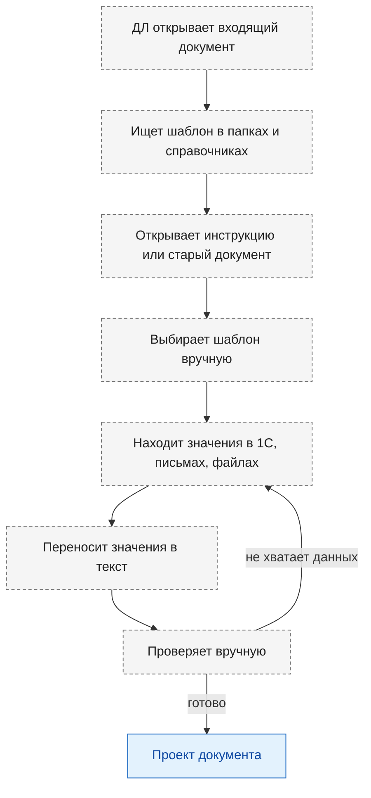

### 3.2. TO-BE

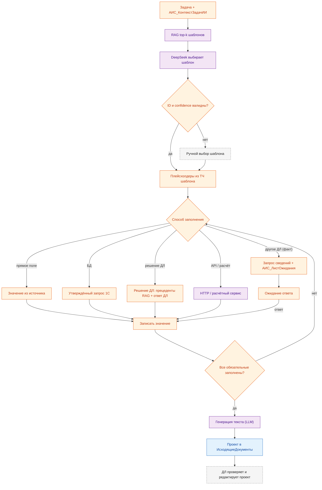

Ключевое отличие: ИИ не исполняет произвольный запрос к БД. Он выбирает утверждённый шаблон запроса и заполняет только параметры; значения проверяются по типам.

Ветка «решение ДЛ» соответствует `docs/design-decisions.md` §17: ДЛ формулирует управленческое решение, а не сообщает известный факт. Значение `РешениеДЛ` добавлено в `АИС_СпособыЗаполнения` в Этапе A.

## 4. Процесс 3. Запрос к другому ДЛ

### 4.1. AS-IS

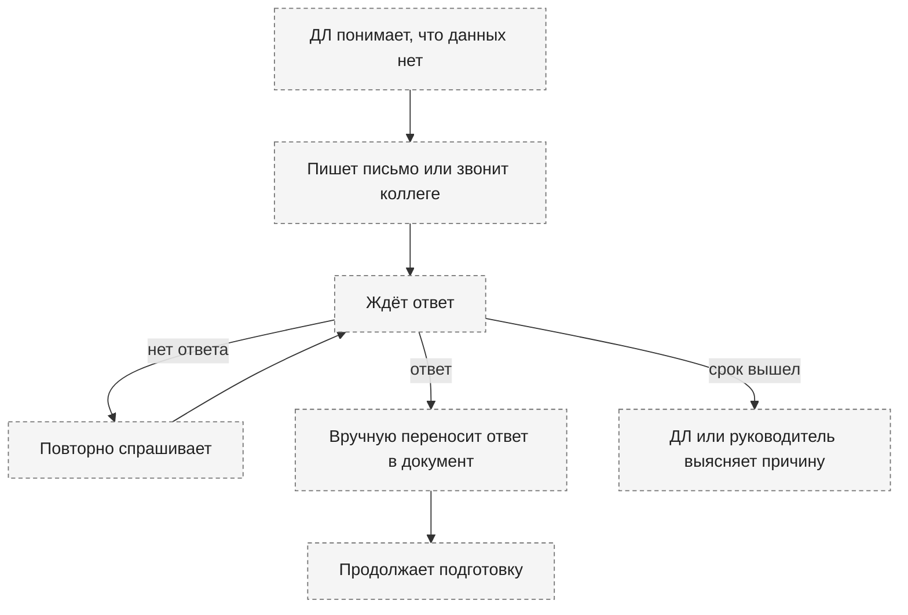

Недостатки: нет единого реестра запросов, срока и ответа; невозможна автоматическая эскалация.

### 4.2. TO-BE

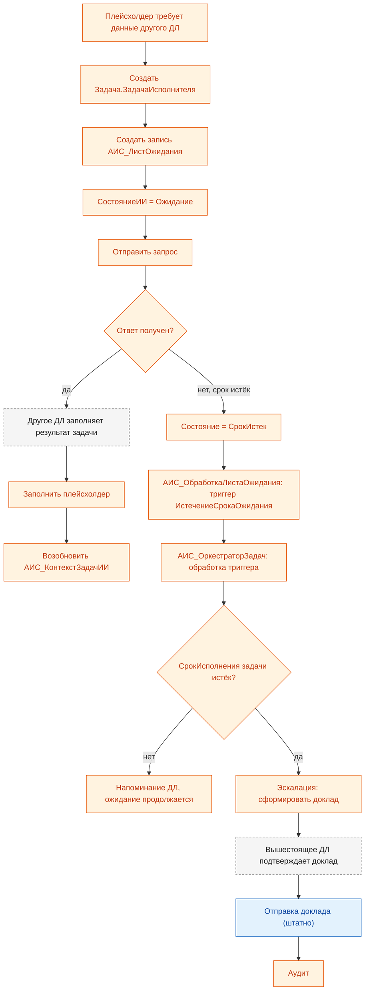

Запрос факта и запрос решения различаются: для `РешениеДЛ` истечение срока создаёт напоминание, а не доклад о срыве; реальная эскалация требует истечения штатного `СрокИсполнения` (`docs/design-decisions.md` §17). Истечение `СрокОжидания` само по себе не равно срыву срока задачи (`raw_specification.md` §4.6.2, §4.7.1).

## 5. Процесс 4. Контроль сроков и эскалация

### 5.1. AS-IS

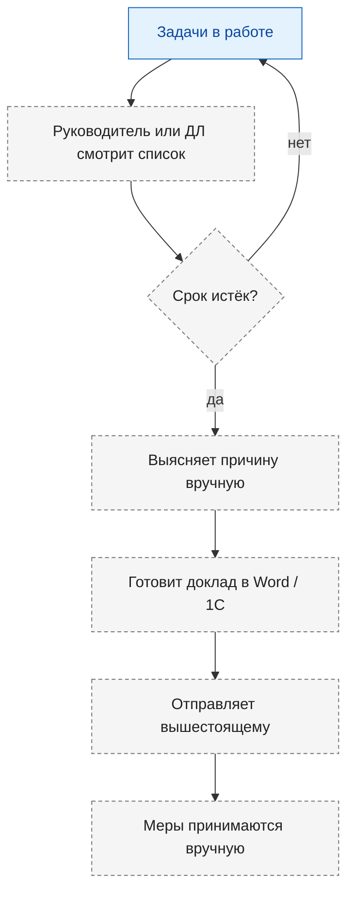

### 5.2. TO-BE

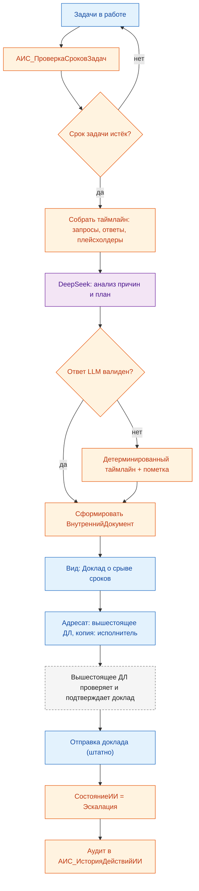

Доклад создаётся со статусом `Проект`; отправка без подтверждения запрещена (`docs/design-decisions.md` §14).

## 6. Процесс 5. Аудит и прослеживаемость

### 6.1. AS-IS

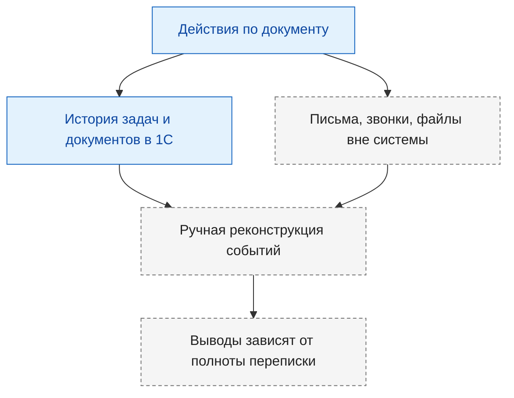

### 6.2. TO-BE

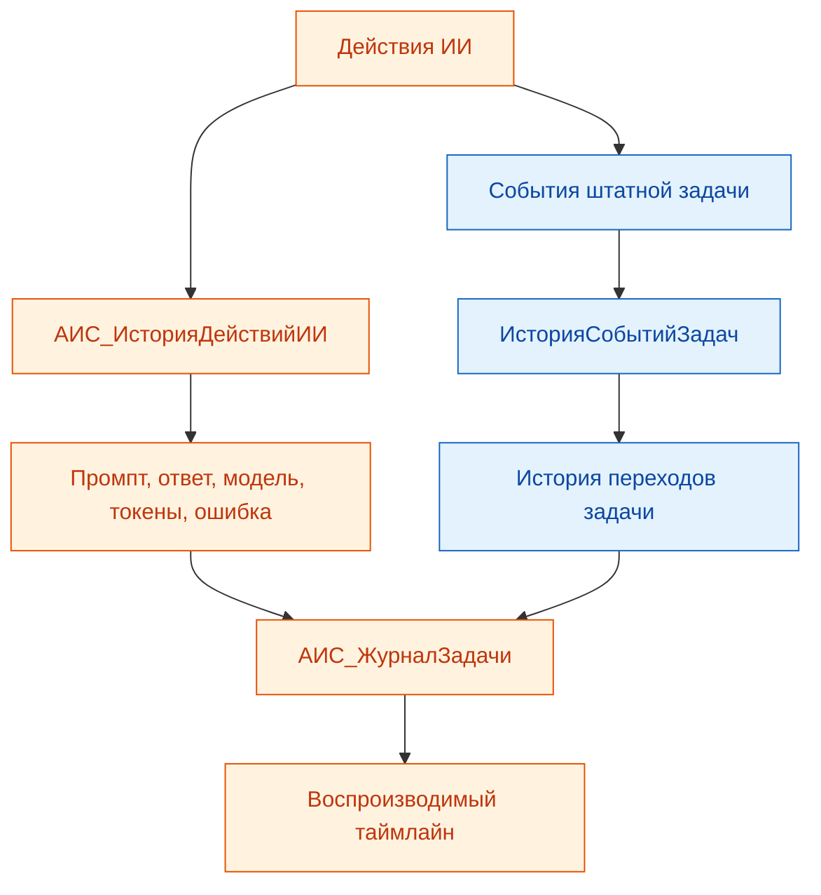

## 7. Процесс 6. Коллективная разработка исходящего документа

В 1С:Документооборот ПРОФ нет отдельного объекта «раздел документа». Коллективная работа ведётся на уровне документа: рабочая группа, задачи соисполнителям, файлы и версии, бизнес-процесс и визы согласования.

### 7.1. AS-IS

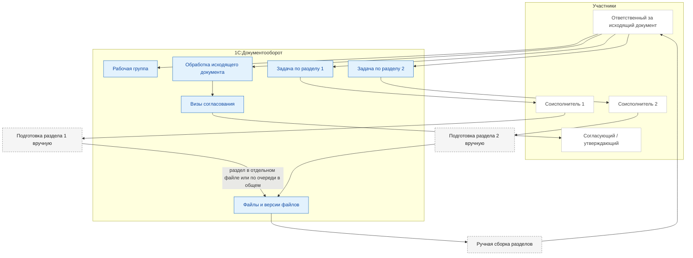

Как это устроено в базе:

- **Рабочая группа** — `Справочник.РабочиеГруппы` и `РегистрСведений.РабочиеГруппы` (`Объект`, `Участник`). Даёт доступ участникам, но не закрепляет разделы.
- **Ответственные** — `ИсходящиеДокументы.Ответственный`, `Подготовил`, `Подписал`, `Создал`; один ответственный за документ.
- **Задачи по разделам** — `Задача.ЗадачаИсполнителя`: `Предметы` ссылаются на документ, раздел указывается в `Описание`/`ПредметСтрокой`, срок — в `СрокИсполнения`, результат — в `РезультатВыполнения`.
- **Файлы** — `Справочник.Файлы` с `Редактирует` и `ДатаЗаема`, `Справочник.ВерсииФайлов` с `НомерВерсии`, `Автор`, `Комментарий`. Один файл редактирует один пользователь; версии фиксируют файл целиком.
- **Согласование** — `Справочник.ВизыСогласования` (`Документ`, `Исполнитель`, `РольИсполнителя`, `РезультатСогласования`) и бизнес-процесс `ОбработкаИсходящегоДокумента` (`ШаблонРегистрации`, `ШаблонСогласования`, `ШаблонУтверждения`, `Предметы`, `ПредметыЗадач`). Согласуется документ целиком.
- **Обсуждения** — `КаналыОбсуждений`, `ЗаметкиДокументооборота`, `ИсторияПереписки`. Это комментарии, а не структурированная ответственность за раздел.
- **Дополнительные реквизиты** — `ДополнительныеРеквизиты` документа/задачи. Можно вручную хранить «раздел» и «ответственный за раздел», но это не штатная таблица разделов.

Ограничения AS-IS:

- нет отдельного объекта «раздел документа»;
- нет матрицы «раздел → ответственный → статус»;
- нет раздельного согласования разделов: визы относятся к документу целиком;
- при одном файле — только один редактор, остальные ждут или работают в копиях;
- версии и история относятся к файлу целиком, а не к разделу;
- сборка разделов и контроль готовности — вручную.

### 7.2. TO-BE

Раздел — специализированный плейсхолдер. Оркестрация та же, что у обычного плейсхолдера, но значение — блок документа, а не скаляр.

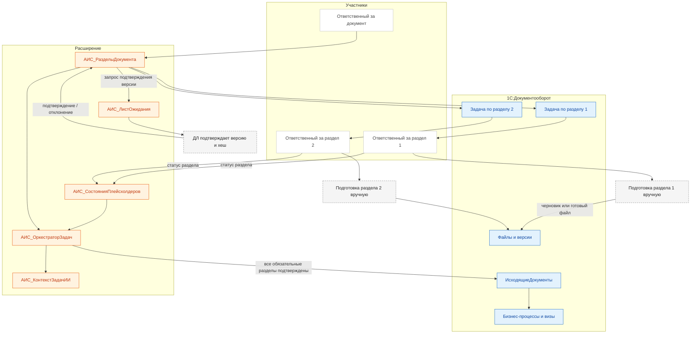

Модель:

- `АИС_СостоянияПлейсхолдеров` — `ВидПлейсхолдера = Раздел`, `СсылкаНаРаздел`.
- `АИС_РазделыДокумента` (справочник, подчинён `ИсходящиеДокументы`) — `Раздел`, `Заголовок`, `Порядок`, `Обязательный`, `Формат`, `Источник`, `Файл`, `Версия`, `Хеш`, `Ответственный`, `Задача`, `Статус`, `Подтвердил`, `ДатаПодтверждения`, `Комментарий`.
- `АИС_ЛистОжидания` — `ТипЗапроса = ПодтверждениеРаздела`, `ОжидаемаяВерсия`, `ОжидаемыйХеш`, `СсылкаНаРаздел`.

Правила:

- готовый файл не используется без подтверждения конкретной версии и хеша;
- изменение файла переводит раздел в `Устарел`;
- подтверждает только ДЛ, не ИИ;
- сборка блокируется, пока обязательные разделы не подтверждены;
- визы и согласование документа остаются штатными.

| Аспект | AS-IS | TO-BE |
|---|---|---|
| Ответственный за раздел | в описании задачи/доп. реквизитах | `АИС_РазделыДокумента.Ответственный` |
| Статус раздела | вручную | `АИС_РазделыДокумента.Статус` |
| Подтверждение | в переписке или задаче | `АИС_ЛистОжидания` + версия/хеш |
| Версия | файл целиком | версия/хеш на раздел |
| Сборка | вручную | оркестратор проверяет обязательные разделы |
| Файлы | один файл — один редактор | файл/версия на раздел + блокировки |
| Согласование | документ целиком | документ целиком + готовность разделов |
| Отчётность | вручную | регистр разделов и статусы |

## 8. Процесс 7. Создание и сопровождение шаблонов

### 8.1. AS-IS

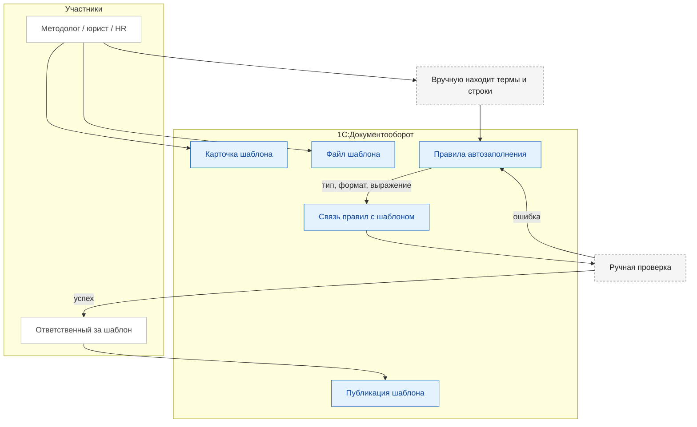

Потери AS-IS:

- десятки правил на один шаблон;
- ручной поиск термов и строк;
- ошибки в типах, форматах и выражениях;
- сложно поддерживать списки, таблицы и падежи;
- шаблоны устаревают быстрее, чем их успевают обновлять.

### 8.2. TO-BE

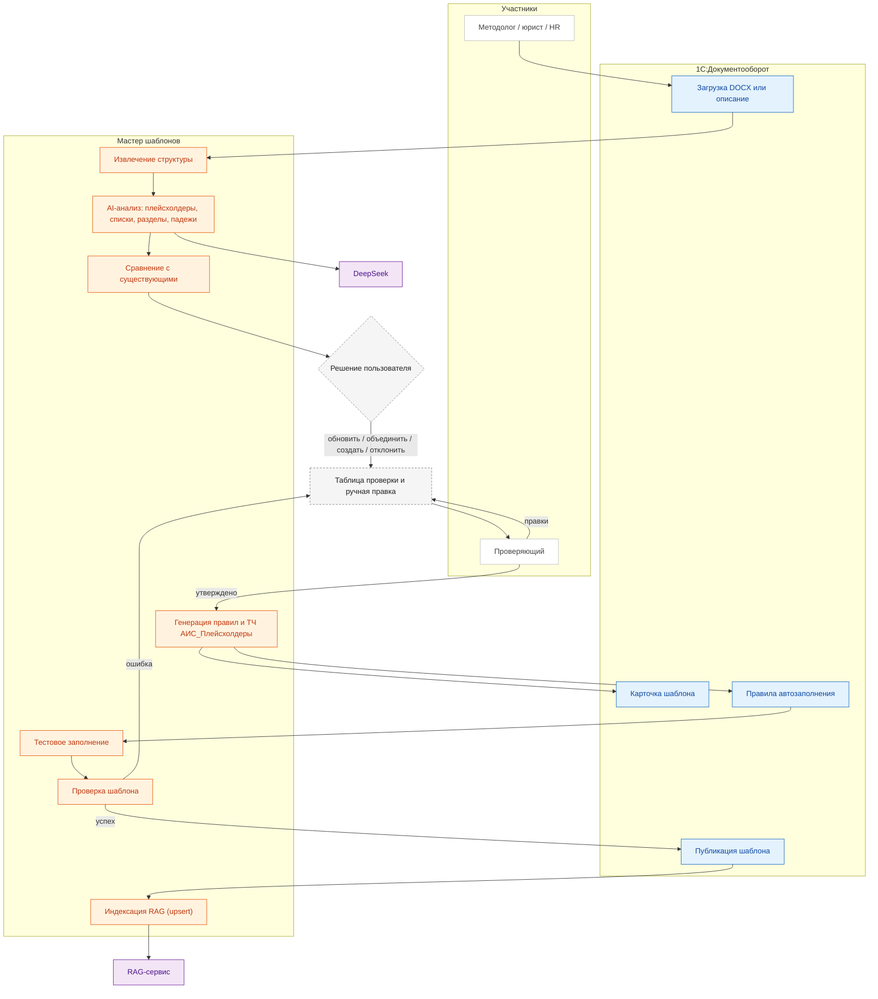

Ключевые изменения:

| Аспект | AS-IS | TO-BE |
|---|---|---|
| Поиск плейсхолдеров | вручную | AI предлагает кандидатов |
| Правила замены | вручную | генерируются автоматически |
| Списки и разделы | вручную | AI находит повторяемые блоки |
| Падежи | вручную | AI предлагает, человек подтверждает |
| Сравнение с существующими | не выполняется, появляются копии | diff, оценка, рекомендация, решение пользователя |
| Ручная правка | нет | принять/отклонить/добавить/удалить/изменить плейсхолдер |
| Проверка | вручную | тестовое заполнение + валидация |
| Публикация | вручную | статус, версия, синхронный upsert в RAG |
| Сопровождение | тяжёлое | версии и переиндексация |

Публикация шаблона синхронно вызывает `upsert` в RAG-сервис; регламентная индексация остаётся догоняющей синхронизацией раз в 5 минут (`docs/design-decisions.md` §18).

## 9. Процесс 8. Вычитка документа

### 9.1. AS-IS

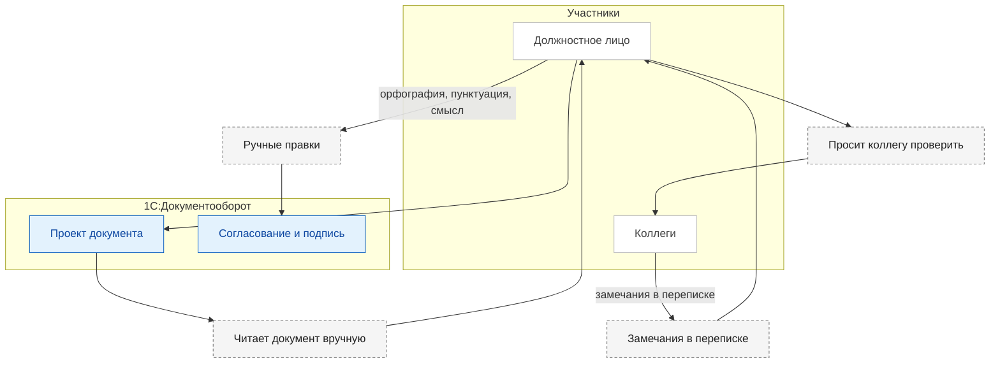

Проблемы AS-IS:

- проверка зависит от внимания и времени;
- замечания не структурированы;
- нет единого списка исправлений;
- смысловые противоречия находятся случайно;
- нет учёта затрат и нагрузки.

### 9.2. TO-BE

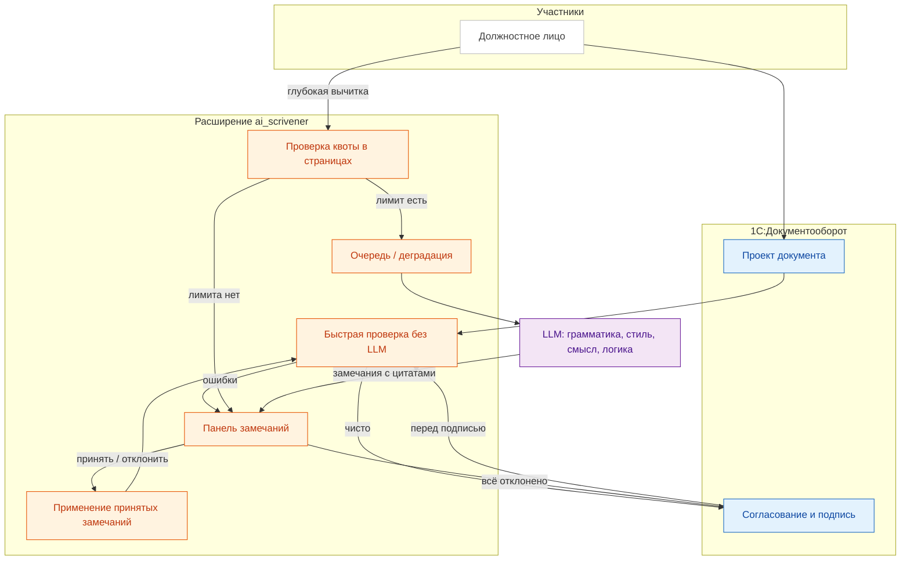

Ключевые изменения:

| Аспект | AS-IS | TO-BE |
|---|---|---|
| Проверка | вручную | быстрая + глубокая по кнопке |
| Замечания | в переписке | структурированная панель с цитатами |
| Применение | вручную | accept/reject, детерминированное применение |
| Стоимость | не учитывается | квоты в страницах |
| Нагрузка | непредсказуема | очередь, деградация, локальная LLM |
| Аудит | частичный | проверки, замечания, решения |

## 10. Сводный эффект

| Процесс | AS-IS | TO-BE |
|---|---|---|
| Обработка входящего | ручной поиск и подготовка | автоматический выбор шаблона и генерация проекта |
| Сбор данных | письма, звонки, память | утверждённые запросы, лист ожидания, API |
| Запрос к ДЛ | без реестра и срока | задача + лист ожидания + автоматическое возобновление |
| Сроки | ручной контроль | регламентная проверка + нормативы ИИ |
| Эскалация | ручной доклад | анализ таймлайна + внутренний документ + подтверждение |
| Аудит | частичная реконструкция | полный аудит промптов, ответов и переходов |
| Коллективная разработка | рабочая группа, задачи и файлы без разрезов | разделы как плейсхолдеры, подтверждение версии/хеша, `АИС_РазделыДокумента` |
| Создание шаблонов | ручная карточка и десятки правил | импорт DOCX, AI-разметка, автогенерация правил, проверка человеком |
| Сравнение шаблонов | копии и дубли | diff, оценка, обновление/объединение/новый по решению пользователя |
| Вычитка документа | ручная вычитка и переписка | быстрая проверка + глубокая LLM по кнопке, замечания с цитатами, квоты |
| Исполнение адресного приказа | ручная задача и подготовка документа | задача адресату, автошаблон, LLM-агент, кадровый шлюз (текущая реализация — §13) |

## 11. Допущения

- AS-IS описан для типового процесса без ИИ-помощника; фактические регламенты заказчика могут отличаться.
- В TO-BE пользовательские задачи и документы остаются штатными объектами Документооборота.
- Новые документы не создаются: запросы к ДЛ, ответы и доклады выражаются через базовую задачу и `ВнутренниеДокументы`.
- RAG/LLM не заменяют бизнес-процессы согласования, утверждения и подписания.

## 12. Результаты сверки диаграмм с документацией

При сверке исправлены:

- добавлен обязательный шаг подтверждения доклада о срыве перед отправкой (`design-decisions.md` §14);
- добавлена ветка `РешениеДЛ` в процесс заполнения плейсхолдеров (`design-decisions.md` §17);
- разделены публикация шаблона и индексация RAG; публикация синхронно вызывает `upsert` (`design-decisions.md` §18);
- быстрая проверка, панель замечаний и применение замечаний отнесены к расширению, а не к штатной конфигурации;
- ручные операции выделены в отдельные узлы и не смешиваются со штатными операциями 1С.

Устранено в Этапах A–B:

- `РешениеДЛ` добавлено в `АИС_СпособыЗаполнения`;
- `Список` добавлен в `АИС_ВидыПлейсхолдеров`;
- ресурс `СсылкаНаРаздел` добавлен в `АИС_СостоянияПлейсхолдеров`;
- ТЧ `АИС_Плейсхолдеры` создана в трёх штатных справочниках шаблонов;
- `ИсточникиДанных` расширен реквизитами URL, JSON-схема и таймаут;
- созданы пять ролей, RLS и параметр сеанса `АИС_ТекущееДЛ`.

Остаются расхождения с фактическим кодом:

- оркестратор, разрешитель плейсхолдеров, мастер шаблонов, формы и отчёты из TO-BE ещё не реализованы;
- реализованы общие модули `АИС_Сотрудники`, `АИС_ОбщегоНазначения`, `АИС_Уведомления`, подписка `АИС_ВнутреннийДокументПриЗаписи`, HTTP-сервис `АИС_Симулятор` и автошаблонизация;
- обработка демоданных реализована и проверена; негативные сценарии доступа пройдены частично;
- текущий контур «адресный внутренний документ → задача → кадровый шлюз» показан отдельно в §13, потому что он ещё не является целевым оркестратором.

Основные компоненты оркестратора входят в Этапы 4–6. Текущая реализация — переходная: она проверяет данные и API, но не заменяет целевую модель.

## 13. Процесс 9. Обработка адресного внутреннего документа (приказ) — текущая реализация

Процесс описывает текущий контур симулятора, а не целевой оркестратор: приказ (или другой внутренний документ) адресуется конкретному ДЛ, расширение создаёт задачу, а исполнитель — LLM-агент симулятора — принимает решение и создаёт следующий документ. Кадровые решения проходят через заявку на найм и HR-шлюз.

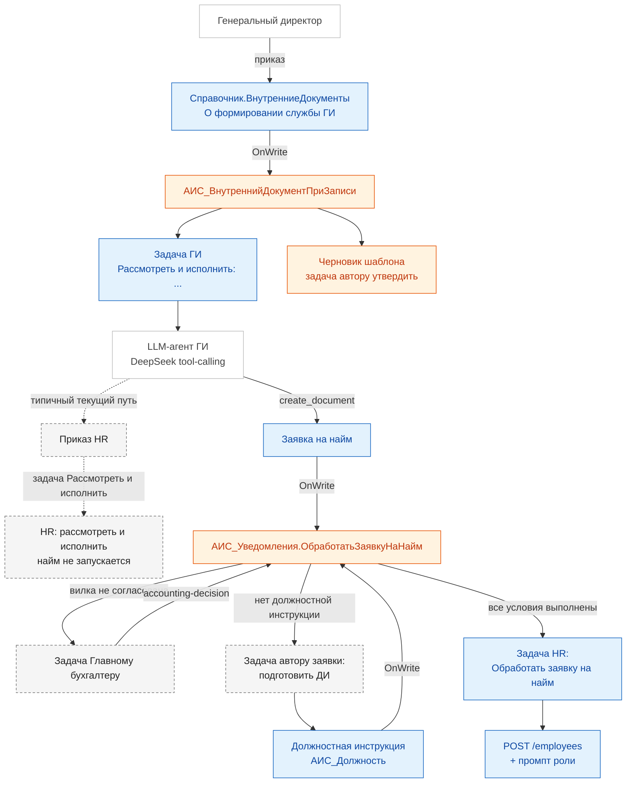

Что важно в текущей реализации:

- приказ/распоряжение/поручение, адресованный ДЛ, создаёт задачу `Рассмотреть и исполнить: ...`, материал (акт, отчёт, план) — `Рассмотреть: ...`; отдельного типа триггера «Приказ» в текущем коде нет — используется `ВнутреннийДокументАдресованДЛ`;
- задача получает штатный предмет `Предметы.Предмет = документ-основание`;
- агент создаёт документ-результат в рамках задачи, и расширение связывает его с основанием через `РегистрСведений.СвязиДокументов` (тип `Исполнение приказа`, обратный `Основание приказа`);
- `GET /hs/ais-sim/orders/status` отдаёт задачи с предметом-приказом и связанные документы; `check` симулятора завершает приказ по выполненной задаче и (для `completion.requires_document`) наличию связи;
- `process` симулятора обрабатывает только задачи текущего изданного приказа; после завершения приказа его оставшиеся задачи не обрабатываются;
- поиск шаблонов выполняется расширением автоматически при создании задачи, результат сохраняется в `АИС_КонтекстЗадачИИ.КандидатыШаблонов`;
- агент самостоятельно оценивает кандидатов, а при их отсутствии ищет образец в интернете;
- заявка на найм должна содержать `АИС_ЗапрашиваемыеДолжности`, иначе HR-шлюз не сможет проверить должностные инструкции;
- должностная инструкция должна иметь заполненное `АИС_Должность`, иначе повторная проверка заявки не сработает;
- агентские инструменты передают `ЗапрашиваемыеДолжности` (заявка на найм) и `Должность` (должностная инструкция); ручные вызовы HTTP API остаются для точечных проверок и восстановления данных;
- если агент создаёт «Приказ» на HR, а не «Заявку на найм», у HR появляется задача `Рассмотреть и исполнить`, и кадровый шлюз не запускается — это типичный текущий путь;
- Автошаблонизация — техническая функция расширения; черновик шаблона технически согласует `Программист1С`, а окончательно утверждает автор исходного документа.
- Подразделения в `Справочник.СтруктураПредприятия` создаёт и изменяет `Программист1С` по распоряжению Гендиректора; симулятор сам подразделения не создаёт.
