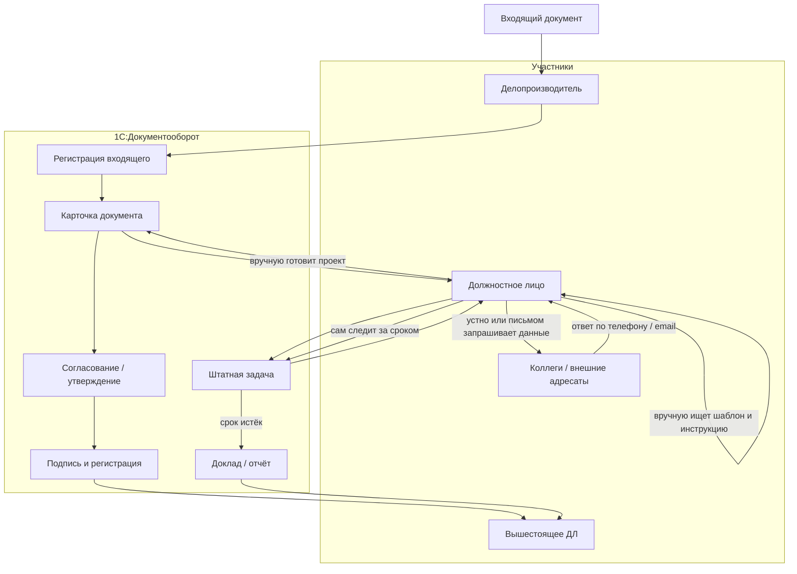
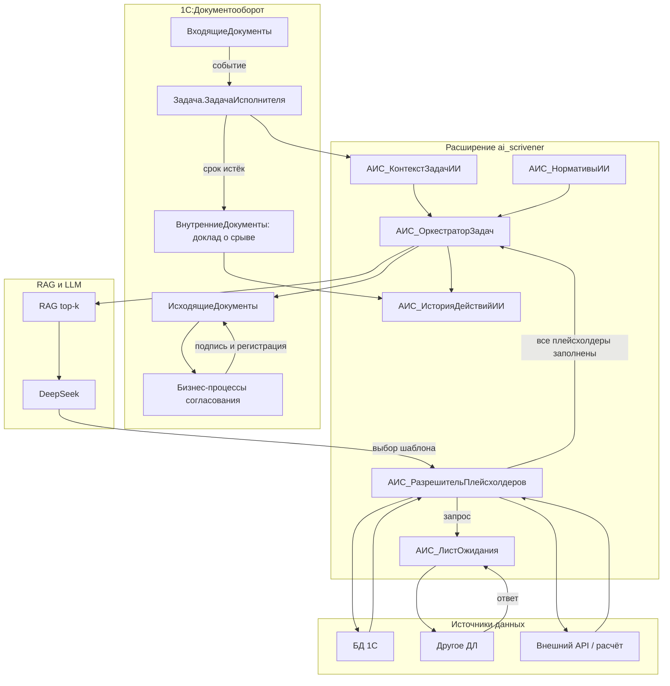
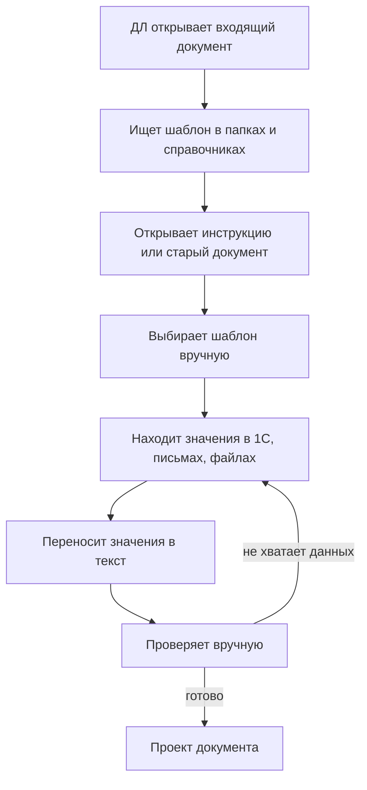
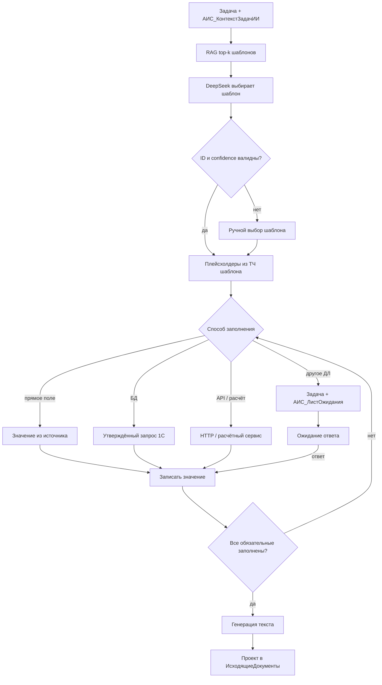
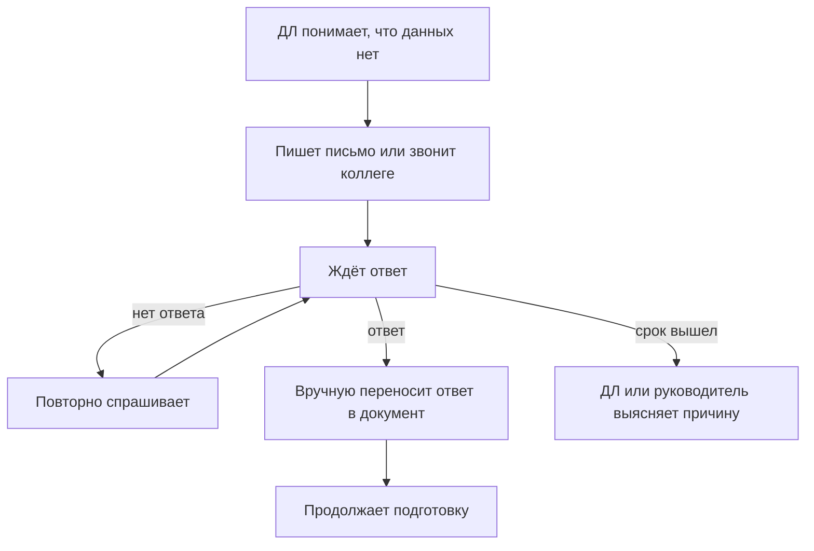
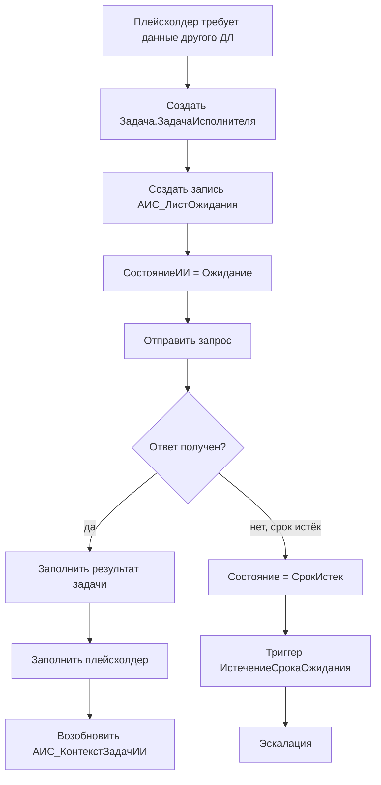
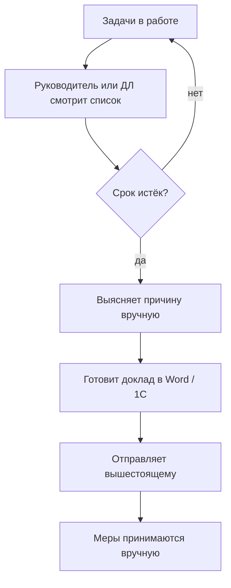
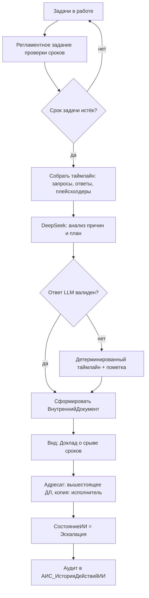
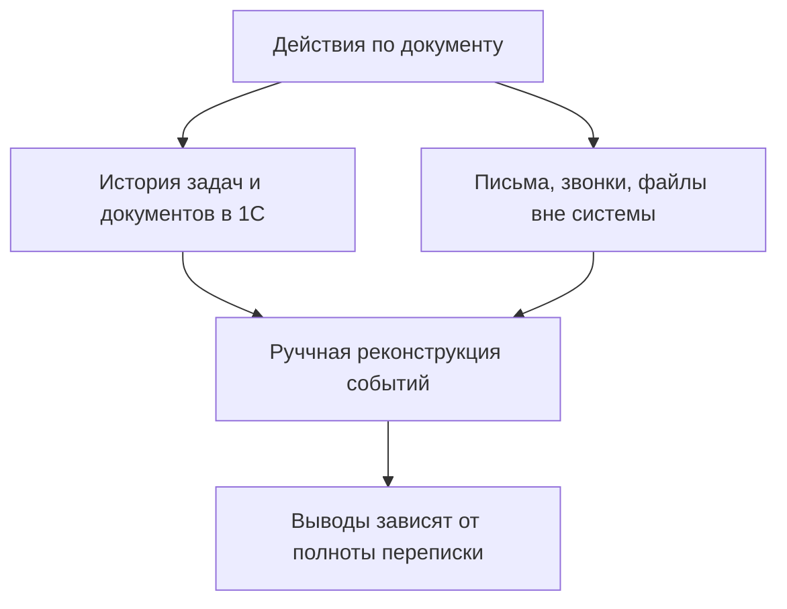
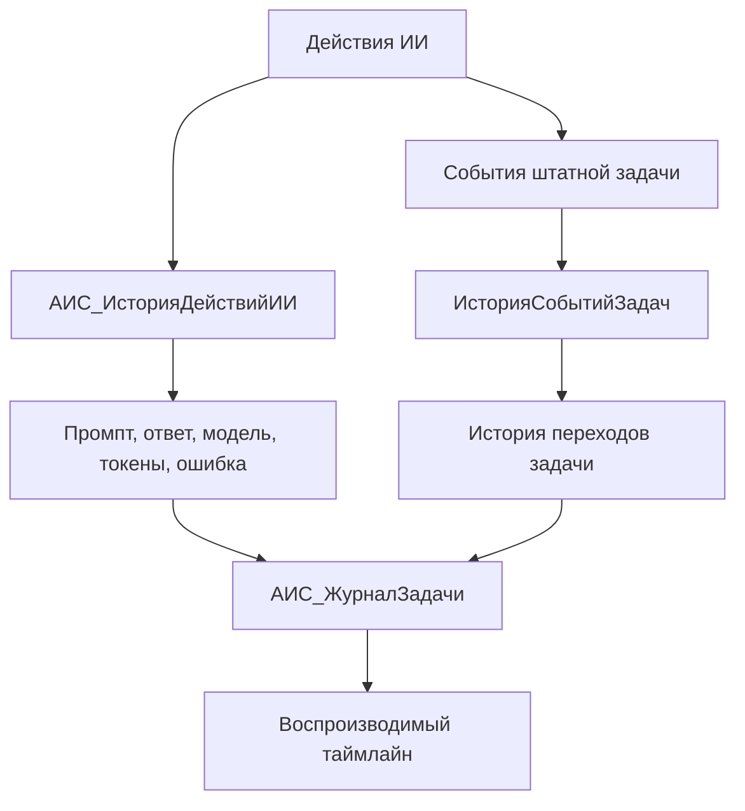

# Процессные диаграммы AS-IS и TO-BE

Документ описывает текущий процесс работы с документами в 1С:Документооборот (AS-IS) и целевой процесс с расширением `ai_scrivener` (TO-BE). AS-IS — типовая модель без ИИ-помощника; конкретные регламенты заказчика уточняются на обследовании.

## 1. Участники и системы

| Обозначение | Роль или система |
|---|---|
| Делопроизводитель | регистрация входящих и исходящих документов |
| ДЛ | должностное лицо, готовящее и подписывающее документ |
| Вышестоящее ДЛ | согласование, утверждение, получение докладов |
| Коллеги / внешние адресаты | источники данных и ответов на запросы |
| 1С:Документооборот | штатные документы, задачи, бизнес-процессы, файлы, права |
| Расширение `ai_scrivener` | ИИ-оркестрация, плейсхолдеры, лист ожидания, аудит |
| RAG-сервис | поиск шаблонов и нормативного контекста в Qdrant |
| DeepSeek | выбор шаблона, анализ, генерация текста |
| Внешние источники | БД 1С, другое ДЛ, внешний API, расчётный сервис |

## 2. Процесс 1. Обработка входящего документа

### 2.1. AS-IS

Типовые потери AS-IS:

- поиск шаблона и инструкции вручную;
- многократные запросы к коллегам без единого реестра ожидания;
- данные переносятся в документ вручную;
- сроки контролируются глазами, эскалация зависит от дисциплины;
- причина срыва восстанавливается по переписке и памяти.

### 2.2. TO-BE

### 2.3. Различия

| Шаг | AS-IS | TO-BE |
|---|---|---|
| Создание задачи | вручную или по регламенту | автоматически при событии |
| Выбор шаблона | вручную | RAG top-k + DeepSeek + валидация |
| Сбор данных | письма, звонки, память | БД, лист ожидания, API, расчётный сервис |
| Подготовка проекта | вручную | генерация в `ИсходящиеДокументы` |
| Сроки | ручной контроль | `СрокИсполнения` задачи + `АИС_НормативыИИ` |
| Эскалация | вручную | регламентное задание + `ВнутреннийДокумент` |
| Аудит | история задач и переписка | `АИС_ИсторияДействийИИ` + история задачи |

## 3. Процесс 2. Выбор шаблона и заполнение плейсхолдеров

### 3.1. AS-IS

### 3.2. TO-BE

Ключевое отличие: ИИ не исполняет произвольный запрос к БД. Он выбирает утверждённый шаблон запроса и заполняет только параметры; значения проверяются по типам.

## 4. Процесс 3. Запрос к другому ДЛ

### 4.1. AS-IS

Недостатки: нет единого реестра запросов, срока и ответа; невозможна автоматическая эскалация.

### 4.2. TO-BE

## 5. Процесс 4. Контроль сроков и эскалация

### 5.1. AS-IS

### 5.2. TO-BE

## 6. Процесс 5. Аудит и прослеживаемость

### 6.1. AS-IS

### 6.2. TO-BE

## 7. Сводный эффект

| Процесс | AS-IS | TO-BE |
|---|---|---|
| Обработка входящего | ручной поиск и подготовка | автоматический выбор шаблона и генерация проекта |
| Сбор данных | письма, звонки, память | утверждённые запросы, лист ожидания, API |
| Запрос к ДЛ | без реестра и срока | задача + лист ожидания + автоматическое возобновление |
| Сроки | ручной контроль | регламентная проверка + нормативы ИИ |
| Эскалация | ручной доклад | анализ таймлайна + внутренний документ |
| Аудит | частичная реконструкция | полный аудит промптов, ответов и переходов |

## 8. Допущения

- AS-IS описан для типового процесса без ИИ-помощника; фактические регламенты заказчика могут отличаться.
- В TO-BE пользовательские задачи и документы остаются штатными объектами Документооборота.
- Новые документы не создаются: запросы к ДЛ, ответы и доклады выражаются через базовую задачу и `ВнутренниеДокументы`.
- RAG/LLM не заменяют бизнес-процессы согласования, утверждения и подписания.
