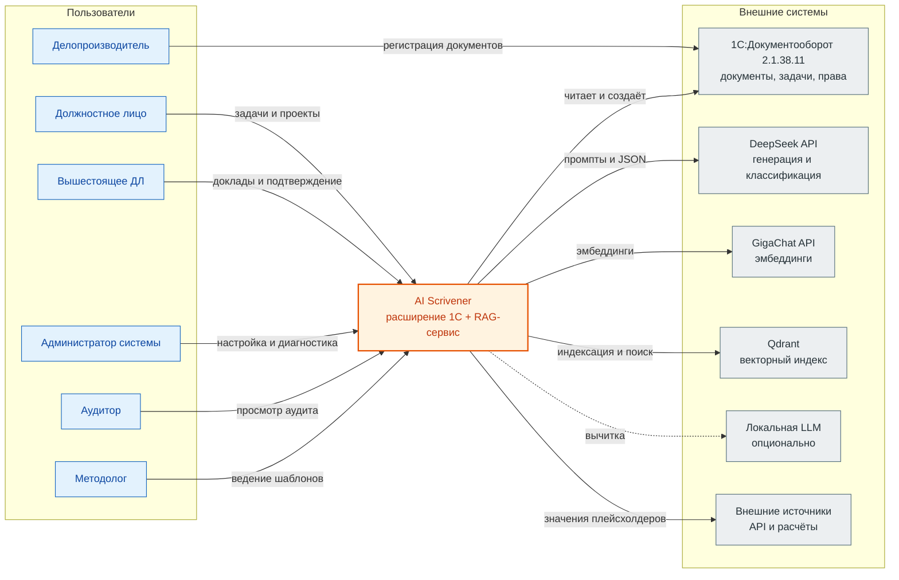
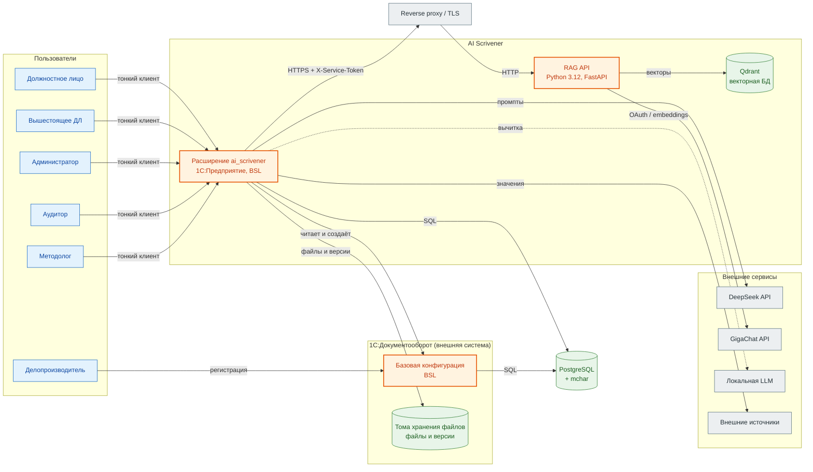
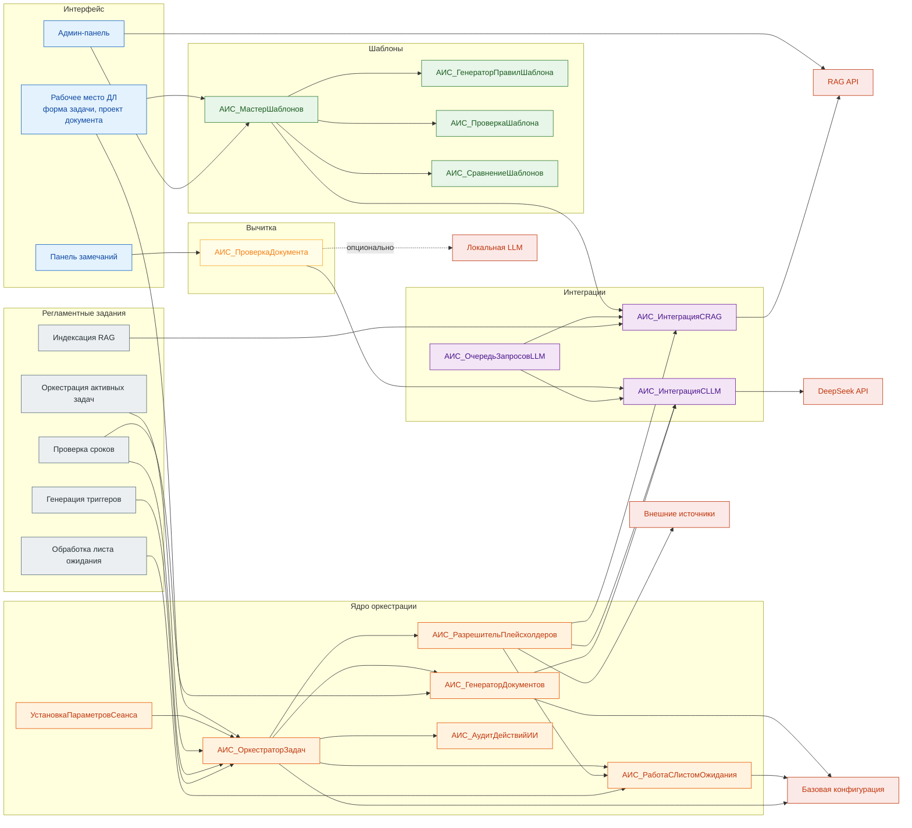
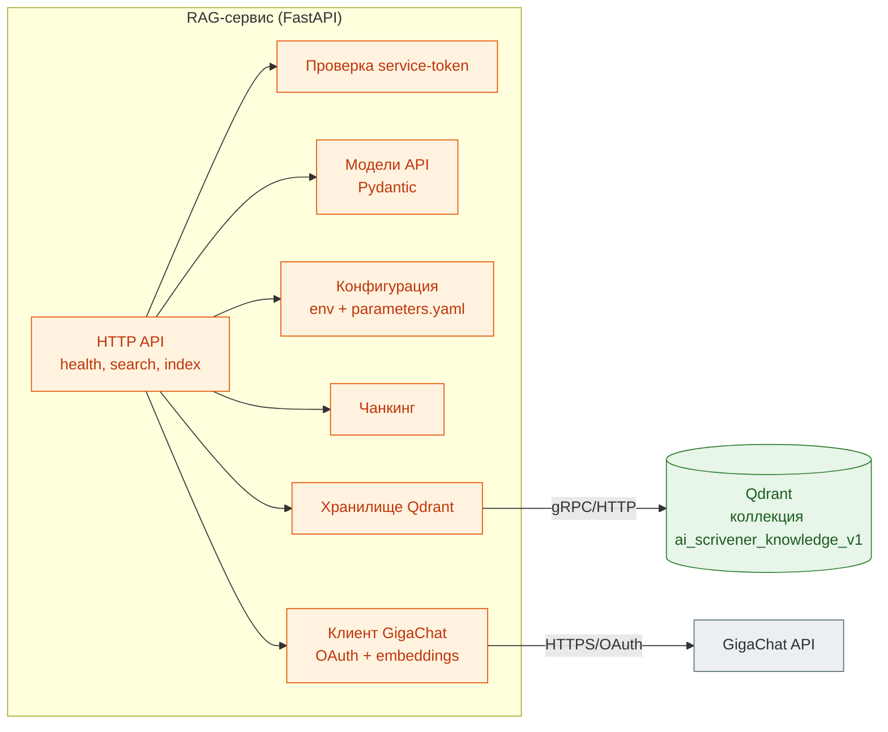

# C4-модель ai_scrivener

Целевая архитектура (TO-BE) на 2026-10-23. Диаграммы показывают проектное устройство системы; фактическое состояние кода отражено в таблицах статусов. Сейчас реализованы RAG-сервис и часть метаданных расширения, компоненты бизнес-логики на BSL ещё не созданы.

Нотация — [C4 model](https://c4model.com/): контекст, контейнеры, компоненты. Диаграммы отрисованы в Mermaid flowchart: уровни C4 сохранены как семантические границы, а flowchart даёт более устойчивое чтение и рендеринг, чем экспериментальный C4-синтаксис. Пунктирная связь означает опциональную или отложенную интеграцию.

## 1. Контекст

Кто пользуется системой и с какими внешними системами она взаимодействует.

| Элемент | Роль | Граница |
|---|---|---|
| Должностное лицо | Основной пользователь: задачи, проекты документов, ответы на запросы | Внутри организации |
| Вышестоящее ДЛ | Получатель докладов и адресат эскалации | Внутри организации |
| Администратор системы | Настройка объектов расширения, промптов, квот, диагностика | Внутри организации |
| Аудитор | Просмотр `АИС_ИсторияДействийИИ` и отчётов без записи | Внутри организации |
| Методолог | Мастер шаблонов, проверка и утверждение версий | Внутри организации |
| Делопроизводитель | Регистрация документов в штатном Документообороте | Вне RBAC расширения |
| AI Scrivener | Расширение `.cfe` и RAG-сервис как единая система в границах проекта | В границах проекта |
| 1С:Документооборот | Источник истины доменных данных; расширение его не заменяет | Внешняя система |
| DeepSeek API | Внешняя LLM для структурированных ответов и генерации текста | Внешний сервис |
| GigaChat API | Эмбеддинги для индексации и поиска | Внешний сервис |
| Qdrant | Векторное хранилище; доступ только через RAG-сервис | Внешний сервис |
| Локальная LLM | Опциональный провайдер для конфиденциальной вычитки | Инфраструктура организации |
| Внешние источники | API и расчётные сервисы для значений плейсхолдеров | Внешние системы |

## 2. Контейнеры

Как система разделена на исполняемые единицы и хранилища.

| Контейнер | Технология | Ответственность | Статус |
|---|---|---|---|
| Базовая конфигурация | 1С:Предприятие 8.3.27, BSL | Пользователи, должности, документы, задачи, бизнес-процессы, штатные права | Работает |
| Расширение `ai_scrivener` | 1С:Предприятие 8.3.27, BSL | ИИ-оркестрация, плейсхолдеры, лист ожидания, аудит, мастер шаблонов, вычитка | Метаданные частично, BSL-логики нет |
| PostgreSQL | PostgreSQL + `mchar` | Единое хранилище данных базовой конфигурации и расширения | Работает |
| Тома хранения файлов | Файловая система 1С | Файлы, версии, тома хранения | Работает |
| RAG API | Python 3.12, FastAPI, httpx, qdrant-client | `/health`, `/v1/search`, `/v1/index/upsert`, `/v1/index/replace`, `DELETE /v1/index/...` | Реализован |
| Qdrant | Векторная БД | Коллекция `ai_scrivener_knowledge_v1`, cosine, payload-индексы | Реализован в сервисе |
| Reverse proxy / TLS | nginx или аналог | Точка входа RAG API, TLS, ограничение доступа | Проект |
| DeepSeek API | Внешний OpenAI-совместимый API | Выбор шаблона, классификация, генерация, анализ срыва | Проект интеграции |
| GigaChat API | Внешний API | OAuth, `EmbeddingsGigaR`, размерность 2560 | Реализован клиент |
| Локальная LLM | OpenAI-совместимый endpoint | Глубокая вычитка конфиденциальных документов | Проект |
| Внешние источники | HTTP API, расчётные сервисы, утверждённые запросы | Значения плейсхолдеров | Проект |

## 3. Компоненты расширения

Ключевые модули, обработки и регламентные задания внутри контейнера `Расширение ai_scrivener`.

| Компонент | Ответственность | Статус |
|---|---|---|
| Интерфейс ДЛ | `АИС_РабочееМестоДЛ`, `АИС_ФормаЗадачи`, `АИС_ФормаПроектаДокумента` | Проект |
| Админ-панель | `АИС_АдминПанель`: объекты расширения, сроки, промпты, health, переиндексация | Проект |
| `АИС_ОркестраторЗадач` | Создание задачи, переходы `СостояниеИИ`, версии, блокировки, идемпотентность | Проект |
| `АИС_РазрешительПлейсхолдеров` | Парсер `{{...}}`, прямое поле, запрос в БД, запрос к ДЛ, внешний API, лимиты рекурсии | Проект |
| `АИС_ГенераторДокументов` | Детерминированная подстановка, LLM-улучшение, создание проекта в `ИсходящиеДокументы` | Проект |
| `АИС_РаботаСЛистомОжидания` | `АИС_ЛистОжидания`, базовая задача ДЛ, ответы, сроки ожидания | Проект |
| `АИС_АудитДействийИИ` | Запись промптов, ответов, токенов, стоимости, ошибок и длительности | Проект |
| `АИС_ОчередьЗапросовLLM` | Общий рейт-лимитер: оркестратор > мастер шаблонов > вычитка, единый backoff | Проект |
| `АИС_ИнтеграцияСLLM` | DeepSeek, JSON-режим, retry, валидаторы, выбор модели | Проект |
| `АИС_ИнтеграцияСRAG` | HTTP-клиент RAG-сервиса, service-token, таймауты, retry | Проект |
| `АИС_МастерШаблонов` | Импорт DOCX/текста, извлечение структуры, проверка человеком, публикация | Проект |
| `АИС_ГенераторПравилШаблона` | `ПравилаАвтозаполненияФайлов` и ТЧ `АИС_Плейсхолдеры` | Проект |
| `АИС_ПроверкаШаблона` | Дубли, пропуски, неоднозначности, обязательные поля | Проект |
| `АИС_СравнениеШаблонов` | Text/placeholder/structure/metadata diff, оценка и рекомендация | Проект |
| `АИС_ПроверкаДокумента` | Быстрая проверка без LLM, глубокая LLM-вычитка, квоты | Проект |
| `АИС_ПанельЗамечаний` | Показ замечаний, accept/reject, повторная проверка | Проект |
| `УстановкаПараметровСеанса` | `ТекущееДЛ` через `Пользователи`/`ФизическиеЛица` | Проект |
| Регламентные задания | Оркестрация, индексация RAG, лист ожидания, проверка сроков, генерация триггеров | Проект |
| Отчёты | `АИС_СтатистикаЗадач`, `АИС_ЖурналЗадачи`, `АИС_АнализСрывовСроков` | Проект |
| `АИС_ЗаполнитьДемоДанные` | Демо-ДЛ, должности, шаблоны, обязанности, промпты | Проект Этапа 2 |

## 4. Компоненты RAG-сервиса

Устройство контейнера `RAG API`.

| Компонент | Файл | Ответственность | Статус |
|---|---|---|---|
| HTTP API | `rag-service/src/rag_service/main.py` | Маршруты `/health`, `/v1/search`, индексация, удаление | Реализован |
| Проверка service-token | `main.py` | `X-Service-Token` для всех методов, кроме `/health` | Реализован |
| Модели API | `models.py` | Схемы запросов и ответов | Реализован |
| Конфигурация | `config.py`, `config/parameters.yaml` | Env, секреты, числовые параметры | Реализован |
| Чанкинг | `chunking.py` | Нормализация, разбиение, overlap | Реализован |
| Клиент GigaChat | `gigachat.py` | OAuth, кэш токена, embeddings, retry | Реализован |
| Хранилище Qdrant | `qdrant_store.py` | Коллекция, payload-индексы, upsert/replace/delete/search | Реализован |

## 5. Границы и допущения

- **Целевая модель.** Диаграммы описывают проект; компоненты расширения на BSL ещё не реализованы. RAG-сервис реализован и проверен на трёх шаблонах.
- **RAG-сервис stateless.** Источник истины — 1С; Qdrant хранит только производный векторный индекс.
- **Qdrant не публикуется наружу.** Доступ к нему есть только у RAG API; RAG API закрыт service-token и TLS/reverse proxy.
- **Секреты.** Ключ DeepSeek и service-token хранятся в безопасном хранилище 1С; GigaChat client_secret — в `.env` RAG-сервиса. В диаграммах секретов нет.
- **Внешние LLM.** DeepSeek используется для генерации и классификации; GigaChat — только для эмбеддингов; локальная LLM — опционально для конфиденциальной вычитки.
- **Граница доверия.** Базовая конфигурация и расширение работают в одном процессе 1С и используют штатную модель прав; RLS расширения опирается на ссылку на базовую задачу.
- **Reverse proxy.** В текущем `deploy/` описан Docker Compose для RAG API и Qdrant; TLS/reverse proxy — проектное требование, отдельный конфиг в репозиторий пока не добавлен.
- **Отчёты и админ-панель.** Показаны как компоненты целевой системы; в MVP они входят в Этап 6.

## Связанные документы

- `plans/implementation_plan.md` §3, §7, §8 — архитектура, RAG-сервис, интеграция с LLM.
- `docs/data-model.md` — объекты расширения и повторно используемые объекты базы.
- `docs/process-diagrams.md` — процессы AS-IS и TO-BE.
- `docs/system-analysis/view-and-scope.md` — границы проекта.
- `docs/system-analysis/stakeholder-map.md` — роли и внешние системы.
