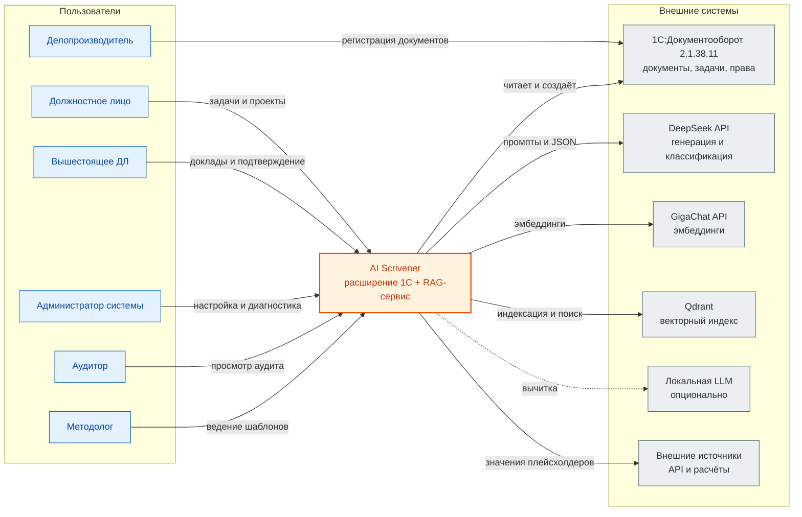
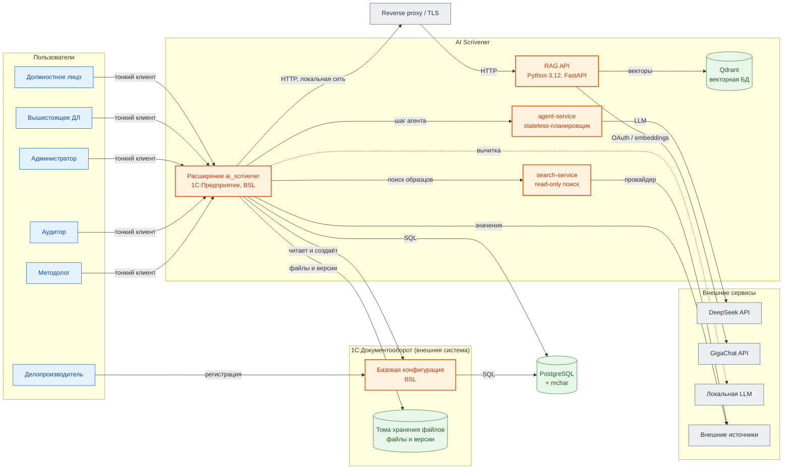
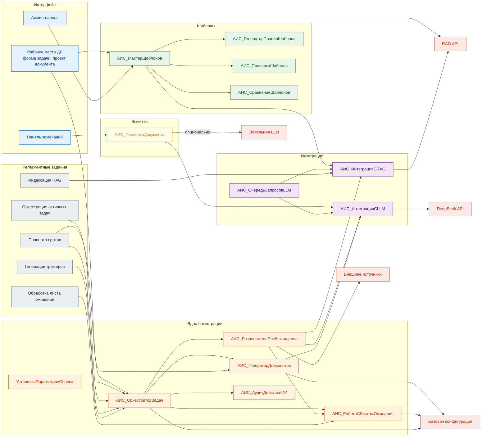
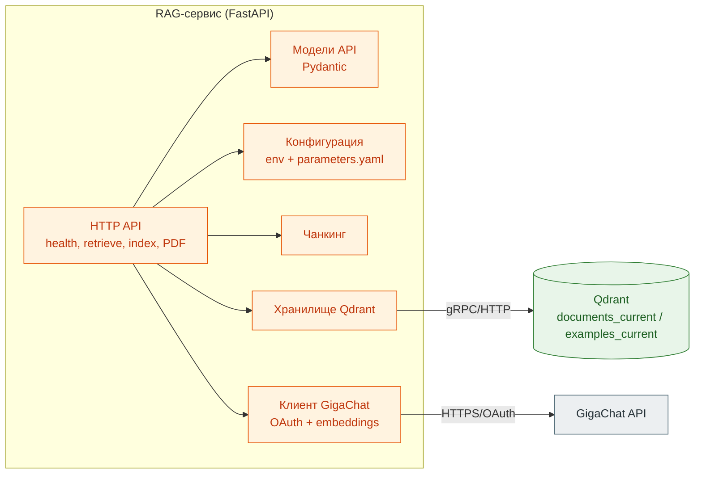
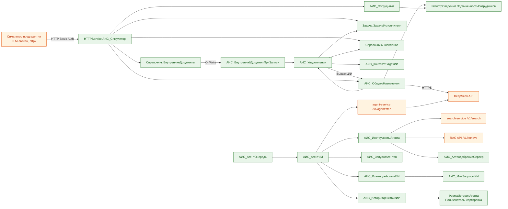

# C4-модель ai_scrivener

Целевая архитектура (TO-BE) на 2026-10-23; фактическое состояние обновлено 2026-10-30. Диаграммы показывают проектное устройство системы, а таблицы статусов и §6 — что уже реализовано. Сейчас реализованы RAG-сервис, метаданные расширения, часть BSL-логики (найм, задачи, адресные документы, HR-шлюз, автошаблонизация, вызов LLM из BSL) и HTTP-сервис `АИС_Симулятор`; оркестратор, разрешитель плейсхолдеров, формы и отчёты остаются проектом.

Нотация — [C4 model](https://c4model.com/): контекст, контейнеры, компоненты. Диаграммы отрисованы в Mermaid flowchart: уровни C4 сохранены как семантические границы, а flowchart даёт более устойчивое чтение и рендеринг, чем экспериментальный C4-синтаксис. Пунктирная связь означает опциональную или отложенную интеграцию.

## 1. Контекст

Кто пользуется системой и с какими внешними системами она взаимодействует.

| Элемент | Роль | Граница |
|---|---|---|
| Должностное лицо | Основной пользователь: задачи, проекты документов, ответы на запросы | Внутри организации |
| Вышестоящее ДЛ | Получатель докладов и адресат эскалации | Внутри организации |
| Администратор системы | Настройка объектов расширения, промптов, квот, диагностика | Внутри организации |
| Аудитор | Просмотр `АИС_ИсторияДействийИИ` и отчётов без записи | Внутри организации |
| Методолог | Мастер шаблонов, проверка и утверждение версий | Внутри организации |
| Делопроизводитель | Регистрация документов в штатном Документообороте | Вне RBAC расширения |
| AI Scrivener | Расширение `.cfe` и RAG-сервис как единая система в границах проекта | В границах проекта |
| 1С:Документооборот | Источник истины доменных данных; расширение его не заменяет | Внешняя система |
| DeepSeek API | Внешняя LLM для структурированных ответов и генерации текста | Внешний сервис |
| GigaChat API | Эмбеддинги для индексации и поиска | Внешний сервис |
| Qdrant | Векторное хранилище; доступ только через RAG-сервис | Внешний сервис |
| Локальная LLM | Опциональный провайдер для конфиденциальной вычитки | Инфраструктура организации |
| Внешние источники | API и расчётные сервисы для значений плейсхолдеров | Внешние системы |

## 2. Контейнеры

Как система разделена на исполняемые единицы и хранилища.

| Контейнер | Технология | Ответственность | Статус |
|---|---|---|---|
| Базовая конфигурация | 1С:Предприятие 8.3.27, BSL | Пользователи, должности, документы, задачи, бизнес-процессы, штатные права | Работает |
| Расширение `ai_scrivener` | 1С:Предприятие 8.3.27, BSL | Агент и инструменты, approval и автоодобрение, очередь запусков, история, настройки и триггеры, RAG-индексация, папки документов, шаблоны | Реализованы контур агента, пользовательские и административные формы, история с атрибуцией пользователя; отчёты — проект |
| PostgreSQL | PostgreSQL + `mchar` | Единое хранилище данных базовой конфигурации и расширения | Работает |
| Тома хранения файлов | Файловая система 1С | Файлы, версии, тома хранения | Работает |
| RAG API | Python 3.12, FastAPI, httpx, qdrant-client | `/health`, `/v1/retrieve`, индексация чанков и документов, PDF-ссылки, диагностика | Реализован |
| agent-service | Python 3.12, FastAPI, httpx | `POST /v1/agent/step`: один `tool_call` или `final`, без состояния и доступа к 1С | Реализован |
| search-service | Python 3.12, FastAPI, httpx | `POST /v1/search`: read-only поиск внешних образцов (провайдер DuckDuckGo на MVP) | Реализован |
| Qdrant | Векторная БД | Коллекции `ai_scrivener_documents_current`, `ai_scrivener_examples_current`; named vectors `dense`/`sparse`, payload-индексы | Реализован в сервисе |
| Reverse proxy / TLS | nginx или аналог | Точка входа RAG API, TLS, ограничение доступа | Проект |
| Apache 2.4 + `wsap24.so` | Веб-сервер 1С | Публикация `HTTPService.АИС_Симулятор` для программного доступа | Работает на стенде (`guides/runbook.md` §2.6) |
| Симулятор предприятия | Python 3.12, httpx, DeepSeek tool-calling | Тестовый клиент: агенты сотрудников, сценарии легенды, профиль компании; не входит в штатную работу | Реализован в отдельном репозитории `ai-scrivener-enterprise-sim` |
| DeepSeek API | Внешний OpenAI-совместимый API | Шаги агента, генерация и классификация в BSL | Используется через agent-service и `АИС_ОбщегоНазначения.ВызватьИИ` |
| GigaChat API | Внешний API | OAuth, `EmbeddingsGigaR`, эмбеддинги | Реализован клиент |
| Локальная LLM | OpenAI-совместимый endpoint | Глубокая вычитка конфиденциальных документов | Проект |
| Внешние источники | HTTP API, расчётные сервисы, утверждённые запросы | Значения плейсхолдеров, внешние образцы | Частично: поиск через search-service |

## 3. Компоненты расширения

Ключевые модули, обработки и регламентные задания внутри контейнера `Расширение ai_scrivener`. Имена модулей в этой таблице — целевые: реализованная замена перечислена в §6 (`АИС_АгентИИ`, `АИС_ИнструментыАгента`, `АИС_ИнтеграцияСАгентом`, `АИС_ИнтеграцияСПоиском`, `АИС_МоиЗапросыИИ`, `АИС_МониторЗапусковИИ` и др.).

| Компонент | Ответственность | Статус |
|---|---|---|
| Интерфейс ДЛ | `АИС_РабочееМестоДЛ`, `АИС_ФормаЗадачи`, `АИС_ФормаПроектаДокумента` | Проект |
| Админ-панель | `АИС_АдминПанель`: объекты расширения, сроки, промпты, health, переиндексация | Проект |
| `АИС_ОркестраторЗадач` | Создание задачи, переходы `СостояниеИИ`, версии, блокировки, идемпотентность | Проект |
| `АИС_РазрешительПлейсхолдеров` | Парсер `{{...}}`, прямое поле, запрос в БД, запрос к ДЛ, внешний API, лимиты рекурсии | Проект |
| `АИС_ГенераторДокументов` | Детерминированная подстановка, LLM-улучшение, создание проекта в `ИсходящиеДокументы` | Проект |
| `АИС_РаботаСЛистомОжидания` | `АИС_ЛистОжидания`, базовая задача ДЛ, ответы, сроки ожидания | Проект |
| `АИС_АудитДействийИИ` | Запись промптов, ответов, токенов, стоимости, ошибок и длительности | Проект |
| `АИС_ОчередьЗапросовLLM` | Общий рейт-лимитер: оркестратор > мастер шаблонов > вычитка, единый backoff | Проект |
| `АИС_ИнтеграцияСLLM` | DeepSeek, JSON-режим, retry, валидаторы, выбор модели | Модуль не создан; базовый вызов реализован в `АИС_ОбщегоНазначения.ВызватьИИ` |
| `АИС_ИнтеграцияСRAG` | HTTP-клиент RAG-сервиса, таймауты, retry | Проект |
| `АИС_МастерШаблонов` | Импорт DOCX/текста, извлечение структуры, проверка человеком, публикация | Проект |
| `АИС_ГенераторПравилШаблона` | `ПравилаАвтозаполненияФайлов` и ТЧ `АИС_Плейсхолдеры` | Проект |
| `АИС_ПроверкаШаблона` | Дубли, пропуски, неоднозначности, обязательные поля | Проект |
| `АИС_СравнениеШаблонов` | Text/placeholder/structure/metadata diff, оценка и рекомендация | Проект |
| `АИС_ПроверкаДокумента` | Быстрая проверка без LLM, глубокая LLM-вычитка, квоты | Проект |
| `АИС_ПанельЗамечаний` | Показ замечаний, accept/reject, повторная проверка | Проект |
| `УстановкаПараметровСеанса` | `АИС_ТекущееДЛ` через `Пользователи`/`ФизическиеЛица` | Реализован |
| `АИС_Сотрудники` | Создание пользователя/физлица/должности, роли, иерархия | Реализован |
| `АИС_ОбщегоНазначения` | Задачи, поиск шаблонов, контекст ИИ, иерархия, должностные инструкции, `ВызватьИИ`, черновик шаблона | Реализован |
| `АИС_Уведомления` | Адресные документы, HR-шлюз на заявку найма, автошаблонизация | Реализован |
| `АИС_ПапкиДокументов` | Папки сотрудника, автораскладка, backfill, выборки документов/папок для UI и RAG | Реализован |
| `АИС_ДокументыВПапках` | Регистр «документ ↔ папка ↔ сотрудник» с назначением и источником | Реализован |
| `АИС_ВнутреннийДокументПриЗаписи` | Подписка `Catalog.ВнутренниеДокументы` на запись | Реализована |
| `АИС_ДокументВПапкуПриЗаписи` | Подписка на запись внутренних/входящих/исходящих документов для раскладки по папкам | Реализована |
| `HTTPService.АИС_Симулятор` | Сотрудники, документы, задачи, статус приказа и связи документов, шаблоны, сеансы, диагностика ИИ, решение бухгалтера | Реализован |
| Регламентные задания | Оркестрация, индексация RAG, лист ожидания, проверка сроков, генерация триггеров | Проект; реализовано только разовое заполнение демоданных |
| Отчёты | `АИС_СтатистикаЗадач`, `АИС_ЖурналЗадачи`, `АИС_АнализСрывовСроков` | Проект |
| Начальные промпты | `АИС_Промпты.Заполнить()` (HTTP `POST /hs/ais-sim/prompts/seed`): тексты и параметры без пользователей/должностей | Реализован |

## 4. Компоненты RAG-сервиса

Устройство контейнера `RAG API`.

| Компонент | Файл | Ответственность | Статус |
|---|---|---|---|
| HTTP API | `rag-service/src/rag_service/main.py` | `/health`, `/v1/retrieve`, индексация чанков и документов, PDF-ссылки, диагностика | Реализован |
| Модели API | `models.py` | Схемы запросов и ответов | Реализован |
| Конфигурация | `config.py`, `config/parameters.yaml` | Env, секреты, числовые параметры | Реализован |
| Чанкинг | `chunking.py` | Нормализация, разбиение, overlap | Реализован |
| Клиент GigaChat | `gigachat.py` | OAuth, кэш токена, embeddings, retry | Реализован |
| Хранилище Qdrant | `qdrant_store.py` | Коллекция, payload-индексы, upsert/replace/delete/search | Реализован |

## 5. Границы и допущения

- **Целевая модель.** Диаграммы §§1–4 описывают целевое устройство; фактически реализованный контур — §6. Реализованы RAG-сервис, agent-service и search-service, контур агента с approval и автоодобрением, очередь запусков, история действий, пользовательские и административные формы и RAG-индексация; отчёты остаются проектом.
- **RAG-сервис stateless.** Источник истины — 1С; Qdrant хранит только производный векторный индекс.
- **Qdrant не публикуется наружу.** Доступ к нему есть только у RAG API; RAG API доступен только из локальной/частной сети.
- **Секреты.** Ключи LLM и Qdrant хранятся только в `.env` сервисов; service-token не используются; `RAG_SERVICE_TOKEN` — только подпись PDF-ссылок.
- **Внешние LLM.** DeepSeek используется для генерации и классификации; GigaChat — только для эмбеддингов; локальная LLM — опционально для конфиденциальной вычитки.
- **Граница доверия.** Базовая конфигурация и расширение работают в одном процессе 1С и используют штатную модель прав; RLS расширения опирается на ссылку на базовую задачу.
- **Reverse proxy.** В текущем `deploy/` описан Docker Compose для RAG API и Qdrant; TLS/reverse proxy — проектное требование, отдельный конфиг в репозиторий пока не добавлен.
- **Отчёты.** Показаны как компоненты целевой системы; в текущем состоянии отчёты не реализованы, административные формы — реализованы.

## 6. Фактическое состояние на 2026-11-18

Ниже — не целевая архитектура, а то, что уже работает в стенде. Диаграмма показывает контур симулятора и контур ИИ-агента. `HTTPService.АИС_Симулятор` — тестовый адаптер: в штатной работе без симулятора документы создаются штатными средствами 1С:ДО, а расширение обрабатывает их подписками и AI-контуром.

| Что проверено | Состояние |
|---|---|
| Найм через `/employees`, роли, руководитель | Работает |
| Создание внутреннего документа и адресная задача с предметом-основанием | Работает |
| Штатные связи документов и статус приказа (`orders/status`, `orders/link`) | Работают |
| Папки сотрудников (`АИС_ДокументыВПапках`, `folders/*`) и UI `АИС_ПапкиДокументов` | Работают; физическая папка остаётся одной на документ, дополнительные представления — через регистр |
| Автоматический поиск шаблонов на стороне расширения | Работает |
| Автошаблонизация по готовому документу и задача автору | Работает |
| HR-шлюз: согласование вилки бухгалтером, должностные инструкции, задача HR | Работает |
| HTTP-сервис и Basic Auth | Работает; права на методы выдаются ролям расширения (`Rights.rights`) |
| LLM-агенты ГИ, HR, Главного бухгалтера и Программиста 1С в симуляторе | Работают; у Программиста 1С есть промпт и технические права |
| Предопределённая должность `Программист1С` | Создана; техническое согласование шаблонов и оргструктура адресуются ей; окончательное утверждение шаблона — автор; роли `АИС_ДолжностноеЛицо` + `АИС_АдминистраторСистемы` |
| Просмотр полной оргструктуры и подчиненности | Реализована обработка `DataProcessor.АИС_Оргструктура` в «АИС: Сервис»; права `Use`/`View` у ролей `АИС_АдминистраторСистемы`/`АИС_ВышестоящееДолжностноеЛицо`; подразделения создаёт `Программист1С`, не симулятор |
| Создание подразделений в `Справочник.СтруктураПредприятия` | Выполняет предопределённая должность `Программист1С` по распоряжению CEO; симулятор сам не создаёт |
| Прямой UI шаблонов | В `АИС: Сервис` добавлена обработка `DataProcessor.АИС_Шаблоны` с единым списком шаблонов всех трёх видов; `Администратор` и `Программист1С` имеют права редактирования |
| Контур ИИ-агента: очередь запусков, шаги через agent-service, инструменты, approval, взаимодействия, таймауты | Работает; регламентные задания `АИС_АгентОчередь` и `АИС_АгентТаймауты` |
| История действий ИИ | `ФормаИсторииАгента` показывает пользователя, чей агент выполнял действие, и поддерживает сортировку по дате и по пользователю с датой |
| Настройки агента и триггеры | `АИС_МоиНастройкиАгента` и `АИС_ТриггерыАгента`: включение, модель, температура, лимит токенов, группы инструментов, расписание и ручной запуск |
| Автоодобрение (MVP) | `АИС_НастройкиАвтоодобрения`, правила по типам и allowlist; временный режим накопления корпуса, только документные одобрения |
| Поиск внешних образцов и знаний | `search-service` (`/v1/search`) и RAG (`/v1/retrieve`) реализованы |
| Целевые шаблоны с поиском и фильтрами | Не реализованы; текущий контур — свободная генерация и синтетический корпус |
| Регламентный триггер по должностным обязанностям | Не реализован; работают документы и задачи |
| Автоодобрение в целевой системе | Отсутствует: изменяющие действия подтверждает человек |
| Отчёты, мастер шаблонов и глубокая вычитка | Не реализованы; формы шаблонов и администрирования есть, отчётность остаётся проектом |
| Передача `ЗапрашиваемыеДолжности` и `Должность` из агентских инструментов | Реализована; проверено на ДИ начальника ОТК и заявке на 12 позиций |

## Связанные документы

- `plans/implementation_plan.md` §3, §7, §8 — архитектура, RAG-сервис, интеграция с LLM.
- `plans/2026-10-26-enterprise-simulator.md` — текущий контур симулятора и его ограничения.
- `docs/data-model.md` — объекты расширения и повторно используемые объекты базы.
- `docs/process-diagrams.md` — процессы AS-IS и TO-BE.
- `docs/system-analysis/view-and-scope.md` — границы проекта.
- `docs/system-analysis/stakeholder-map.md` — роли и внешние системы.
