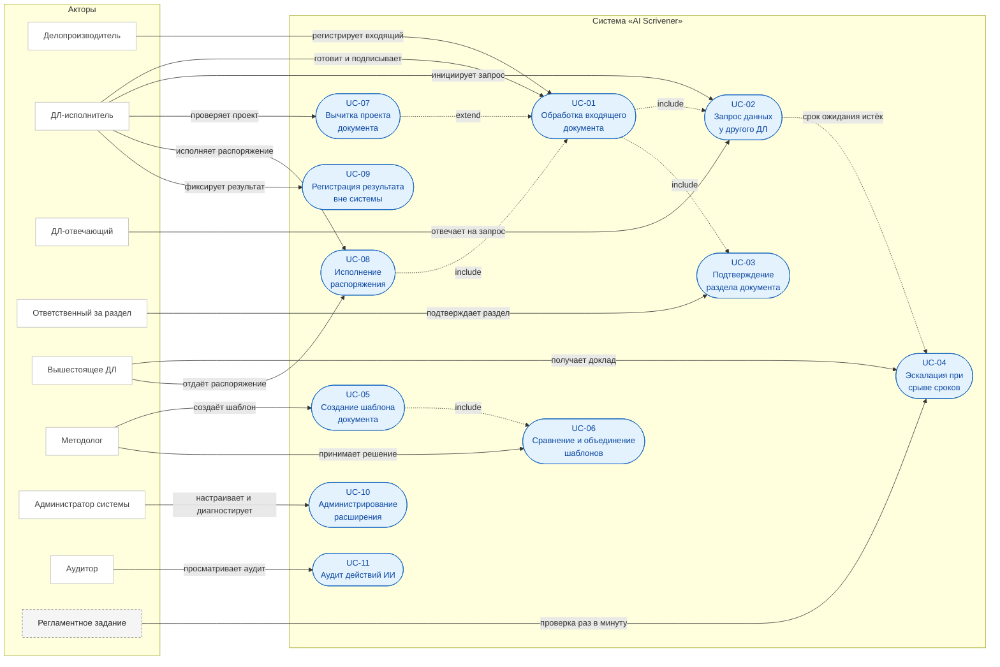
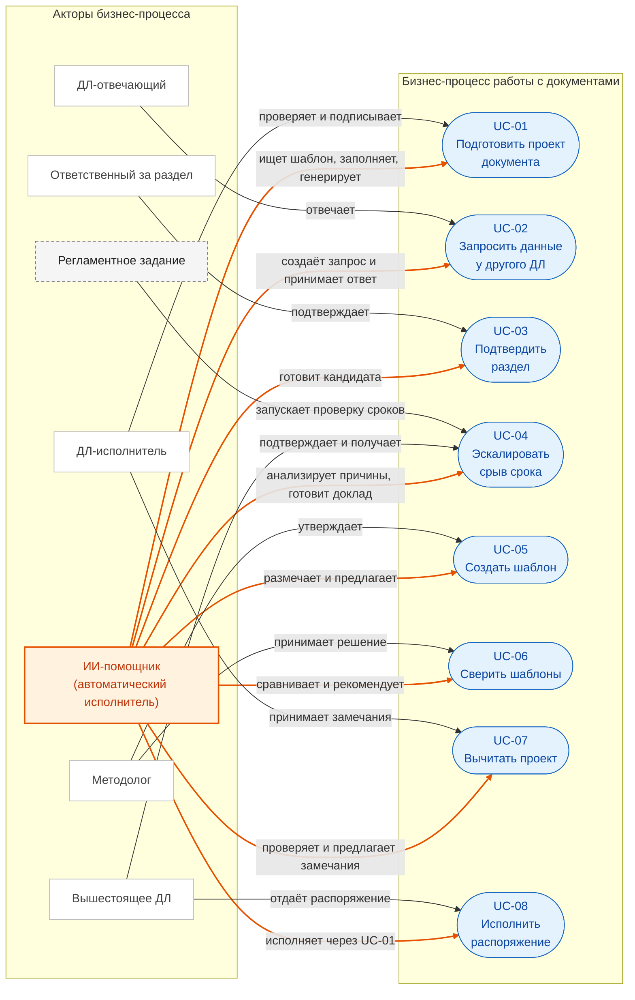

# Варианты использования

Отдельного раздела use cases в `docs/raw_specification.md` не было — сценарии были растворены в функциональных требованиях (§4), MVP-сценарии (§6.2 плана реализации) и процессных диаграммах. Этот документ собирает их в формате актор/предусловие/поток, не вводя нового поведения, а только переформулируя уже специфицированное.

## Сводная таблица

| UC | Название | Основной актор | Триггер | Связанные FR |
|---|---|---|---|---|
| UC-01 | Обработка входящего документа и подготовка проекта | ДЛ-исполнитель | Входящий документ зарегистрирован | FR-008, FR-019, FR-020, FR-024 |
| UC-02 | Запрос данных у другого ДЛ | ДЛ-инициатор, ДЛ-отвечающий | Плейсхолдер требует данные другого лица | FR-012, FR-013, FR-021, FR-027 |
| UC-03 | Подтверждение раздела документа | Ответственный за раздел | Плейсхолдер вида «Раздел» требует значения | FR-043 |
| UC-04 | Эскалация при срыве сроков | Регламентное задание, вышестоящее ДЛ | Срок задачи истёк | FR-014 |
| UC-05 | Создание шаблона документа мастером | Методолог | Нужен новый/обновлённый шаблон | FR-044 |
| UC-06 | Сравнение и объединение шаблонов | Методолог | Кандидат похож на существующий шаблон | FR-045 |
| UC-07 | Вычитка проекта документа | ДЛ | Нужна проверка перед подписанием | FR-046, NFR-032 |
| UC-08 | Исполнение распоряжения (разовое и периодическое) | Вышестоящее ДЛ, ДЛ-исполнитель | Распоряжение отдано письменно или устно | FR-009, FR-003 |
| UC-09 | Регистрация результата действия вне системы | ДЛ | Действие вне системы выполнено | FR-026 |
| UC-10 | Администрирование расширения | Администратор системы | Требуется настройка/диагностика | FR-033 |
| UC-11 | Аудит действий ИИ | Аудитор | Нужна проверка/расследование | FR-028, FR-029, NFR-010, NFR-013 |

Роли — см. `docs/system-analysis/stakeholder-map.md`; термины — `docs/system-analysis/glossary.md`.

## Системная диаграмма вариантов использования

Сплошная стрелка — участие актора в варианте использования; пунктир — связи `include`/`extend` и переход к эскалации.
Овалы изображены формой `([...])`: Mermaid не поддерживает UML use case diagram нативно, поэтому границы системы и акторы показаны через `subgraph`.

## Взгляд на бизнес-процесс: ИИ-помощник как актор

На системной диаграмме выше ИИ-помощник находится внутри границы `ai_scrivener` и является поведением системы. Если же рассматривать организационный бизнес-процесс, где ИИ выполняет работу, которую раньше делал человек, его корректно показывать отдельным актором — наряду с людьми. Граница в этом взгляде — бизнес-процесс, а не расширение.

Границы полномочий ИИ не меняются: он готовит, предлагает и исполняет шаги, но не подписывает документ, не подтверждает раздел и не отправляет доклад без человека (см. UC-03 и UC-04). UC-09, UC-10 и UC-11 в этот взгляд не входят: там ИИ не является исполнителем.

## UC-01. Обработка входящего документа и подготовка проекта

**Актор:** ДЛ-исполнитель, система (оркестратор).
**Предусловие:** ДЛ назначен на должность с действующими обязанностями; есть хотя бы один утверждённый и проиндексированный шаблон.
**Триггер:** входящий документ зарегистрирован и проведён.

**Основной поток:**

1. ДЛ/делопроизводитель регистрирует и проводит `Справочник.ВходящиеДокументы`.
2. Система создаёт штатную задачу (исполнитель — по виду документа и наиболее специфичной обязанности, `docs/raw_specification.md` §4.1.5) и запись `АИС_КонтекстЗадачИИ` без вызова LLM; состояние `Инициация`.
3. Регламентное задание переводит задачу в `ПоискШаблона`.
4. Кандидаты сужаются детерминированно (тип действия → справочник шаблонов; требуемый вид документа из обязанности, если задан); RAG-сервис возвращает top-k внутри этого набора, DeepSeek выбирает один и возвращает `{template_id, confidence, reason}`.
5. Система создаёт записи `АИС_СостоянияПлейсхолдеров` для всех плейсхолдеров выбранного шаблона; состояние → `РазрешениеПлейсхолдеров`.
6. Для каждого плейсхолдера система определяет источник и заполняет значение (прямое поле / утверждённый запрос к БД / расчётный сервис / внешний API), либо переводит задачу в `Ожидание` (см. UC-02, UC-03).
7. После заполнения всех обязательных плейсхолдеров — `Генерация`: детерминированная подстановка значений, при необходимости LLM улучшает текст.
8. Создаётся проект `Справочник.ИсходящиеДокументы` со статусом `Проект`; задача → `ВерификацияДЛ`.
9. ДЛ проверяет, при необходимости редактирует и подписывает документ; статус `Подписан`, задача → `Завершена`.

**Альтернативные потоки:**

- 4a. Confidence ниже порога или ID вне списка кандидатов → ручной выбор шаблона.
- 6a. Плейсхолдер не может быть заполнен (0 или >1 строк в запросе БД, ошибка внешнего источника) → `НеМожетБытьЗаполнен`, ручное решение или эскалация.
- 9a. ДЛ запрашивает повторную генерацию вместо подписи → возврат к шагу 7.

**Постусловие:** подписанный документ; полный аудит действий ИИ в `АИС_ИсторияДействийИИ`.

## UC-02. Запрос данных у другого ДЛ

**Актор:** ДЛ-инициатор (через оркестратор), ДЛ-отвечающий.
**Предусловие:** в составе UC-01 (шаг 6) плейсхолдер классифицирован с источником «Другое ДЛ».
**Триггер:** оркестратор определил источник «Другое ДЛ» для плейсхолдера.

**Основной поток:**

1. Система создаёт штатную `Задача.ЗадачаИсполнителя` для ДЛ-отвечающего и запись `АИС_ЛистОжидания`.
2. Плейсхолдер → `Ожидает`; `СостояниеИИ` родительской задачи → `Ожидание`.
3. ДЛ-отвечающий получает уведомление, выполняет задачу, вводит результат.
4. Система находит запись листа ожидания по ID, заполняет результат базовой задачи и историю, заполняет плейсхолдер.
5. Родительская задача возобновляется — `СостояниеИИ` → `РазрешениеПлейсхолдеров`.

**Альтернативный поток:**

- 3a. Срок ожидания истекает (проверка раз в минуту) → состояние запроса `СрокИстек`, триггер `ИстечениеСрокаОжидания` → UC-04.

**Постусловие:** плейсхолдер заполнен либо инициирована эскалация.

## UC-03. Подтверждение раздела документа

**Актор:** ответственный за раздел (ДЛ), ответственный за документ.
**Предусловие:** шаблон содержит плейсхолдер вида «Раздел»; документ создан.
**Триггер:** оркестратор дошёл до плейсхолдера с `ВидПлейсхолдера = Раздел`.

**Основной поток:**

1. Система находит кандидата (готовый файл, прошлый раздел, RAG-фрагмент) или определяет, что раздел нужно подготовить с нуля.
2. Создаётся запись `АИС_ЛистОжидания` с `ТипЗапроса = ПодтверждениеРаздела` и штатная задача ответственному.
3. Ответственный готовит/загружает содержимое или подтверждает предложенную версию и хеш.
4. Система фиксирует версию/хеш, переводит `АИС_РазделыДокумента` в `Подтвержден`.
5. Сборка документа проверяет, что все обязательные разделы подтверждены, и продолжает генерацию (UC-01, шаг 7).

**Альтернативные потоки:**

- 3a. Ответственный отклоняет версию → новая попытка.
- 4a. Файл меняется после подтверждения → раздел → `Устарел`, требуется повторное подтверждение.

**Постусловие:** раздел в состоянии `Подтвержден` с конкретной версией/хешом, либо сборка документа блокирована. ИИ не может подтвердить раздел самостоятельно ни при каких условиях.

## UC-04. Эскалация при срыве сроков

**Актор:** регламентное задание, вышестоящее ДЛ, исполнитель.
**Предусловие:** задача не в состоянии `Завершена`, срок исполнения истёк.
**Триггер:** регламентное задание `АИС_ПроверкаСроковЗадач` (раз в минуту).

**Основной поток:**

1. Система собирает таймлайн: создание задачи, запросы, ответы, незаполненные плейсхолдеры.
2. DeepSeek анализирует причины и формирует план мероприятий (промпт `АнализСрываСроков`).
3. Создаётся `ВнутреннийДокумент` с видом «Доклад о срыве сроков», статус `Проект`.
4. Доклад проверяется и подтверждается человеком перед отправкой (`docs/design-decisions.md` §14) — вышестоящим ДЛ или исполнителем.
5. После подтверждения доклад направляется вышестоящему ДЛ, копия — исполнителю; `СостояниеИИ` → `Эскалация`.

**Альтернативный поток:**

- 2a. LLM недоступна или вернула невалидный ответ → доклад формируется с детерминированным таймлайном и пометкой «причина требует уточнения».

**Постусловие:** доклад зафиксирован, подтверждён человеком и отправлен; аудит записан.

## UC-05. Создание шаблона документа мастером

**Актор:** методолог / ответственный за шаблон.
**Предусловие:** нет шаблона для нужного вида документа, либо требуется обновление.
**Триггер:** методолог запускает мастер шаблонов.

**Основной поток:**

1. Загрузка DOCX/текста, описание словами, либо клонирование существующего шаблона.
2. Извлечение текста и структуры: разделы, списки, таблицы, колонтитулы.
3. AI-анализ: кандидаты в плейсхолдеры, типы, источники, падежи, повторяемые блоки.
4. Мастер сравнивает кандидата с существующими активными шаблонами (см. UC-06); при высокой похожести предлагает обновление/объединение вместо нового.
5. Методологу показывается таблица проверки; он принимает/отклоняет/добавляет/удаляет/изменяет каждый плейсхолдер.
6. Генерируются `ПравилаАвтозаполненияФайлов` и ТЧ `АИС_Плейсхолдеры`.
7. Выполняется тестовое заполнение на демо-данных.
8. Методолог публикует шаблон: статус `Утвержден`, версия, активность, индексация RAG.

**Альтернативные потоки:**

- 5a. Методолог отклоняет всю ИИ-разметку → ручной режим, черновик сохраняется.
- 5b. Методолог отклоняет шаблон полностью → ничего не создаётся.
- 7a. Тестовое заполнение завершается ошибкой → возврат к шагу 5.

**Постусловие:** опубликованный и проиндексированный шаблон, либо осознанное решение не создавать его.

## UC-06. Сравнение и объединение шаблонов

**Актор:** методолог.
**Предусловие:** есть кандидат шаблона (из UC-05) и корпус активных шаблонов.
**Триггер:** мастер шаблонов переходит к шагу сравнения.

**Основной поток:**

1. Система находит похожие активные шаблоны (вид документа, должность, RAG/эмбеддинги, реквизиты).
2. Сравниваются текст, плейсхолдеры, структура, метаданные; вычисляется оценка сходства (веса 0.4/0.3/0.2/0.1).
3. Показывается side-by-side diff и рекомендация: `ОбновитьСуществующий` / `Объединить` / `СоздатьНовый` / `РучноеРешение`.
4. Методолог принимает решение.
5. Решение и различия записываются в `АИС_СравненияШаблонов`.

**Альтернативные потоки:**

- 3a. Несколько кандидатов в пределах 0.05 по оценке → ручной выбор.
- 4a. Методолог выбирает «Создать новый» при низкой похожести → система требует явную причину.

**Постусловие:** шаблон обновлён, объединён или создан заново — с зафиксированным решением и аудитом.

## UC-07. Вычитка проекта документа

**Актор:** ДЛ.
**Предусловие:** существует проект документа (`ИсходящиеДокументы` в статусе `Проект`).
**Триггер:** быстрая проверка — автоматически после генерации; глубокая — по кнопке.

**Основной поток:**

1. Быстрая проверка без LLM: плейсхолдеры, обязательные разделы, даты, суммы, номера, ссылки, формат, повторы, склонения.
2. ДЛ запускает глубокую проверку; система показывает оценку расхода квоты в страницах.
3. LLM возвращает замечания с цитатой, позицией, типом, важностью, предложением, confidence.
4. ДЛ принимает или отклоняет каждое замечание в панели замечаний.
5. Принятые замечания применяются детерминированно; выполняется повторная быстрая проверка.

**Альтернативные потоки:**

- 2a. Квота исчерпана → глубокая проверка блокируется, доступна только быстрая.
- 3a. Цитата замечания не найдена в тексте → замечание отбрасывается автоматически.
- 3b. Локальная LLM перегружена → запрос становится в очередь или проверка деградирует до быстрой.

**Постусловие:** документ проверен; принятые исправления применены и аудированы; квота списана только за фактически выполненную глубокую проверку.

## UC-08. Исполнение распоряжения вышестоящего ДЛ (разовое и периодическое)

**Актор:** вышестоящее ДЛ, ДЛ-исполнитель.
**Предусловие:** между ДЛ существует организационная связь (действующая должность/иерархия, `docs/system-analysis/glossary.md`).
**Триггер:** вышестоящее ДЛ отдаёт распоряжение — письменно или устно.

**Основной поток:**

1. Распоряжение регистрируется как `ВнутреннийДокумент` с соответствующим видом независимо от исходного канала (письменного или устного).
2. Система создаёт базовую задачу и запись `АИС_КонтекстЗадачИИ` с типом триггера `Распоряжение`.
3. Если распоряжение описывает разовое действие — требуемое действие может браться из текста распоряжения напрямую, минуя каталог обязанностей.
4. Если распоряжение устанавливает периодическое/отложенное по времени требование — его необходимо явно зафиксировать как запись `АИС_РасписаниеТриггеров`.
5. Задача обрабатывается по UC-01.

**Альтернативный поток:**

- 4a. Фиксация расписания не выполнена → периодическое требование не создаёт будущих триггеров и молча не исполняется. Это известная открытая проблема без принятого решения о защите (`reviews/critical-review.md` 2.10) — не штатное поведение «как задумано».

**Постусловие:** разовое распоряжение исполняется через стандартный пайплайн; периодическое — только если явно зафиксировано как расписание.

## UC-09. Регистрация результата действия вне системы

**Актор:** ДЛ.
**Предусловие:** задача ожидает результата действия, выполненного вне системы (звонок, встреча, письмо).
**Триггер:** ДЛ выполнил действие вне системы и фиксирует результат.

**Основной поток:**

1. ДЛ открывает задачу и вводит результат: канал связи, контакт, содержание, файлы.
2. Система регистрирует результат как результат штатной задачи и/или `ВнутреннийДокумент`, если нужен жизненный цикл документа.
3. Задача возобновляется, если ждала это действие.

**Постусловие:** результат зафиксирован и доступен в истории.

## UC-10. Администрирование расширения

**Актор:** администратор системы.
**Предусловие:** нет.
**Триггер:** администратор открывает рабочее место администратора.

**Основной поток:**

1. Администратор управляет справочниками расширения (обязанности, типы действий, промпт-параметры, нормативы ИИ).
2. Администратор проверяет здоровье интеграций через `АИС_ТестИнтеграцииСLLM`.
3. Администратор запускает переиндексацию RAG при необходимости.
4. Администратор просматривает статистику задач без доступа к их содержанию.

**Постусловие:** конфигурация расширения обновлена; содержание задач ДЛ администратору не раскрыто.

## UC-11. Аудит действий ИИ

**Актор:** аудитор.
**Предусловие:** есть задачи с историей действий ИИ.
**Триггер:** аудитор открывает журнал задачи или отчёт.

**Основной поток:**

1. Аудитор находит задачу/период.
2. Система показывает полный таймлайн: действия ИИ, переходы `СостояниеИИ`, запросы и ответы (`АИС_ЖурналЗадачи`).
3. Аудитор анализирует промпты, ответы, модель, токены, ошибки без права редактирования.

**Постусловие:** прослеживаемость обеспечена; попытка изменения записи аудитором отклоняется.

## Связанные документы

- `docs/raw_specification.md` §4 — функциональные требования, из которых выведены сценарии.
- `docs/process-diagrams.md` — AS-IS/TO-BE диаграммы по тем же процессам, детальнее на уровне блок-схем.
- `docs/system-analysis/stakeholder-map.md`, `docs/system-analysis/glossary.md` — акторы и термины.
- `docs/requirements/functional_requirements.md` — формальные FR/критерии приёмки.
