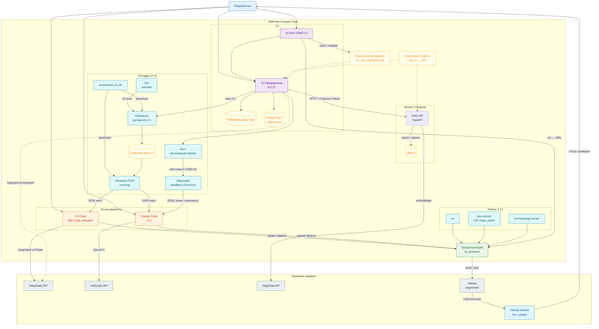

# Среда разработки

Схема показывает, как устроен локальный контур разработки `ai_scrivener`: рабочие места, AI-агенты, инструменты проверки, 1С-стенд, RAG-сервис и внешние сервисы. Диаграмма описывает именно среду разработки, а не промышленную топологию.



## 1. Компоненты

| Компонент | Назначение | Где |
|---|---|---|
| Kilo Code | AI-агент в VS Code: правки кода, документации и метаданных | Рабочая станция |
| DeepSeek v4 Flash | Модель Kilo Code для генерации и правок | Внешний API |
| Claude Code | CLI-агент для задач, ревью и пакетных изменений | Рабочая станция |
| Sonnet 5 | Модель Claude Code | Внешний API |
| Git-репозиторий | Единый источник кода, документов и требований | Рабочая станция |
| GitHub `origin/main` | Удалённый репозиторий и точка интеграции | GitHub |
| GitHub Actions | CI: pre-commit, линтеры и Python-тесты | GitHub |
| `uv` | Управление Python-окружением и зависимостями | Рабочая станция |
| `pre-commit` | Локальные проверки перед коммитом | Рабочая станция |
| `ruff`, `mypy`, `pytest` | Стиль, типы и тесты Python | Рабочая станция |
| `bsl-language-server` | Статический анализ BSL-кода | Рабочая станция |
| `screenshot_ocr.sh` | Захват окна 1С и выдача OCR-текста агенту | Рабочая станция |
| GStreamer `gst-launch-1.0` | Захват X11-окна в PNG | Рабочая станция |
| `xwininfo` | Поиск ID окна 1С | Рабочая станция |
| Tesseract OCR | Распознавание русского и английского текста (`rus+eng`) | Рабочая станция |
| `ibsrv` | Автономный сервер 1С: публикует базу для веб-клиента без Apache/nginx | Рабочая станция |
| Playwright | Headless Chromium: управляет веб-клиентом 1С программно (вход под разными пользователями, клики, DOM, скриншоты) — без участия человека, в отличие от десктопного клиента | Рабочая станция |
| 1C:EDT 2026.1.3 | Разработка расширения, сборка и валидация `.cfe` | Рабочая станция |
| 1С:Предприятие 8.3.27 | Исполнение базы и расширения | Рабочая станция |
| Файловая демо-база | Быстрый локальный стенд | Рабочая станция |
| PostgreSQL-демо-база | Серверный стенд, приближенный к эксплуатации | Рабочая станция |
| RAG API | Поиск и индексация, FastAPI | Docker Compose |
| Qdrant | Векторный индекс шаблонов и обязанностей | Docker Compose |
| GigaChat API | Эмбеддинги для RAG | Внешний API |
| Локальные секреты | `.env_0` → `.env`, `rag-service/.env`; в Git не попадают | Рабочая станция |
| Локальные артефакты | `.dt`, `.cfe`, `artifacts/extension-xml`; в Git не попадают | Рабочая станция |

## 2. Как идёт изменение

1. Разработчик ставит задачу одному агенту: Kilo Code в VS Code или Claude Code в терминале.
2. Агент правит файлы в общем рабочем дереве `ai_scrivener`.
3. Локально выполняются `make check` и, при изменении 1С, сборка/валидация в EDT.
4. Изменения коммитятся и пушатся в `origin/main`.
5. GitHub Actions прогоняет Python-проверки; 1С-проверки остаются локальными.
6. Для проверки расширения `.cfe` применяется к демо-базе; артефакты не коммитятся.

## 3. Правила работы с двумя агентами

- Оба агента работают с одним репозиторием и одним рабочим деревом. Не запускать их одновременно на одних и тех же файлах.
- Для параллельной работы использовать отдельные ветки или git worktree, а не две одновременные правки в одном каталоге.
- Kilo Code удобен для изменений в редакторе и навигации по проекту; Claude Code — для CLI-сценариев, пакетных правок и независимого ревью.
- Перед передачей задачи другому агенту зафиксировать состояние: `git status`, `git diff`, `make check`.
- Секреты и ключи не передаются агентам в промптах; используются только локальные `.env`-файлы.

## 4. Отладка UI 1С

Агенты не видят изображения, но читают OCR-текст. Для этого используется `scripts/debug/screenshot_ocr.sh`:

```bash
./scripts/debug/screenshot_ocr.sh --list          # список X11-окон
./scripts/debug/screenshot_ocr.sh --window 0x...  # конкретное окно
./scripts/debug/screenshot_ocr.sh                 # первое окно 1cv8
```

Зависимости: `tesseract` с языками `rus+eng`, GStreamer (`gst-launch-1.0`) и X11-утилита `xwininfo`. Скриншот сохраняется в `/tmp/kilo/1c-screen.png`, OCR-текст выводится в stdout.

Ограничение: Tesseract читает заголовки, поля, ошибки и пункты меню, но не понимает иконки и вёрстку.

Для толстого/тонкого клиента (десктопное приложение) это единственный доступный агенту способ видеть экран — нет инструмента ввода (`xdotool`), клики выполняет только человек. Для таких же проверок на той же базе есть альтернатива: `ibsrv` (автономный сервер 1С, входит в дистрибутив платформы) публикует базу как обычный веб-клиент на HTML/JS, без Apache/nginx — и им управляет Playwright (headless Chromium) полностью самостоятельно: вход под любым демо-пользователем, клики, поиск, чтение DOM, скриншоты — без участия человека. Подробности и рабочий пример — `guides/runbook.md` §2.5. Используется для сценариев, где нужно реально воспроизвести разные роли/права (например, негативные тесты доступа `tests/1c/test_access.md`), а не просто посмотреть текущий экран.

## 5. Границы автоматизации

- CI проверяет Python, YAML/JSON, требования, трассируемость и заглушки.
- CI не запускает EDT и не собирает `.cfe`: для этого нужны лицензия, платформа и локальная база.
- Проверка 1С-метаданных выполняется локально через EDT CLI и `CheckConfig`; это ручной шаг.
- RAG-сервис в разработке поднимается через Docker Compose; Qdrant и сервис не публикуются в интернет.
- GigaChat и DeepSeek вызываются по HTTPS; ключи хранятся вне репозитория.

## 6. Связанные документы

- `guides/development.md` — установка, команды, пре-коммит, EDT и локальный стенд.
- `guides/runbook.md` — запуск платформы, базы, EDT и RAG-сервиса.
- `guides/postgresql.md` — PostgreSQL для 1С.
- `guides/versioning.md` — источник истины, артефакты и релизный цикл.
- `docs/system-analysis/c4-model.md` — целевая архитектура системы.
