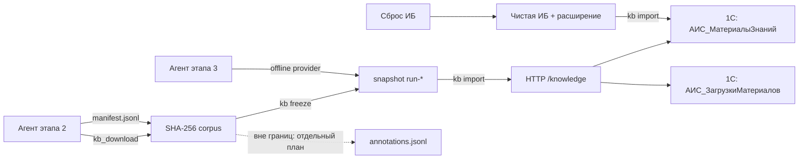

# План: внешнее SHA-256 хранилище знаний для `owner-9`

Дата: 2026-11-03
Статус: черновик к реализации (plan mode; код не изменялся)

Репозитории:

- расширение: `/home/igorvolk/PycharmProjects/ai_scrivener`;
- симулятор: `/home/igorvolk/PycharmProjects/ai-scrivener-enterprise-sim`.

## 1. Цель

Сделать так, чтобы скачанные агентами материалы:

1. переживали полный сброс ИБ и расширения (`db_admin init` / «Пересоздать базу с нуля»);
2. повторно импортировались в 1С идемпотентно, без дублей;
3. позволяли повторить этап 3 симулятора **без доступа агентов в интернет**;
4. подтверждали выполнение `owner-9`: провенанс, отчёт по каждому сотруднику, отсутствие выдуманных текстов.

## 2. Принятые решения

| № | Решение | Обоснование |
|---|---|---|
| D1 | Источник истины — внешний content-addressed store (SHA-256), вне ИБ | Переживает сброс; дедуп; проверка целостности |
| D2 | 1С — пересоздаваемая проекция: каталоги `АИС_МатериалыЗнаний` и `АИС_ЗагрузкиМатериалов` + HTTP-импорт | `owner-9` должен быть виден и проверяем в 1С |
| D3 | Штатные `Справочник.Файлы` / `ТомаХраненияФайлов` в MVP **не используются** | Настройки томов живут в ИБ и теряются при восстановлении из демо-`.dt`; API `РаботаСФайлами` требует проверки в базовой конфигурации |
| D4 | Метаданные — `manifest.jsonl` (append-only), байты — `blobs/sha256/ab/cd/<hash>` | Хеш = адрес; провенанс отдельно |
| D5 | Fan-out 2+2 hex-символа, каталоги создаются лениво | Достаточно до ~10 млн объектов; см. обсуждение |
| D6 | Офлайн-режим — отдельный провайдер поиска и запрет сети в коде агента | Воспроизводимость этапа 3 |
| D7 | Раздачу задач по сотрудникам для `owner-9` делает симулятор детерминированно | LLM не должен быть единственным оркестратором |
| D8 | Всё включается флагом `knowledge.enabled`, по умолчанию `false` | Безопасный поэтапный запуск |
| D9 | Материал и факт загрузки разделены: `АИС_МатериалыЗнаний` уникален по `Хеш`, `АИС_ЗагрузкиМатериалов` — по `(sha256, source_url, employee, task)` | Один файл у нескольких агентов не размножается; отчёты считаются по загрузкам |

## 3. Границы

Входит:

- CAS-хранилище, манифест, снапшоты, проверка и GC;
- инструменты агента для скачивания и регистрации материалов;
- офлайн-провайдер `search_internet`;
- каталоги `АИС_МатериалыЗнаний` и `АИС_ЗагрузкиМатериалов`, HTTP-импорт в расширении;
- детерминированная раздача задач `owner-9` и проверка завершения;
- тесты и приёмочный прогон на копии базы.

Не входит:

- назначение рубрик и рубрикаторный фильтр — отдельный план; здесь только резервируется append-only `annotations.jsonl` по `sha256` (см. §5.5);
- штатные тома хранения файлов 1С и предпросмотр вложений;
- шифрование, S3/MinIO, UI управления корпусом;
- юридическая экспертиза лицензий (фиксируем поле `Лицензия`, проверка — на стороне владельца).

## 4. Архитектура



Корпус: `/home/igorvolk/1C/ai_scrivener_corpus` (вне `database.base_path` и `database.backup_dir`).

```
ai_scrivener_corpus/
  blobs/sha256/ab/cd/<sha256>
  tmp/
  manifest.jsonl
  annotations.jsonl        # имя зарезервировано; в этом плане не создаётся
  retrieval_events.jsonl
  offline_misses.jsonl
  snapshots/run-YYYYMMDDTHHMMSS.json
  reports/<login>/<run>.json
```

## 5. Форматы и контракты

### 5.1. `config/enterprise.json` (симулятор)

```json
"knowledge": {
  "enabled": false,
  "corpus_dir": "/home/igorvolk/1C/ai_scrivener_corpus",
  "mode": "record",
  "max_file_mb": 50,
  "allowed_mime": ["application/pdf", "text/plain", "text/html", "application/vnd.openxmlformats-officedocument.wordprocessingml.document"],
  "allowed_ext": [".pdf", ".txt", ".html", ".docx"],
  "require_provenance": true
}
```

`mode`: `record` (сеть + запись), `offline` (только корпус), `verify` (проверка без запуска агентов).

### 5.2. Запись манифеста

```json
{
  "file_id": "uuid",
  "sha256": "64 hex",
  "size": 123456,
  "mime": "application/pdf",
  "original_name": "ГОСТ 2.101-2016.pdf",
  "stored_path": "blobs/sha256/ab/cd/<sha256>",
  "source_url": "https://...",
  "source_kind": "official|library|vendor|other",
  "authority": "Росстандарт",
  "published_at": "2016-01-01",
  "retrieved_at": "2026-11-03T07:00:00Z",
  "title": "ГОСТ 2.101-2016",
  "doc_type": "ГОСТ",
  "employee": "ГлавныйИнженер",
  "position": "Главный инженер",
  "task_id": "uuid",
  "license": "...",
  "status": "downloaded|verified|rejected",
  "notes": "..."
}
```

Один блоб может иметь несколько записей (разные URL/сотрудники). Это журнал **загрузок**, а не карточка файла. Импорт разделён: материал — upsert по `sha256`, загрузка — upsert по `(sha256, source_url, employee, task_id)`.

### 5.3. Каталог `АИС_МатериалыЗнаний` (файл)

Одна строка = один физический материал, уникальный по `Хеш`.

- `Наименование` (заголовок материала);
- `Хеш` (String 64, индекс);
- `Размер` (Number 15,0);
- `MIME` (String 100);
- `ПутьВХранилище` (String 500, относительный путь);
- `ВидДокумента` (String 100);
- `Статус` (String 30: `Проверен`, `Отклонён`);
- `Комментарий` (String 500).

`Сотрудник`, `Задача`, `ИсточникURL`, `Лицензия` в материал не входят: это провенанс загрузки.

### 5.3.1. Каталог `АИС_ЗагрузкиМатериалов` (факт загрузки)

Подчинён `АИС_МатериалыЗнаний` (`Owner`), одна строка = один факт загрузки материала сотрудником.

- `КодЗагрузки` (String 64, индекс) — SHA-256 от `(sha256, source_url, employee, task_id)`;
- `Наименование` — презентация, например `<сотрудник> / <дата>`;
- `Сотрудник` (`CatalogRef.Пользователи`);
- `Должность` (`CatalogRef.Должности`);
- `Задача` (`TaskRef.ЗадачаИсполнителя`);
- `ИсточникURL` (String 1000);
- `ВидИсточника` (String 50; enum — опционально);
- `АвторОрган` (String 300);
- `ДатаПубликации` (Date);
- `ДатаЗагрузки` (Date);
- `Лицензия` (String 200);
- `Статус` (String 30: `Загружен`, `Проверен`, `Отклонён`);
- `Комментарий` (String 500).

Несколько агентов, скачавших один файл, дают один материал и N загрузок. `owner-9` считает загрузки по сотруднику, RAG индексирует материал один раз, GC удаляет блоб только после исчезновения всех загрузок.

Рубрики в каталоги этого этапа не входят. Они появятся отдельным планом через `annotations.jsonl` и версионированный реестр; ТЧ каталога добавляется только вместе с ним.

Константа `АИС_КаталогКорпусаЗнаний` (String 500) — разрешённый корень для проверки путей.

### 5.4. HTTP-контракты (расширение)

- `POST /hs/ais-sim/knowledge/materials` — upsert материала по `Хеш`.
  Тело: `Хеш`, `Путь`, `Наименование`, `ВидДокумента`, `Статус`, `Комментарий`.
- `POST /hs/ais-sim/knowledge/downloads` — upsert факта загрузки по `(sha256, source_url, employee, task)`.
  Тело: `Хеш`, `ИсточникURL`, `Сотрудник`, `Должность`, `Задача`, `ВидИсточника`, `АвторОрган`, `ДатаПубликации`, `ДатаЗагрузки`, `Лицензия`, `Статус`, `Комментарий`.
- `GET /hs/ais-sim/knowledge/materials?sha256=&status=` — список/поиск материалов.
- `GET /hs/ais-sim/knowledge/downloads?sha256=&employee=&task=&status=` — загрузки.
- `POST /hs/ais-sim/knowledge/materials/status` — смена статуса материала.
- `POST /hs/ais-sim/knowledge/downloads/status` — смена статуса загрузки.
- `GET /hs/ais-sim/knowledge/summary?order=` — количество уникальных материалов по сотрудникам (по загрузкам) для `check`.

Правила:

- путь только относительный, канонизируется и обязан лежать под `АИС_КаталогКорпусаЗнаний`; `..`, абсолютные пути и symlink запрещены;
- `Хеш` обязателен, 64 hex;
- материал уникален по `Хеш`; загрузка уникальна по `КодЗагрузки`, который считается от `(sha256, source_url, employee, task_id)`;
- `Сотрудник` по умолчанию — текущий пользователь; импорт от сервисной учётной записи может указать явно;
- upsert выполняется под `БлокировкаДанных` по ключу; повторный вызов обновляет запись, но не создаёт дубль;
- `summary` считает `COUNT(DISTINCT Материал)` по загрузкам сотрудника, а не число строк материала.

### 5.5. Рубрики: резерв, не реализация

В этом плане рубрики **не назначаются** и **не хранятся** ни в манифесте, ни в каталоге, ни в HTTP-контрактах. Причина: без версионированного реестра рубрикаторов коды превращаются в непроверяемые строки, а жёсткий фильтр затем тиражирует ошибку.

Резервируется отдельный append-only файл:

```
corpus/annotations.jsonl
```

Будущая запись (контракт для отдельного плана, здесь не реализуется):

```json
{
  "sha256": "64 hex",
  "system": "ОКУД",
  "code": "<код из реестра>",
  "name": "<наименование из реестра>",
  "rubricator_version": "ОК 011-93:<дата редакции>",
  "parent_codes": ["<код родителя>"],
  "annotated_at": "2026-11-03T07:00:00Z",
  "annotator": "ГлавныйИнженер",
  "method": "llm|manual|import",
  "confidence": 0.0,
  "status": "proposed|accepted|rejected"
}
```

Инварианты:

- `manifest.jsonl` неизменяем и не содержит рубрик;
- аннотации ссылаются на `sha256` и не переписывают провенанс;
- код валидируется по реестру с явной версией; свободные коды не принимаются;
- повторная аннотация — новая строка, а не правка старой;
- офлайн-повтор и импорт в 1С от аннотаций не зависят.

## 6. Этапы реализации

### Этап 0. Предпосылки и фиксация

- [ ] Убедиться, что `owner-6.status == "completed"`, а `owner-9.status == "pending"`; не издавать `owner-9` до этого.
- [ ] Снять backup живой базы: `uv run python -m enterprise_sim.db_admin backup`.
- [ ] Создать каталог корпуса вне базы и backup-каталога, права `0750`.
- [ ] Добавить секцию `knowledge` в `config/enterprise.json` с `enabled=false`.

### Этап 1. CAS + манифест (симулятор)

Файлы (новые):

- `src/enterprise_sim/knowledge/__init__.py`
- `src/enterprise_sim/knowledge/corpus.py`
- `src/enterprise_sim/knowledge/manifest.py`
- `src/enterprise_sim/knowledge/cli.py`
- `tests/test_knowledge_corpus.py`
- `tests/test_knowledge_manifest.py`

Задачи:

- [ ] `corpus.put_file(src, meta) -> record`: потоковый SHA-256, запись в `tmp/`, `fsync`, атомарный `os.replace`; при существующем блобе — проверить размер и не перезаписывать.
- [ ] `corpus.read/verify/verify_all`: пересчёт хеша, обнаружение missing/mismatch.
- [ ] Безопасность: `resolve()` под корнем, запрет symlink/traversal, лимит размера, MIME/расширение по allowlist.
- [ ] `manifest.append(record)`: `fcntl.flock`, JSONL, `fsync`; `load`, `find`, `snapshot(tag)`, `gc(dry_run=True)`.
- [ ] `retrieval_events.append/load`: запрос, провайдер, результаты, выбранный URL, `sha256`, агент, время.
- [ ] CLI: `put`, `verify`, `freeze`, `gc`, `status`.
- [ ] Тесты: дедуп, атомарность при обрыве, traversal, лимиты, конкурентная запись, snapshot, GC.

### Этап 2. Инструменты агента и офлайн-режим (симулятор)

Файлы:

- `src/enterprise_sim/config.py` — `KnowledgeSettings`;
- `src/enterprise_sim/deepseek_agent.py` — провайдер поиска и новые tools;
- `src/enterprise_sim/prompts/system.md` — правила провенанса;
- `tests/test_offline_search.py`, `tests/test_knowledge_tools.py`.

Задачи:

- [ ] `KnowledgeSettings`: `enabled`, `corpus_dir`, `mode`, лимиты; env-override `AIS_SIM_KNOWLEDGE_MODE`, `AIS_SIM_CORPUS_DIR`.
- [ ] Абстракция провайдера `search_internet`; `record` — текущий `ddgs`, `offline` — только `retrieval_events`/манифест, `verify` — без сети.
- [ ] В `offline` при промахе писать в `offline_misses.jsonl` и возвращать явный текст «в офлайн-корпусе не найдено»; сетевой вызов не выполнять.
- [ ] Tool `kb_download(url, title, authority, published_at, license, doc_type, notes)`: только `http/https`, лимит редиректов и размера, стриминг в CAS, запись в манифест, возврат `sha256` и относительного пути. Рубрики не передаются — их назначение вынесено в отдельный план (§5.5).
- [ ] Tool `kb_register_material` — регистрация уже лежащего локально файла (ручной импорт).
- [ ] Tool `kb_list_materials` — свои материалы и пробелы.
- [ ] Промпт: не выдумывать тексты; обязательны источник, автор/орган, дата; при отсутствии — фиксировать пробел.
- [ ] Тесты: офлайн-хит/промах, запрет сети (monkeypatch `ddgs`), отказ по MIME/размеру, дедуп.

### Этап 3. Каталог и импорт в 1С (расширение)

Файлы:

- `src/Catalogs/АИС_МатериалыЗнаний/АИС_МатериалыЗнаний.mdo` — новый;
- `src/Catalogs/АИС_ЗагрузкиМатериалов/АИС_ЗагрузкиМатериалов.mdo` — новый, подчинён материалам;
- `src/CommonModules/АИС_МатериалыЗнаний/Module.bsl` — новый;
- `src/Constants/АИС_КаталогКорпусаЗнаний/АИС_КаталогКорпусаЗнаний.mdo` — новый;
- `src/HTTPServices/АИС_Симулятор/АИС_Симулятор.mdo`, `Module.bsl` — маршруты;
- роли `АИС_ДолжностноеЛицо`, `АИС_СервисныйПользователь`, `АИС_АдминистраторСистемы` — права;
- `docs/data-model.md` — описание каталогов.

Задачи:

- [ ] Создать `АИС_МатериалыЗнаний` по §5.3: уникальность по `Хеш`, индекс по `Хеш`.
- [ ] Создать `АИС_ЗагрузкиМатериалов` по §5.3.1 с `Owner` = материал; индексы по `КодЗагрузки`, `Сотрудник`, `Задача`.
- [ ] Константа `АИС_КаталогКорпусаЗнаний`.
- [ ] Модуль: `ЗарегистрироватьМатериал`, `ЗарегистрироватьЗагрузку`, `НайтиМатериалПоХешу`, `ЗагрузкиПоСотруднику`, `СводкаПоСотрудникам`, `ПроверитьПуть`.
- [ ] HTTP-маршруты по §5.4; тонкие обработчики, логика в модуле.
- [ ] Идемпотентность: материал — upsert по `Хеш`, загрузка — upsert по `КодЗагрузки`; обе операции под `БлокировкаДанных` с повторным поиском после блокировки.
- [ ] Проверка пути: канонизация, запрет `..`, абсолютных путей и symlink; файл должен существовать.
- [ ] Пересчитать SHA-256 средствами платформы, если доступно; иначе сверить размер и хеш из манифеста (независимая проверка — `kb verify`).
- [ ] EDT build/validate; загрузить расширение на копию базы; прогнать существующие тесты.

### Этап 4. Интеграция `owner-9` (симулятор + конфиг)

Файлы:

- `config/enterprise.json` — `completion` для `owner-9`, блок `knowledge`;
- `src/enterprise_sim/owner_orders.py` — раздача задач, capability gate, `check`;
- `prompts/system.md` — роль CEO при `owner-9`;
- `tests/test_owner_orders_knowledge.py`.

Задачи:

- [ ] Добавить `owner-9.completion`: `requires_document: true`, `requires_knowledge: true`.
- [ ] `_dispatch_knowledge_tasks(data, order)`: при текущем изданном `owner-9` создать по одной задаче каждому сотруднику (идемпотентно по `Основание` + заголовку); в описании — требования к источникам и отчёту.
- [ ] Capability gate для `owner-9`: разрешить `search_internet` (только в `record`), `kb_download`, `kb_register_material`, `kb_list_materials`, `create_document`, `complete_task`, `list_documents`, `read_document`; запретить `create_employee`, `create_department`, `create_task` из LLM.
- [ ] `check`: все задачи сотрудников завершены; у каждого есть ≥1 загрузка (уникальный материал); отчётный документ связан с приказом; `GET /knowledge/summary` без пробелов.
- [ ] Отчёт сотрудника — `create_document` вида «Отчёт о наполнении хранилища» с перечнем: что загружено, откуда, пробелы.
- [ ] Тесты с моками: 2–3 сотрудника, полный и неполный набор, повторный прогон без дублей материалов и загрузок.

### Этап 5. Сброс, импорт и офлайн-приёмка

- [ ] Снять backup, развернуть копию, выполнить `db_admin init` на копии.
- [ ] `kb import --snapshot <run>`: пройти манифест, вызвать `POST /knowledge/materials` (upsert по `Хеш`), затем `POST /knowledge/downloads` (upsert по `КодЗагрузки`); проверить идемпотентность повторным запуском.
- [ ] Сверить количество и хеши: `kb verify`, `GET /knowledge/materials` (уникальные хеши), `GET /knowledge/downloads` (факты по сотрудникам), `GET /knowledge/summary`.
- [ ] Переключить `knowledge.mode=offline`, заблокировать сеть в тесте (monkeypatch / сетевой namespace), прогнать этап 3 на копии.
- [ ] Приёмочный сценарий: `owner-9` → задачи всем → материалы и загрузки → отчёты → `check`; затем сброс → импорт → офлайн-повтор без сети.
- [ ] Убедиться, что `db_admin init` не удаляет и не изменяет `corpus_dir`.

## 7. Поток сброса и повторного прогона

1. Этап 2: агенты пишут в `corpus_dir`, манифест и `retrieval_events`.
2. `kb freeze --tag run-...` — снапшот манифеста и хешей.
3. `db_admin init` — ИБ заменяется, корпус не трогается.
4. `kb import --snapshot run-...` — каталоги материалов и загрузок восстанавливаются идемпотентно.
5. `knowledge.mode=offline` — агенты используют только корпус; сеть недоступна.
6. Повторный прогон этапа 3 детерминирован по снапшоту.

## 8. Валидация

Симулятор:

```bash
uv run pytest
uv run ruff check .
uv run mypy src
uv run python -m enterprise_sim.knowledge verify --corpus <dir>
```

Расширение:

```bash
# EDT build/validate
# загрузка на копию базы через scripts/load_extension.sh
# существующие HTTP-тесты и регрессия
```

Приёмка:

- `owner-9` не издан, пока `owner-6` не завершён;
- полный сброс → импорт → офлайн-прогон без сетевых вызовов;
- повторный импорт не создаёт дублей;
- один и тот же файл у нескольких сотрудников даёт один материал по `sha256` и N загрузок;
- у каждого сотрудника есть провенанс: источник, автор/орган, дата, лицензия;
- в `manifest.jsonl` нет ключа `rubrics`, а `annotations.jsonl` этим планом не создаётся и не изменяется;
- `check` блокирует завершение при отсутствии загрузок или отчёта.

## 9. Риски и меры

| Риск | Мера |
|---|---|
| API `РаботаСФайлами` в базовой конфигурации не подтверждён | MVP не использует штатные `Файлы`; привязка — отдельный этап после проверки в EDT |
| 1С-сервер не читает путь корпуса | один хост; добавить права на чтение; fallback — HTTP-загрузка base64 |
| Лицензии на ГОСТ/классификаторы | приватный корпус, поле `Лицензия`, запрет публикации в git |
| Осиротевшие блобы после сброса | GC только по манифесту, `dry-run` по умолчанию |
| Агент скачивает произвольные файлы | allowlist MIME/расширений, лимит размера, запрет исполняемых, карантин `tmp/` |
| LLM выдумывает источник | обязательные поля провенанса; `kb_download` без URL не создаёт запись |
| Гонки при записи | `flock` на манифест, атомарный `replace`, уникальность по хешу; в 1С — `БлокировкаДанных` и повторный поиск для материала и загрузки |
| Разрастание корпуса | дедуп, `kb gc`, снапшоты, отчёт по объёму |
| Рубрики «прилипают» к этапу хранения | В манифесте, каталоге и HTTP их нет; только `annotations.jsonl` в отдельном плане |

## 10. Порядок внедрения

1. Этапы 1–2 в симуляторе, флаг выключен, тесты.
2. Этап 3 в расширении на копии базы, EDT build/validate.
3. Этап 4: конфиг `owner-9`, dry-run на копии.
4. Завершить `owner-6`, затем издать `owner-9`.
5. Зафиксировать снапшот, выполнить сброс и офлайн-повтор.
6. Только после приёмки включать `knowledge.enabled` на рабочей базе.

## 11. Открытые решения (значения по умолчанию)

- «Файловое хранилище» для `owner-9` = внешний корпус + каталоги `АИС_МатериалыЗнаний` и `АИС_ЗагрузкиМатериалов`; штатные `Справочник.Файлы` — не в MVP.
- Ключ материала: `sha256` (одна строка на файл).
- Ключ загрузки: `(sha256, source_url, employee, task_id)` (одна строка на факт загрузки).
- Лимит файла: 50 МБ; список MIME/расширений — из §5.1.
- Отчёт сотрудника обязателен; агрегированный отчёт CEO — документ-результат приказа.
- Рубрики: в этом плане отсутствуют; зарезервирован `annotations.jsonl`, назначение и реестр — отдельный план.
- Сроки хранения и квоты — не ограничиваем в MVP.
