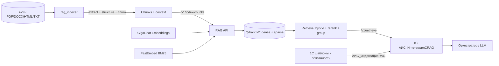

# План: эффективный RAG на Qdrant с интеграцией в 1С

Дата: 2026-11-04
Статус: проект, готов к реализации
Связанные документы: `plans/implementation_plan.md#7`, `docs/design-decisions.md#18`, `reviews/critical-review.md#3`, `plans/1793687400076-knowledge-corpus-storage.md`, `docs/system-analysis/c4-model.md`.

## 1. Цель

Поднять качество RAG с «наивного dense-поиска по чанкам» до измеримого retrieval-контура:

- корпус знаний из CAS реально попадает в индекс;
- шаблоны и должностные обязанности индексируются из 1С и обновляются автоматически;
- поиск использует структуру документа, гибридный dense+sparse поиск, rerank и группировку по источнику;
- 1С получает кандидатов через `АИС_ИнтеграцияСRAG` и не падает при недоступности RAG;
- качество подтверждается golden set и метриками, а не тремя ручными примерами.

Критерии успеха (уточняются после baseline):

| Область | Метрика | Цель |
|---|---|---|
| Выбор шаблона | Recall@10 / MRR@10 | ≥ 0,90 / ≥ 0,70 на 100 запросах |
| Корпус знаний | Recall@10 / nDCG@10 | ≥ 0,85 / ≥ 0,70 на 100 запросах |
| Точные идентификаторы | Recall@10 по запросам с ГОСТ/кодом/пунктом | ≥ 0,90 |
| Отсутствие ответа | precision «не найдено» | ≥ 0,90 |
| Latency `/v1/retrieve` | p95 при rerank on, CPU | < 1,5 с |
| Надёжность | падение RAG не роняет задачу 1С | 100% fallback |

## 2. Принятые решения

| № | Решение |
|---|---|
| D1 | Векторное хранилище — **Qdrant**. pgvector не добавляем, PostgreSQL 1С не трогаем. |
| D2 | RAG-сервис остаётся **retrieval-only**: генерация ответа и выбор шаблона — в оркестраторе/LLM, не в RAG. |
| D3 | Извлечение и чанкинг корпуса — отдельный Python-пакет `rag_indexer` внутри `rag-service` с optional-зависимостями; API-сервис остаётся лёгким. |
| D4 | Извлечение: Docling как основной для PDF/DOCX/HTML, OCR для сканов; `python-docx`/`trafilatura` как точечные fallback-экстракторы. |
| D5 | Чанкинг — структурный, по разделам/пунктам, с таблицами и context header. Фиксированные 1000 символов остаются только как fallback. |
| D6 | Поиск — hybrid dense + sparse BM25 (`Qdrant/bm25`, `language="russian"`), fusion RRF, rerank `BAAI/bge-reranker-v2-m3-int8`, группировка по `document_key`. |
| D7 | Новая коллекция `v2` с named vectors `dense`/`sparse`, payload-индексами и alias `ai_scrivener_knowledge_current`. Переиндексация — в новую коллекцию с атомарным alias-swap. |
| D8 | 1С-интеграция: `АИС_ИнтеграцияСRAG` + регламентное задание `АИС_ИндексацияRAG` + регистр состояний. Дельта — по хешу содержимого, не по `ДатаИзменения`. |
| D9 | Индексируются только утверждённые шаблоны, активные обязанности и материалы корпуса со статусом `downloaded`/`verified`; `rejected` исключается. |
| D10 | Публикация/утверждение шаблона вызывает синхронный upsert; регламентное задание остаётся догоняющей синхронизацией. |
| D11 | При недоступности RAG 1С использует существующий детерминированный поиск шаблонов. |
| D12 | В аудит пишутся параметры запроса, ID/score результатов и ошибки; полные тексты документов не логируются. |
| D13 | OCR — единый интерфейс `rag_indexer.ocr.OcrEngine`: основной `PaddleOcrEngine`, fallback `YandexOcrEngine`, page-level policy; downstream не зависит от выбранного движка. |

## 3. Границы

Входит:

- Python: retrieval, sparse/dense, rerank, группировка, parent expansion, контракты API, тесты.
- Python: `rag_indexer` — CAS → извлечение → структура → чанки → вызов RAG API.
- Qdrant: новая схема коллекции, alias-swap, payload-индексы, snapshot/rollback.
- Eval: golden set, метрики, сравнение режимов.
- 1С: константы, `АИС_ИнтеграцияСRAG`, `АИС_ИндексацияRAG`, регистр состояний, интеграция в `АИС_Уведомления`, кнопка полной переиндексации, права.
- Конфигурация, Docker, runbook, обновление требований/трассируемости.

Не входит:

- LLM-генерация ответа внутри RAG (`/v1/answer`).
- pgvector и изменения PostgreSQL 1С.
- Полный ACL/FR-041, RAPTOR, GraphRAG, proposition chunking, late chunking.
- Замена GigaChat Embeddings на self-hosted модель.
- Полноценная админ-панель; только кнопка полной переиндексации.

## 4. Текущее состояние и разрывы

| Разрыв | Факт | Следствие |
|---|---|---|
| Корпус не индексируется | RAG принимает только `text`; в `rag-service/pyproject.toml` нет экстракторов | PDF/DOCX/HTML корпуса не попадают в поиск |
| Нет клиента RAG в 1С | `АИС_ИнтеграцияСRAG`, `АИС_ИндексацияRAG` отсутствуют | 1С не может искать и обновлять индекс |
| Наивный чанкинг | `normalize_text` схлопывает переводы строк; резка по 1000 символов | Рвутся пункты, таблицы, списки |
| Только dense | Нет sparse/BM25, rerank, group-by-source | Шумный top-10, один документ занимает всю выдачу |
| Нет порога | `search_min_score: 0.0` | Всегда возвращается top-k, нет «не найдено» |
| Неатомарная индексация | `upsert`/`replace` удаляют перед вставкой | Падение оставляет частичный/пустой индекс |
| Нет eval | Только ручная проверка на 3 шаблонах | Нельзя измерить улучшение |

## 5. Целевая архитектура



Ключевой принцип: **1С и индексатор не ходят в Qdrant напрямую**. Единственный владелец Qdrant — RAG API; это сохраняет единый embedding pipeline и упрощает миграции.

## 6. Контракты

### 6.1. `POST /v1/retrieve`

Новый endpoint для 1С и оркестратора. `/v1/search` сохраняется для обратной совместимости и тестов.

Запрос:

```json
{
  "query": "текст задачи или документа",
  "top_k": 10,
  "candidate_k": 50,
  "group_by_source": true,
  "group_size": 3,
  "rerank": true,
  "mmr_lambda": 0.0,
  "include_parent": true,
  "filters": {
    "source_types": ["template_internal"],
    "doc_types": ["Приказ"],
    "statuses": ["verified"],
    "active": true,
    "position_ids": [],
    "folders": [],
    "employees": [],
    "purposes": []
  }
}
```

Ответ:

```json
{
  "query": "...",
  "results": [
    {
      "source_type": "template_internal",
      "source_id": "uuid",
      "document_key": "template_internal:uuid",
      "title": "Шаблон приказа",
      "score": 0.87,
      "score_type": "rerank_sigmoid",
      "metadata": {},
      "chunks": [
        {
          "chunk_index": 0,
          "text": "...",
          "embedding_text": "...",
          "score": 0.87,
          "section_path": ["4", "4.2"],
          "clause": "4.2.1",
          "page_start": 12,
          "page_end": 13,
          "kind": "text",
          "parent_id": "..."
        }
      ]
    }
  ],
  "diagnostics": {
    "candidates": 50,
    "returned": 5,
    "dense_hits": 50,
    "sparse_hits": 50,
    "rerank_ms": 120,
    "retrieval_ms": 30
  }
}
```

Правила:

- `top_k` в `/v1/retrieve` — число документов после группировки; в старом `/v1/search` — число чанков. `group_size` — чанков на документ.
- `score` — итоговая оценка: `sigmoid(rerank)` при rerank, иначе dense score (dense-only) или RRF score (hybrid). Тип оценки возвращается в `score_type`.
- `search_min_score` применяется к итоговому score; для RRF-режима без rerank порог по умолчанию не применяется.
- `include_parent` — подтягивает все чанки с тем же `parent_id` в пределах `context_max_tokens`.
- `mmr_lambda=0` отключает MMR; включается только после eval.
- При пустом результате возвращается `results=[]`, а не случайный top-k.

### 6.2. `POST /v1/index/chunks`

Новый endpoint для `rag_indexer`. 1С продолжает использовать существующие `/v1/index/upsert` и `/v1/index/replace`.

```json
{
  "source_type": "knowledge_material",
  "document": {
    "source_id": "sha256",
    "version": "2026-01-01",
    "title": "ГОСТ 2.101-2016",
    "metadata": {
      "doc_type": "ГОСТ",
      "authority": "Росстандарт",
      "source_url": "https://...",
      "published_at": "2016-01-01",
      "effective_from": "2017-01-01",
      "status": "verified",
      "mime": "application/pdf",
      "path": "blobs/sha256/ab/cd/<sha256>"
    }
  },
  "chunks": [
    {
      "index": 0,
      "text": "...",
      "embedding_text": "Документ: ...\nРаздел: ...\nПункт: ...\nТекст: ...",
      "section_path": ["4", "4.2"],
      "clause": "4.2.1",
      "page_start": 12,
      "page_end": 13,
      "kind": "text",
      "parent_id": "sha256:4.2",
      "char_start": 0,
      "char_end": 900
    }
  ]
}
```

Ответ: `{source_type, source_id, version, indexed_chunks}`.

### 6.3. Qdrant payload и коллекция

Коллекция: `ai_scrivener_knowledge_v2_<timestamp>`, alias `ai_scrivener_knowledge_current`.

Named vectors:

- `dense`: 2560, cosine, GigaChat `EmbeddingsGigaR`.
- `sparse`: BM25, `modifier=IDF`, `Qdrant/bm25`, `language="russian"`.

Payload:

- `source_type`, `source_id`, `version`, `document_key`, `title`, `chunk_index`
- `text`, `embedding_text`
- `section_path`, `section_text`, `clause`, `page_start`, `page_end`, `kind`, `parent_id`
- `char_start`, `char_end`
- `doc_type`, `authority`, `published_at`, `effective_from`, `status`, `active`
- `position_ids`, `folders`, `employees`, `purposes`
- `document_hash`, `extraction_version`, `chunker_version`, `embedding_model`, `indexed_at`
- `metadata` — исходный словарь

Payload-индексы: `source_type`, `source_id`, `document_key`, `doc_type`, `active`, `status`, `authority`, `position_ids`, `parent_id`, `kind`, `page_start`, `metadata.folders`, `metadata.employees`, `metadata.purposes`, `effective_from`.

Значения `source_type`:

| `source_type` | Источник | `source_id` |
|---|---|---|
| `template_internal` | `Справочник.ШаблоныВнутреннихДокументов` | UUID |
| `template_incoming` | `Справочник.ШаблоныВходящихДокументов` | UUID |
| `template_outgoing` | `Справочник.ШаблоныИсходящихДокументов` | UUID |
| `obligation` | `Справочник.АИС_ДолжностныеОбязанности` | UUID |
| `knowledge_material` | материал CAS | SHA-256 |

Point ID: `uuid5("ai-scrivener:{source_type}:{source_id}:{version}:{chunk_index}")`.

### 6.4. 1С: константы и регистр

Константы:

| Константа | Тип | Назначение |
|---|---|---|
| `АИС_АдресRAGСервиса` | String 200 | `http://127.0.0.1:8080` |
| `АИС_ТокенRAGСервиса` | String 200 | `X-Service-Token` |
| `АИС_ТаймаутRAGСервиса` | Number 5,0 | таймаут HTTP, сек |
| `АИС_ПовторыRAGСервиса` | Number 2,0 | число повторов |
| `АИС_RAGВключён` | Boolean | глобальный выключатель, старт `false` |
| `АИС_МаксимальнаяДлинаЗапросаRAG` | Number 6,0 | обрезка query, символов |

Регистр сведений `АИС_СостоянияИндексации`:

- измерения: `ТипИсточника` (String 50), `Идентификатор` (String 64);
- ресурсы: `ХешСодержимого` (String 64), `ДатаИндексации` (Date), `Статус` (String 20), `Ошибка` (String 1000).

## 7. Этапы

### Этап 0. Baseline, контракты, защита от регрессий

- [ ] Зафиксировать решения D1–D12 в `docs/design-decisions.md` и обновить `docs/system-analysis/c4-model.md`.
- [ ] Снять snapshot Qdrant и сохранить копию `manifest.jsonl` (без дублирования блобов корпуса).
- [ ] Создать golden set для шаблонов: 50–100 запросов, 20–30 «не найдено»; для корпуса — каркас и список целевых материалов.
- [ ] Реализовать `rag_service.eval` с режимами `dense`, `hybrid`, `hybrid_rerank`; снять baseline текущего сервиса.
- [ ] Добавить в `config/parameters.yaml` и `parameters.schema.json` параметры из §8; обновить тесты конфигурации.
- [ ] Зафиксировать API-контракты §6 в `docs/design-decisions.md` и тестах.

**Готово, когда:** есть baseline-цифры, golden set версионирован, конфигурация валидируется, snapshot снят.

### Этап 1. Retrieval core

- [ ] Добавить `fastembed` и модели `Qdrant/bm25` (russian) и `BAAI/bge-reranker-v2-m3-int8`; кэш моделей через volume. `avg_len` для BM25 выставить по фактическому среднему размеру чанка из статистики индексатора, а не оставлять 256 по умолчанию.
- [ ] Реализовать `sparse.py`, `rerank.py`, `fusion.py`, `retrieval.py`; протоколы для тестируемости.
- [ ] Перейти на коллекцию `v2` с named vectors `dense`/`sparse`, payload-индексами и alias.
- [ ] Реализовать `ensure_alias`, `create_versioned_collection`, `switch_alias`; startup падает с понятной ошибкой, если alias указывает на несовместимую размерность.
- [ ] Реализовать `/v1/retrieve`: hybrid prefetch + RRF, rerank, sigmoid, group-by-source, `group_size`, parent expansion, diagnostics.
- [ ] Оставить `/v1/search` совместимым; внутри использовать тот же retrieval, но вернуть плоский список чанков.
- [ ] Расширить `/health`: alias, target collection, points_count, sparse/rerank готовность.
- [ ] Тесты: fusion, rerank fallback, group-by-source, parent expansion, фильтры, пустой результат, alias-switch.
- [ ] Сравнить на golden set: dense vs hybrid vs hybrid+rerank; зафиксировать выигрыш.

**Готово, когда:** `/v1/retrieve` работает на v2, метрики гибрида/rerank лучше baseline, alias-switch и rollback проверены.

### Этап 2. Индексатор корпуса

- [ ] Добавить пакет `rag-service/src/rag_indexer/` и optional-группу зависимостей `indexer` (docling, python-docx, trafilatura, razdel, tiktoken).
- [x] Реализовать `Block`/`ExtractedDocument`, `PdfExtractor`, page triage и `LineToParagraphMerger`.
- [x] Реализовать DOCX/HTML/TXT экстракторы и `DocumentExtractor` в тот же `ExtractedDocument`; таблицы и колонки требуют доработки.
- [x] Реализовать `rag_indexer.pdf`: `TextLayerReport` и `detect_pdf_text_layer` для page-level triage «есть текстовый слой / нужен OCR»; опциональная зависимость `indexer`.
- [x] Реализовать `rag_indexer.ocr`: `OcrEngine`/`OcrDocument`, `PaddleOcrEngine` (основной), `YandexOcrEngine` (fallback), `FallbackOcrEngine` с page-level policy; опциональная зависимость `ocr-paddle`.
- [x] Реализовать `LineToParagraphMerger`: bbox, вертикальные интервалы, отступы, нумерация, переносы; колонки и таблицы требуют доработки.
- [x] Добавить фильтр повторяющихся колонтитулов, номеров страниц и boilerplate: определять повторяющиеся строки по страницам/позиции (верх/низ), удалять до склейки, сохранять удалённое в `metadata` для аудита; проверка на П-6 и 20–30 PDF.
- [x] Реализовать `StructureBuilder`: заголовки, уровни разделов и путь секции; сложная юридическая нумерация пока базовая.
- [x] Реализовать `ClauseAwareChunker`: context header, `embedding_text`, section path, clause, split long by sentences, merge small tail; таблицы пока как отдельные блоки.
- [ ] Кэш извлечения и чанков по `sha256 + extractor_version + chunker_version`; state-файл для идемпотентности.
- [ ] CLI: `python -m rag_indexer index|validate|stats` с `--corpus-dir`, `--manifest`, `--rag-url`, `--token`, `--full`, `--limit`, `--dry-run`, `--statuses`.
- [ ] Реализовать `/v1/index/chunks` и батчевую индексацию; `DELETE` для исчезнувших материалов.
- [ ] Dockerfile/профиль `rag-indexer`; corpus volume read-only; сеть только к RAG API.
- [ ] Пилот на 20–30 материалах: проверить заголовки, таблицы, сканы, кодировки; замерить chunk integrity.
- [ ] Собрать knowledge golden set: 50–100 запросов с ожидаемыми `sha256`/пунктом, включая точные идентификаторы и «не найдено».
- [ ] После пилота — полная индексация корпуса и eval по knowledge golden set.

**Готово, когда:** корпус индексируется идемпотентно, пилотные запросы находят нужные пункты, повторный запуск не создаёт дублей, ошибки извлечения видны в отчёте.

### Этап 2.5. Качество чанкинга и контекста

- [ ] Включить `include_parent` для корпуса; проверить, что LLM получает полный пункт, а не обрывок.
- [ ] Добавить `status`/`authority`/`published_at`/`effective_from` в фильтры и буст официальных источников.
- [ ] Включить MMR (`mmr_lambda` 0,6–0,8) только если eval показывает рост nDCG/Recall без падения точности.
- [ ] Проверить overlap-дубли и соседние чанки; при необходимости — dedup/merge.
- [ ] Зафиксировать `chunker_version` и правило полной переиндексации при его изменении.

**Готово, когда:** knowledge golden set достигает целевых метрик, ручная выборка 20–30 ответов не показывает обрывков пунктов и таблиц.

### Этап 3. Интеграция с 1С

- [ ] Добавить константы, регистр `АИС_СостоянияИндексации`, общий модуль `АИС_ИнтеграцияСRAG`, регламентное задание `АИС_ИндексацияRAG` в `Configuration.mdo`.
- [ ] Реализовать HTTP-клиент: разбор URL, host/port, `X-Service-Token`, таймаут, retry на сеть/5xx, JSON.
- [ ] Реализовать `Поиск`, `ИндексироватьШаблон`, `ИндексироватьОбязанность`, `УдалитьДокумент`, `ПолнаяПереиндексация`, `ПроверитьДоступность`. Текст шаблона: `Наименование + Заголовок + ВидДокумента + КомментарийКШаблону + ТЧ АИС_Плейсхолдеры`. Текст обязанности: `Description + Текст + ТипТриггера + ТипДействия + Характеристика + ТребуемыйВидДокумента + Должность`.
- [ ] Реализовать `ВыполнитьРегламентнуюИндексацию`: утверждённые шаблоны трёх справочников + активные обязанности; хеш содержимого; upsert изменённых; delete исчезнувших; состояние в регистре. Расписание задания — каждые 5 минут; при `АИС_RAGВключён=false` задание завершается без вызовов.
- [ ] Синхронно индексировать шаблон после `УтвердитьШаблон_POST` (`Статус="Утверждён"`); ошибка RAG не отменяет утверждение.
- [ ] В `АИС_Уведомления` заменить прямой вызов `НайтиШаблоныВнутреннихДокументов` на RAG-поиск с deterministic fallback; добавить `Score` в JSON кандидатов. Query = `ВидДокумента + " " + Заголовок + " " + Содержание`, обрезка до `АИС_МаксимальнаяДлинаЗапросаRAG`; фильтры — `source_types=["template_internal"]`, `doc_types=[ВидДокумента]`, `active=true`.
- [ ] Добавить кнопку «Переиндексировать RAG» в `DataProcessor.АИС_Шаблоны` (админ/Программист 1С).
- [ ] Права: `АИС_СервисныйПользователь` — чтение шаблонов/обязанностей, константы, регистр; `АИС_АдминистраторСистемы` — полная переиндексация.
- [ ] Аудит: `АИС_ИсторияДействийИИ` — параметры запроса, ID/score, ошибка, длительность; без полного текста. Для записи использовать/создать тип действия `ПоискRAG` в `АИС_ТипыДействий` (данные, не метаданные).
- [ ] EDT build/validate, `CheckModules`, сценарий `tests/1c/test_rag.md` на копии ИБ.

**Готово, когда:** 1С индексирует шаблоны/обязанности, поиск возвращает кандидатов, RAG down даёт fallback, полная переиндексация идемпотентна, права проверены.

### Этап 4. Раскатка и эксплуатация

- [ ] Shadow mode: 1С вызывает RAG, но использует deterministic-кандидатов; сравнить на 20–30 задачах.
- [ ] Включить RAG-first с fallback в тестовой ИБ; замерить latency/качество.
- [ ] Полная индексация корпуса; проверить `/health`, points_count, alias.
- [ ] Snapshot Qdrant, backup, репетиция rollback: alias на предыдущую коллекцию, `АИС_RAGВключён=false`.
- [ ] Мониторинг: ошибки 5xx, пустые результаты, latency, размер индекса, staleness.
- [ ] Обновить `README.md`, `guides/runbook.md`, `docs/requirements/traceability_matrix.md`, `docs/system-analysis/c4-model.md`.
- [ ] Зафиксировать метрики до/после и решение о включении по умолчанию.

**Готово, когда:** метрики достигнуты, rollback проверен, документация обновлена, RAG включён в тестовой ИБ.

## 8. Конфигурация

Добавить в `rag`-секцию `config/parameters.yaml` и `parameters.schema.json`:

| Параметр | Значение по умолчанию | Назначение |
|---|---|---|
| `top_k` | 10 | документов в ответе `/v1/retrieve` |
| `candidate_k` | 50 | кандидатов до rerank |
| `group_by_source` | true | группировка по документу |
| `group_size` | 3 | чанков на документ |
| `hybrid_enabled` | true | dense + sparse |
| `rerank_enabled` | true | cross-encoder rerank |
| `rerank_model` | `BAAI/bge-reranker-v2-m3-int8` | модель rerank |
| `rerank_batch_size` | 16 | батч rerank |
| `sparse_model` | `Qdrant/bm25` | sparse-модель |
| `sparse_language` | `russian` | стеммер/стоп-слова BM25 |
| `mmr_lambda` | 0.0 | 0 — выключено |
| `include_parent` | true | подтягивать parent-чанки |
| `context_max_tokens` | 6000 | бюджет контекста |
| `query_max_chars` | 4000 | обрезка запроса |
| `search_min_score` | 0.0 | калибруется по eval |
| `collection_alias` | `ai_scrivener_knowledge_current` | alias Qdrant |
| `chunk_target_tokens` | 350 | целевой размер |
| `chunk_max_tokens` | 600 | максимум |
| `chunk_min_tokens` | 80 | минимум |
| `chunk_overlap_sentences` | 1 | overlap внутри пункта |
| `index_batch_size` | 64 | батч индексации |
| `hnsw_ef` | 128 | качество HNSW-поиска |

Старые `chunk_size_chars`/`chunk_overlap_chars` сохранить для обратной совместимости и fallback; пометить как deprecated после перехода на структурный чанкер.

## 9. Отказы и fallback

| Отказ | Поведение |
|---|---|
| RAG недоступен | 1С использует `НайтиШаблоныВнутреннихДокументов`; задача не падает |
| Qdrant недоступен | `/health` красный; `/v1/retrieve` → 502; 1С fallback |
| GigaChat недоступен | индексация/поиск → 502; повтор по расписанию; 1С fallback |
| Reranker не загрузился | при `rerank_enabled=true` — fail fast; при `false` — fusion order |
| Sparse-модель не загрузилась | hybrid отключается с warning, dense-only |
| Битая/отсутствующая страница PDF | материал пропускается с ошибкой в отчёте; не блокирует остальные |
| Скан без текста | OCR; при провале — запись в отчёт пробелов |
| Падение индексации | новая коллекция/alias не переключается; старая остаётся рабочей |
| Повторный запуск индексатора | идемпотентный upsert по point ID; дублей нет |
| Шаблон перестал быть утверждённым | delete/active=false в RAG при следующей синхронизации |
| RAG вернул пусто | 1С fallback, а не пустой список кандидатов |

## 10. Валидация

Тесты Python:

- unit: chunker boundaries, structure tree, BM25, fusion, rerank fallback, grouping, parent expansion, config.
- integration: локальный Qdrant, named vectors, payload-фильтры, alias-switch, `/v1/retrieve`, `/v1/index/chunks`.
- failure: Qdrant down, GigaChat 5xx, модель отсутствует, пустой корпус, битый PDF/DOCX, частичная индексация.
- eval: golden set, метрики, сравнение режимов, отчёт в `artifacts/rag-eval/`.

Тесты 1С:

- EDT build/validate, `CheckModules` без ошибок.
- `tests/1c/test_rag.md`: настройка констант, полная переиндексация, поиск, fallback при остановленном RAG, повторная индексация без дублей.
- Проверка прав `АИС_СервисныйПользователь` и `АИС_АдминистраторСистемы`.
- Проверка, что утверждение шаблона не откатывается при ошибке RAG.

Приёмка:

- golden set показывает достижение целей §1 или зафиксированное обоснованное отклонение.
- `/v1/retrieve` p95 < 1,5 с на целевом железе.
- RAG down не роняет задачу 1С.
- Повторная индексация не создаёт дублей.
- Alias-swap и rollback проверены.
- В логах и аудите нет полных текстов документов.

## 11. Риски и открытые вопросы

| Риск/вопрос | Мера/решение |
|---|---|
| Docling медленный на CPU и не идеален на русских сканах | пилот на 20–30 материалах, OCR, fallback на `python-docx`/`trafilatura`; при необходимости Marker как challenger |
| `PdfExtractor` на текстовом слое использует `pypdfium2` и текстовые эвристики; сложная вёрстка/колонтитулы могут склеиваться | пилот на 20–30 PDF; при проблемах подключить Docling/PyMuPDF для layout и фильтр повторяющихся колонтитулов |
| `ClauseAwareChunker` не делит `Block`, если экстрактор склеил несколько пунктов | пилот на реальных PDF; детектор границ пунктов внутри блока и тесты |
| Таблицы сохраняются одним блоком без построчной нарезки и повтора шапки | отдельный table chunker: строки/группы строк, повтор header, caption |
| Размер чанка оценивается как `len(text) / 4`, а не токенайзером GigaChat | подключить точный токенайзер, проверить лимит embedding-модели |
| Regex нумерации может не покрыть реальные форматы корпуса | собрать примеры из 20–30 PDF, расширить regex и закрепить тестами |
| GigaChat-эмбеддинги 2560 и лимиты батча | замерить лимиты, батч 32, обрезка/разбиение при ошибке |
| Reranker на CPU добавляет latency | int8-модель, `candidate_k=30–50`, профилирование; GPU опционально |
| BM25 Snowball может агрессивно стеммить юридические термины | eval, кастомные стоп-слова, при необходимости собственный словарь |
| Alias-swap и миграция Qdrant | snapshot, dual-run v1/v2, rollback на предыдущий alias |
| 1С scheduled job и права | запуск под `АИС_СервисныйПользователь`, проверка прав, идемпотентность |
| Нет `ДатаИзменения` у adopted-справочников | дельта по хешу содержимого, а не по дате |
| Статус материала: манифест vs `АИС_МатериалыЗнаний` | MVP — манифест; синхронизация статуса из 1С — отдельная задача P2 |
| ACL корпуса | payload-поля и фильтры заложить; принудительное ограничение — после FR-041 |
| Лицензии моделей | BM25 Apache-2.0, BGE reranker Apache-2.0, Docling MIT; зафиксировать в документации |
| Полные тексты в логах | логировать ID, длины, хеши, score; не логировать `text` |

## 12. Definition of Done

- Корпус знаний индексируется из CAS идемпотентно, с провенансом и структурными чанками.
- Шаблоны и обязанности индексируются из 1С, обновляются по расписанию и при утверждении.
- `/v1/retrieve` использует hybrid + rerank + group-by-source + parent expansion.
- 1С вызывает RAG через `АИС_ИнтеграцияСRAG` и при сбое использует deterministic fallback.
- Golden set и метрики подтверждают качество; baseline и результат зафиксированы.
- Alias-swap, snapshot и rollback проверены.
- Тесты Python/1С, линтеры, EDT build/validate проходят.
- Документация, конфигурация и трассируемость обновлены.
