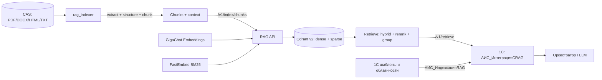

# План: эффективный RAG на Qdrant с интеграцией в 1С

Актуальный план следующих шагов: `plans/2026-11-05-rag-quality-next.md`.

Дата: 2026-11-04
Статус: пересмотрен 2026-11-05: MVP — однократный Q&A по базе знаний; шаблоны/генерация — post-MVP
Связанные документы: `plans/implementation_plan.md#7`, `docs/design-decisions.md#18`, `reviews/critical-review.md#3`, `plans/1793687400076-knowledge-corpus-storage.md`, `docs/system-analysis/c4-model.md`.

## 1. Цель

Поднять качество RAG с «наивного dense-поиска по чанкам» до измеримого retrieval-контура:

- корпус знаний из CAS реально попадает в индекс;
- пользователь 1С задаёт однократный вопрос по базе знаний и получает ответ LLM с цитатами;
- поиск использует структуру документа, гибридный dense+sparse поиск, rerank и группировку по источнику;
- 1С получает фрагменты через `АИС_ИнтеграцияСRAG` и не подменяет ответ при недоступности RAG;
- качество подтверждается golden set и метриками, а не тремя ручными примерами;
- шаблоны, плейсхолдеры и должностные обязанности индексируются в post-MVP.

Критерии успеха (уточняются после baseline):

| Область | Метрика | Цель |
|---|---|---|
| MVP: Q&A retrieval | Recall@10 / nDCG@10 | ≥ 0,85 / ≥ 0,70 на 60–80 вопросах |
| MVP: Q&A citations | citation accuracy | ≥ 0,95 для `found=true` |
| MVP: Q&A groundedness | ответы с подтверждёнными citations | ≥ 0,90 |
| MVP: «не найдено» | precision | ≥ 0,90 |
| MVP: latency | p95 `/v1/retrieve` + LLM | < 3 с |
| Post-MVP: выбор шаблона | Recall@10 / MRR@10 | ≥ 0,90 / ≥ 0,70 на 100 запросах |
| Точные идентификаторы | Recall@10 по ГОСТ/коду/пункту | ≥ 0,90 |
| Надёжность | падение RAG не даёт ложный ответ | 100% явная ошибка/источники |

## 1.1. Пересмотренный MVP: Q&A по базе знаний (2026-11-05)

Шаблоны, плейсхолдеры и генерация документов переносятся в post-MVP. Текущий MVP — однократный ответ на вопрос пользователя по базе знаний организации.

### Границы MVP

Входит:

- диалоговое окно `АИС_ВопросПоБазеЗнаний` в расширении 1С;
- один вопрос — один ответ, без истории и накопления контекста;
- RAG `/v1/retrieve` по корпусу знаний;
- ответ LLM только по найденным фрагментам;
- citations: документ, вид, раздел/пункт, страница;
- «в базе знаний не найдено» при недостатке контекста;
- аудит вопроса, ответа, citations и ошибок;
- golden set по фактическим типам документов;
- retrieval/answer evaluation.

Не входит:

- многошаговый чат, история диалогов, tool-calling;
- выбор шаблона, плейсхолдеры, DOCX-генерация, подписание;
- внешние источники, лист ожидания, эскалация;
- ACL сверх текущих прав на материалы;
- мастер шаблонов и вычитка как обязательные функции MVP.

### Архитектура ответа

```text
1С: окно вопроса
  → АИС_ИнтеграцияСRAG.Поиск (alias-aware /v1/retrieve)
  → АИС_ОтветПоБазеЗнаний: DeepSeek listwise-реранк кандидатов
  → контекст [S1]…[Sn]
  → АИС_ИнтеграцияСLLM: промпт ОтветПоБазеЗнаний
  → JSON {found, answer, citations}
  → валидация citations по выданным source_id/пунктам
  → ответ + источники в окне 1С
  → журнал/аудит
```

RAG-сервис не генерирует ответ: он остаётся retrieval-only. Это сохраняет текущую границу ответственности и упрощает аудит.

### Golden set: состав по фактическим типам корпуса

Корпус не привязан к шляпному производству. В манифесте фактически представлены:

- ГОСТ — 185;
- руководства по эксплуатации оборудования — 41;
- приказы по охране труда — 33;
- учебные пособия — 30;
- ЕТКС — 22;
- технические регламенты — 22;
- федеральные законы — 18;
- учебники — 14;
- ФНП — 13;
- постановления Правительства РФ — 12;
- инструкции, кодексы, приказы, СП, ГОСТ Р, каталоги, методички — меньшими группами.

Стартовый набор: 60–80 вопросов.

| Тип вопроса | Доля |
|---|---|
| Факт: срок, число, размер, допуск | 20% |
| Конкретный пункт/статья | 20% |
| Определение термина | 10% |
| Порядок действий | 15% |
| Требования и запреты | 15% |
| Сравнение/связь документов | 5% |
| Устаревшая/неоднозначная редакция | 5% |
| «Не найдено» | 10–15% |

Схема вопроса:

```json
{
  "query": "...",
  "doc_type": "ГОСТ",
  "filters": {"doc_types": ["ГОСТ"], "statuses": ["verified"]},
  "expected_source_ids": ["sha256..."],
  "expected_clauses": ["4.2.1"],
  "expected_pages": [12],
  "answer_type": "fact|clause|definition|procedure|requirements|comparison|no_answer",
  "must_cite": true,
  "no_answer": false,
  "difficulty": "easy|medium|hard",
  "notes": "..."
}
```

### Метрики MVP

- retrieval: Recall@10, MRR@10, nDCG@10;
- answer: correctness, citation accuracy, groundedness;
- no-answer precision;
- latency p95;
- доля ответов без citations (должна быть 0 для `found=true`).

### Первый практический шаг

Собрать черновик golden set из реальных документов: по 2–3 документа на тип, вопросы по заголовкам/определениям/пунктам, проверка цитат по тексту, ручная выборочная проверка. Не использовать выдуманные ГОСТы и термины: ожидаемые `source_id`/пункты должны существовать в корпусе.

## 2. Принятые решения

| № | Решение |
|---|---|
| D1 | Векторное хранилище — **Qdrant**. pgvector не добавляем, PostgreSQL 1С не трогаем. |
| D2 | RAG-сервис остаётся **retrieval-only**: генерация ответа и выбор шаблона — в оркестраторе/LLM, не в RAG. |
| D3 | Извлечение и чанкинг корпуса — отдельный Python-пакет `rag_indexer` внутри `rag-service` с optional-зависимостями; API-сервис остаётся лёгким. |
| D4 | Извлечение: Docling как основной для PDF/DOCX/HTML, OCR для сканов; `python-docx`/`trafilatura` как точечные fallback-экстракторы. |
| D5 | Чанкинг — структурный, по разделам/пунктам, с таблицами и context header. Фиксированные 1000 символов остаются только как fallback. |
| D6 | Поиск — hybrid dense + sparse BM25 (`Qdrant/bm25`, `language="russian"`), fusion RRF, группировка по `document_key`. Rerank `BAAI/bge-reranker-v2-m3-int8` реализован, но в MVP выключен по умолчанию из-за CPU-latency. |
| D7 | Новая коллекция `v2` с named vectors `dense`/`sparse`, payload-индексами и alias `ai_scrivener_knowledge_current`. Переиндексация — в новую коллекцию с атомарным alias-swap. |
| D8 | 1С-интеграция: `АИС_ИнтеграцияСRAG` + регламентное задание `АИС_ИндексацияRAG` + регистр состояний. Дельта — по хешу содержимого, не по `ДатаИзменения`. |
| D9 | MVP: материалы корпуса со статусом `downloaded`/`verified`; `rejected` исключается. Post-MVP: утверждённые шаблоны и активные обязанности. |
| D10 | Post-MVP: публикация/утверждение шаблона вызывает синхронный upsert; регламентное задание остаётся догоняющей синхронизацией. |
| D11 | MVP: при недоступности RAG окно Q&A показывает явную ошибку/список источников. Post-MVP: deterministic fallback поиска шаблонов. |
| D12 | В аудит пишутся параметры запроса, ID/score результатов и ошибки; полные тексты документов не логируются. |
| D13 | OCR — единый интерфейс `rag_indexer.ocr.OcrEngine`: основной `PaddleOcrEngine`, fallback `YandexOcrEngine`, page-level policy; downstream не зависит от выбранного движка. |
| D14 | **MVP пересмотрен 2026-11-05:** однократный вопрос по базе знаний → RAG → ответ LLM с цитатами; шаблоны, плейсхолдеры и генерация документов — post-MVP. |
| D15 | RAG остаётся retrieval-only; ответ LLM генерируется в 1С, citations валидируются по `source_id`/пунктам из выдачи. |
| D16 | MVP и golden set не привязаны к отрасли: вопросы строятся по фактическим типам документов корпуса. |
| D17 | MVP rerank — **DeepSeek listwise** по кандидатам RAG: дешево, рубли/доступный API, без GPU. Локальный cross-encoder на CPU выключен; production-варианты — on-prem GPU, Yandex Cloud, Selectel или Intellion. |

## 3. Границы

Входит:

- Python: retrieval, sparse/dense, rerank, группировка, parent expansion, контракты API, тесты.
- Python: `rag_indexer` — CAS → извлечение → структура → чанки → вызов RAG API.
- Qdrant: новая схема коллекции, alias-swap, payload-индексы, snapshot/rollback.
- Eval: golden set, метрики, сравнение режимов.
- 1С MVP: константы RAG/LLM, `АИС_ИнтеграцияСRAG` (поиск/health), `АИС_ОтветПоБазеЗнаний`, диалог `АИС_ВопросПоБазеЗнаний`, аудит, права.
- 1С post-MVP: `АИС_ИндексацияRAG` для шаблонов/обязанностей, интеграция в `АИС_Уведомления`, полная переиндексация шаблонов.
- Конфигурация, Docker, runbook, обновление требований/трассируемости.

Не входит:

- LLM-генерация ответа внутри RAG (`/v1/answer`).
- pgvector и изменения PostgreSQL 1С.
- Полный ACL/FR-041, RAPTOR, GraphRAG, proposition chunking, late chunking.
- Замена GigaChat Embeddings на self-hosted модель.
- Полноценная админ-панель; только кнопка полной переиндексации.

## 4. Текущее состояние и разрывы

| Разрыв | Факт | Следствие |
|---|---|---|
| Корпус не индексируется | RAG принимает только `text`; в `rag-service/pyproject.toml` нет экстракторов | PDF/DOCX/HTML корпуса не попадают в поиск |
| Нет клиента RAG в 1С | `АИС_ИнтеграцияСRAG`, `АИС_ИндексацияRAG` отсутствуют | 1С не может искать и обновлять индекс |
| Наивный чанкинг | `normalize_text` схлопывает переводы строк; резка по 1000 символов | Рвутся пункты, таблицы, списки |
| Только dense | Нет sparse/BM25, rerank, group-by-source | Шумный top-10, один документ занимает всю выдачу |
| Нет порога | `search_min_score: 0.0` | Всегда возвращается top-k, нет «не найдено» |
| Неатомарная индексация | `upsert`/`replace` удаляют перед вставкой | Падение оставляет частичный/пустой индекс |
| Нет eval | Только ручная проверка на 3 шаблонах | Нельзя измерить улучшение |

## 5. Целевая архитектура



Ключевой принцип: **1С и индексатор не ходят в Qdrant напрямую**. Единственный владелец Qdrant — RAG API; это сохраняет единый embedding pipeline и упрощает миграции.

## 6. Контракты

### 6.1. `POST /v1/retrieve`

Новый endpoint для 1С и оркестратора. `/v1/search` сохраняется для обратной совместимости и тестов.

Запрос:

```json
{
  "query": "текст задачи или документа",
  "top_k": 10,
  "candidate_k": 50,
  "group_by_source": true,
  "group_size": 3,
  "rerank": true,
  "mmr_lambda": 0.0,
  "include_parent": true,
  "filters": {
    "source_types": ["template_internal"],
    "doc_types": ["Приказ"],
    "statuses": ["verified"],
    "active": true,
    "position_ids": [],
    "folders": [],
    "employees": [],
    "purposes": []
  }
}
```

Ответ:

```json
{
  "query": "...",
  "results": [
    {
      "source_type": "template_internal",
      "source_id": "uuid",
      "document_key": "template_internal:uuid",
      "title": "Шаблон приказа",
      "score": 0.87,
      "score_type": "rerank_sigmoid",
      "metadata": {},
      "chunks": [
        {
          "chunk_index": 0,
          "text": "...",
          "embedding_text": "...",
          "score": 0.87,
          "section_path": ["4", "4.2"],
          "clause": "4.2.1",
          "page_start": 12,
          "page_end": 13,
          "kind": "text",
          "parent_id": "..."
        }
      ]
    }
  ],
  "diagnostics": {
    "candidates": 50,
    "returned": 5,
    "dense_hits": 50,
    "sparse_hits": 50,
    "rerank_ms": 120,
    "retrieval_ms": 30
  }
}
```

Правила:

- `top_k` в `/v1/retrieve` — число документов после группировки; в старом `/v1/search` — число чанков. `group_size` — чанков на документ.
- `score` — итоговая оценка: `sigmoid(rerank)` при rerank, иначе dense score (dense-only) или RRF score (hybrid). Тип оценки возвращается в `score_type`.
- `search_min_score` применяется к итоговому score; для RRF-режима без rerank порог по умолчанию не применяется.
- `include_parent` — подтягивает все чанки с тем же `parent_id` в пределах `context_max_tokens`.
- `mmr_lambda=0` отключает MMR; включается только после eval.
- При пустом результате возвращается `results=[]`, а не случайный top-k.

### 6.2. `POST /v1/index/chunks`

Новый endpoint для `rag_indexer`. 1С продолжает использовать существующие `/v1/index/upsert` и `/v1/index/replace`.

```json
{
  "source_type": "knowledge_material",
  "document": {
    "source_id": "sha256",
    "version": "2026-01-01",
    "title": "ГОСТ 2.101-2016",
    "metadata": {
      "doc_type": "ГОСТ",
      "authority": "Росстандарт",
      "source_url": "https://...",
      "published_at": "2016-01-01",
      "effective_from": "2017-01-01",
      "status": "verified",
      "mime": "application/pdf",
      "path": "blobs/sha256/ab/cd/<sha256>"
    }
  },
  "chunks": [
    {
      "index": 0,
      "text": "...",
      "embedding_text": "Документ: ...\nРаздел: ...\nПункт: ...\nТекст: ...",
      "section_path": ["4", "4.2"],
      "clause": "4.2.1",
      "page_start": 12,
      "page_end": 13,
      "kind": "text",
      "parent_id": "sha256:4.2",
      "char_start": 0,
      "char_end": 900
    }
  ]
}
```

Ответ: `{source_type, source_id, version, indexed_chunks}`.

### 6.3. Qdrant payload и коллекция

Коллекция: `ai_scrivener_knowledge_v2_<timestamp>`, alias `ai_scrivener_knowledge_current`.

Named vectors:

- `dense`: 2560, cosine, GigaChat `EmbeddingsGigaR`.
- `sparse`: BM25, `modifier=IDF`, `Qdrant/bm25`, `language="russian"`.

Payload:

- `source_type`, `source_id`, `version`, `document_key`, `title`, `chunk_index`
- `text`, `embedding_text`
- `section_path`, `section_text`, `clause`, `page_start`, `page_end`, `kind`, `parent_id`
- `char_start`, `char_end`
- `doc_type`, `authority`, `published_at`, `effective_from`, `status`, `active`
- `position_ids`, `folders`, `employees`, `purposes`
- `document_hash`, `extraction_version`, `chunker_version`, `embedding_model`, `indexed_at`
- `metadata` — исходный словарь

Payload-индексы: `source_type`, `source_id`, `document_key`, `doc_type`, `active`, `status`, `authority`, `position_ids`, `parent_id`, `kind`, `page_start`, `metadata.folders`, `metadata.employees`, `metadata.purposes`, `effective_from`.

Значения `source_type`:

| `source_type` | Источник | `source_id` |
|---|---|---|
| `template_internal` | `Справочник.ШаблоныВнутреннихДокументов` | UUID |
| `template_incoming` | `Справочник.ШаблоныВходящихДокументов` | UUID |
| `template_outgoing` | `Справочник.ШаблоныИсходящихДокументов` | UUID |
| `obligation` | `Справочник.АИС_ДолжностныеОбязанности` | UUID |
| `knowledge_material` | материал CAS | SHA-256 |

Point ID: `uuid5("ai-scrivener:{source_type}:{source_id}:{version}:{chunk_index}")`.

### 6.4. 1С: константы и регистр

Константы:

| Константа | Тип | Назначение |
|---|---|---|
| `АИС_АдресRAGСервиса` | String 200 | `http://127.0.0.1:8080` |
| `АИС_ТокенRAGСервиса` | String 200 | `X-Service-Token` |
| `АИС_ТаймаутRAGСервиса` | Number 5,0 | таймаут HTTP, сек |
| `АИС_ПовторыRAGСервиса` | Number 2,0 | число повторов |
| `АИС_RAGВключён` | Boolean | глобальный выключатель, старт `false` |
| `АИС_МаксимальнаяДлинаЗапросаRAG` | Number 6,0 | обрезка query, символов |

Регистр сведений `АИС_СостоянияИндексации`:

- измерения: `ТипИсточника` (String 50), `Идентификатор` (String 64);
- ресурсы: `ХешСодержимого` (String 64), `ДатаИндексации` (Date), `Статус` (String 20), `Ошибка` (String 1000).

## 7. Этапы

### Этап 0. Baseline, контракты, защита от регрессий

- [ ] Зафиксировать решения D1–D12 в `docs/design-decisions.md` и обновить `docs/system-analysis/c4-model.md`.
- [ ] Снять snapshot Qdrant и сохранить копию `manifest.jsonl` (без дублирования блобов корпуса).
- [ ] Создать golden set для шаблонов: 50–100 запросов, 20–30 «не найдено»; для корпуса — каркас и список целевых материалов.
- [x] Реализовать `rag_service.eval`: Recall@k, MRR, nDCG, no-answer accuracy и latency; сравнение dense/hybrid/rerank — через конфигурацию сервиса.
- [ ] Добавить в `config/parameters.yaml` и `parameters.schema.json` параметры из §8; обновить тесты конфигурации.
- [ ] Зафиксировать API-контракты §6 в `docs/design-decisions.md` и тестах.

**Готово, когда:** есть baseline-цифры, golden set версионирован, конфигурация валидируется, snapshot снят.

### Этап 1. Retrieval core

- [ ] Добавить `fastembed` и модели `Qdrant/bm25` (russian) и `BAAI/bge-reranker-v2-m3-int8`; кэш моделей через volume. `avg_len` для BM25 выставить по фактическому среднему размеру чанка из статистики индексатора, а не оставлять 256 по умолчанию.
- [ ] Реализовать `sparse.py`, `rerank.py`, `fusion.py`, `retrieval.py`; протоколы для тестируемости.
- [x] Перейти на коллекцию `v2` с named vectors `dense`/`sparse`, payload-индексами и alias.
- [x] Реализовать alias lifecycle: создание версионированной коллекции, `switch_alias`, `target_collection` для индексации, startup с понятной ошибкой при несовместимой размерности.
- [ ] Реализовать `/v1/retrieve`: hybrid prefetch + RRF, rerank, sigmoid, group-by-source, `group_size`, parent expansion, diagnostics.
- [ ] Оставить `/v1/search` совместимым; внутри использовать тот же retrieval, но вернуть плоский список чанков.
- [x] Расширить `/health`: alias и target collection; points_count и sparse/rerank готовность остаются в мониторинге.
- [x] Тесты: fusion, rerank fallback, group-by-source, parent expansion, фильтры, пустой результат, alias-switch.
- [ ] Сравнить на golden set: dense vs hybrid vs hybrid+rerank; зафиксировать выигрыш.

**Готово, когда:** `/v1/retrieve` работает на v2, метрики гибрида/rerank лучше baseline, alias-switch и rollback проверены.

#### Live alias-swap 2026-11-05

Проверено против реального Qdrant 1.16.3 и RAG-сервиса:

- alias `ai_scrivener_knowledge_current` указывал на `..._v1_1793860874`;
- создана коллекция `ai_scrivener_knowledge_live_3ff96d69`;
- документ проиндексирован в неё через `target_collection`;
- до переключения alias поиск вернул 0 результатов;
- после `alias-switch` — 1 результат с ожидаемым `source_id`;
- после rollback на предыдущую коллекцию — снова 0;
- live integration test index → retrieve → delete прошёл.

### Этап 2. Индексатор корпуса

- [ ] Добавить пакет `rag-service/src/rag_indexer/` и optional-группу зависимостей `indexer` (docling, python-docx, trafilatura, razdel, tiktoken).
- [x] Реализовать `Block`/`ExtractedDocument`, `PdfExtractor`, page triage и `LineToParagraphMerger`.
- [x] Реализовать DOCX/HTML/TXT экстракторы и `DocumentExtractor` в тот же `ExtractedDocument`; таблицы и колонки требуют доработки.
- [x] Реализовать `rag_indexer.pdf`: `TextLayerReport` и `detect_pdf_text_layer` для page-level triage «есть текстовый слой / нужен OCR»; опциональная зависимость `indexer`.
- [x] Реализовать `rag_indexer.ocr`: `OcrEngine`/`OcrDocument`, `PaddleOcrEngine` (основной), `YandexOcrEngine` (fallback), `FallbackOcrEngine` с page-level policy; опциональная зависимость `ocr-paddle`.
- [x] Реализовать `LineToParagraphMerger`: bbox, вертикальные интервалы, отступы, нумерация, переносы; колонки и таблицы требуют доработки.
- [x] Добавить фильтр повторяющихся колонтитулов, номеров страниц и boilerplate: определять повторяющиеся строки по страницам/позиции (верх/низ), удалять до склейки, сохранять удалённое в `metadata` для аудита; проверка на П-6 и 20–30 PDF.
- [x] Реализовать `StructureBuilder`: заголовки, уровни разделов и путь секции; сложная юридическая нумерация пока базовая.
- [x] Реализовать `ClauseAwareChunker`: context header, `embedding_text`, section path, clause, split long by sentences, merge small tail, дробление склеенных пунктов и таблиц по группам строк с повтором шапки.
- [x] Извлечение таблиц из PDF с текстовым слоем через `pdfplumber` для таблиц с линиями; borderless/сканы и merged cells остаются в отдельных задачах.
- [x] State-файл для идемпотентности по `sha256 + pipeline_version`; кэш извлечения/чанков на диск пока не реализован.
- [x] CLI: `python -m rag_indexer index|validate|stats` с `--corpus-dir`, `--manifest`, `--rag-url`, `--token`, `--full`, `--limit`, `--dry-run`, `--statuses`, `--ocr`.
- [x] Использовать `/v1/index/chunks` и `DELETE` для исчезнувших материалов.
- [x] Дисковый кэш extraction/chunks по `sha256 + extractor_version + chunker_version` (`rag_indexer.cache`).
- [x] OCR engine/model version в ключе кэша, `--export-dir`, gzip-сжатие JSON и `rag_indexer cache-cleanup` для retention старых версий.
- [x] Батчинг payload для больших PDF: `--chunk-batch-size`; батчи пишутся с `active=false`, затем `/v1/index/activate` включает новую версию и удаляет старые.
- [x] Очистка неактивных staging-версий: `POST /v1/index/cleanup` и `rag_indexer cleanup`; точки получают `created_at`.
- [ ] Отдельные версии extractor/chunker в state вместо одного `pipeline_version`; в кэше они уже раздельные.
- [x] Gated live integration test `tests/test_live_rag.py` (index → retrieve → delete) через `RAG_LIVE_URL`/`RAG_LIVE_TOKEN`; запуск против живого RAG остаётся ручным.
- [x] Dockerfile/профиль `rag-indexer`; corpus volume read-only; сеть только к RAG API; PaddleOCR включается build-arg `WITH_PADDLE`.
- [ ] Пилот на 20–30 материалах: проверить заголовки, таблицы, сканы, кодировки; замерить chunk integrity.
- [ ] Собрать knowledge golden set: 50–100 запросов с ожидаемыми `sha256`/пунктом, включая точные идентификаторы и «не найдено».
- [ ] После пилота — полная индексация корпуса и eval по knowledge golden set.

**Готово, когда:** корпус индексируется идемпотентно, пилотные запросы находят нужные пункты, повторный запуск не создаёт дублей, ошибки извлечения видны в отчёте.

#### Пилот 2026-11-04 (25 PDF, `--ocr none`)

- 14 документов с текстовым слоем, 11 без слоя (44% выборки требуют OCR).
- 694 чанка; 406 чанков с извлечённым `clause` после фикса `1.1.`.
- 0 табличных чанков: таблицы из текстового слоя пока не распознаются как таблицы.
- Основные пробелы: сканы без OCR, колонтитулы ГОСТ попадают в тело блоков, слабое извлечение пунктов в части ГОСТ/ТР ТС, нет табличной структуры.
- Следующие шаги: OCR-пилот на 11 сканах, table parser, доработка regex и удаления колонтитулов.

#### OCR-пилот 2026-11-04 (11 PDF, PaddleOCR)

- 11/11 документов обработаны без ошибок; 421 страница, 1001 чанк, 169 чанков с `clause`.
- OCR вызывался только для страниц без текстового слоя; смешанные PDF используют `text_layer` + `paddleocr`.
- 0 табличных чанков; извлечение таблиц остаётся главным пробелом.
- Токен-prefix stripping и `clean_block_headers` убирают типовые колонтитулы (`С. N`, `Продолжение`, `ГОСТ ...`), включая попавшие в середину блока; нестандартные/OCR-искажённые заголовки могут оставаться.
- В учебниках/руководствах мало `clause` — это ожидаемо, но часть ГОСТ/ТР ТС всё ещё теряет пункты.
- Следующие шаги: table parser для PDF, улучшение clause extraction и golden set.

#### Повторный пилот после table/clause (25 PDF, `--ocr none`)

- 14 документов с текстовым слоем, 11 без слоя.
- 738 чанков (было 694), 466 чанков с `clause` (было 407), 31 табличный чанк (было 0).
- `pdfplumber` извлекает таблицы с линиями; borderless/сканы остаются отдельной задачей.
- Улучшено извлечение clause для заголовков и `Статья N`.

#### Пилотная индексация 2026-11-05 (30 PDF, PaddleOCR)

- 30/30 документов проиндексированы; 825 страниц; 2023 чанка; 1115 чанков с `clause`; 150 табличных чанков.
- Alias `ai_scrivener_knowledge_current` переключён на пилотную коллекцию `ai_scrivener_knowledge_pilot_1793864097`.
- Проверены 5 вопросов: top-1 релевантен для маркировки головных уборов, хранения текстиля, СИЗ, стеллажей и контроля качества швейных изделий.
- Rerank на CPU: 38 с на 50 кандидатов, 11 с на 20; в MVP выключен, hybrid RRF — около 0,2 с.

#### Golden set v0 2026-11-05 (15 типов, 30 документов)

- 70 кейсов: 60 answerable + 10 no-answer; файл `rag-service/eval/golden/knowledge.jsonl`.
- Покрыты все 15 типов пилотной коллекции; по 2 вопроса на каждый из 30 проиндексированных материалов.
- Baseline: Recall@10 1.000, MRR@10 0.983, nDCG@10 0.988; no-answer accuracy 0.000 при `search_min_score = 0.0`.
- Ограничение среза: 15 из 68 типов и 30 из 599 материалов; после полной индексации расширить набор на все типы и полный корпус.

### Этап 2.5. Качество чанкинга и контекста

- [x] Проверен `include_parent`: выключен. Он раздувает контекст в 4–5 раз и снижает `expected_clause_in_context` до 0.80–0.82; выбраны `group_size=5`, `include_parent=false`.
- [x] Context fix: `group_size=5` поднял found_rate до 0.617, correctness до 0.582; ложные отказы 30 → 23, из них 22 — citations.
- [ ] Добавить `status`/`authority`/`published_at`/`effective_from` в фильтры и буст официальных источников.
- [ ] Включить MMR (`mmr_lambda` 0,6–0,8) только если eval показывает рост nDCG/Recall без падения точности.
- [ ] Проверить overlap-дубли и соседние чанки; при необходимости — dedup/merge.
- [x] Исправлен чанкер: пункт не теряется при слиянии соседних чанков, номера заголовков наследуются, list items не считаются пунктами; `PIPELINE_VERSION=2`, тесты в `rag-service/tests/test_chunker.py`.
- [x] Rechunk пилота на 30 документах: MRR@10 1.0, nDCG@10 1.0, found_rate 0.5, correctness 0.466, citation_precision 0.457; alias не переключался. Остаются 30 ложных отказов (19 при наличии пункта), 24 rerank-fallback и no-answer precision 0.25.
- [x] Стабилизирован реранк: JSON mode, первые 15 кандидатов и repair-попытка; полный eval дал 0 fallback, 12 empty ranking, correctness 0.483, citation accuracy 0.867, e2e p95 18.3 с.
- [x] Контракт citations: модель возвращает только метки `[S1]`, сервер подставляет `source_id`/`clause`. Полный eval: found_rate 0.967, citation precision 0.976, citation accuracy 0.966, correctness 0.939, false_refusals 2; `group_size=5` выбран вместо 10.
- [ ] Латентность: e2e p50 5.7 с / p95 10.9 с при цели p95 < 3 с; проверить модель, размер контекста и max_tokens.
- [ ] Полная переиндексация корпуса с Paddle/OCR и повторный eval на расширенном golden set.
- [ ] Зафиксировать правило полной переиндексации при изменении `PIPELINE_VERSION`.

**Готово, когда:** knowledge golden set достигает целевых метрик, ручная выборка 20–30 ответов не показывает обрывков пунктов и таблиц.

### Этап 3. Интеграция с 1С

MVP-часть: `АИС_ИнтеграцияСRAG.Поиск/ПроверитьДоступность`, `АИС_ОтветПоБазеЗнаний`, диалог `АИС_ВопросПоБазеЗнаний`, аудит. Пункты про индексацию шаблонов, регламентное задание и `АИС_Уведомления` относятся к post-MVP.

- [x] Реализовать `АИС_ИнтеграцияСRAG.Поиск` и `ПроверитьДоступность` для `/v1/retrieve`/`/health`.
- [x] Реализовать `АИС_ОтветПоБазеЗнаний`: контекст `[S1]…[Sn]`, промпт `ОтветПоБазеЗнаний`, JSON `{found, answer, citations}`, валидация citations, «не найдено».
- [x] Реализовать DeepSeek listwise-реранк `РеранкФрагментов` с fallback на RRF.
- [x] Диалог `АИС_ВопросПоБазеЗнаний` в «АИС: Сервис»: вопрос, ответ, источники, статус, без истории; переход к исходному материалу — следующий шаг.
- [ ] Аудит Q&A в `АИС_ИсторияДействийИИ`: вопрос, citation ID, latency, ошибки; без полного текста документов.
- [ ] Golden set 60–80 вопросов по фактическим типам документов; eval retrieval/answer.
- [ ] Добавить константы, регистр `АИС_СостоянияИндексации`, общий модуль `АИС_ИнтеграцияСRAG`, регламентное задание `АИС_ИндексацияRAG` в `Configuration.mdo` (post-MVP для индексации шаблонов).
- [ ] Реализовать HTTP-клиент: разбор URL, host/port, `X-Service-Token`, таймаут, retry на сеть/5xx, JSON.
- [ ] Реализовать `Поиск`, `ИндексироватьШаблон`, `ИндексироватьОбязанность`, `УдалитьДокумент`, `ПолнаяПереиндексация`, `ПроверитьДоступность`. Текст шаблона: `Наименование + Заголовок + ВидДокумента + КомментарийКШаблону + ТЧ АИС_Плейсхолдеры`. Текст обязанности: `Description + Текст + ТипТриггера + ТипДействия + Характеристика + ТребуемыйВидДокумента + Должность`.
- [ ] Реализовать `ВыполнитьРегламентнуюИндексацию`: утверждённые шаблоны трёх справочников + активные обязанности; хеш содержимого; upsert изменённых; delete исчезнувших; состояние в регистре. Расписание задания — каждые 5 минут; при `АИС_RAGВключён=false` задание завершается без вызовов.
- [ ] Синхронно индексировать шаблон после `УтвердитьШаблон_POST` (`Статус="Утверждён"`); ошибка RAG не отменяет утверждение.
- [ ] В `АИС_Уведомления` заменить прямой вызов `НайтиШаблоныВнутреннихДокументов` на RAG-поиск с deterministic fallback; добавить `Score` в JSON кандидатов. Query = `ВидДокумента + " " + Заголовок + " " + Содержание`, обрезка до `АИС_МаксимальнаяДлинаЗапросаRAG`; фильтры — `source_types=["template_internal"]`, `doc_types=[ВидДокумента]`, `active=true`.
- [ ] Добавить кнопку «Переиндексировать RAG» в `DataProcessor.АИС_Шаблоны` (админ/Программист 1С).
- [ ] Права: `АИС_СервисныйПользователь` — чтение шаблонов/обязанностей, константы, регистр; `АИС_АдминистраторСистемы` — полная переиндексация.
- [ ] Аудит: `АИС_ИсторияДействийИИ` — параметры запроса, ID/score, ошибка, длительность; без полного текста. Для записи использовать/создать тип действия `ПоискRAG` в `АИС_ТипыДействий` (данные, не метаданные).
- [ ] EDT build/validate, `CheckModules`, сценарий `tests/1c/test_rag.md` на копии ИБ.

**Готово, когда:** в 1С можно задать вопрос по базе знаний, получить ответ с валидными citations, «не найдено» и аудит; RAG down не даёт ложный ответ. Индексация шаблонов/обязанностей и fallback на шаблоны — post-MVP.

### Этап 4. Раскатка и эксплуатация

- [ ] Прогнать Q&A на golden set; зафиксировать baseline и целевые пороги.
- [ ] Включить окно для пилотной группы пользователей; собрать вопросы, ошибки и ложные ответы.
- [ ] Полная индексация корпуса; проверить `/health`, points_count, alias.
- [ ] Snapshot Qdrant, backup, репетиция rollback: alias на предыдущую коллекцию.
- [ ] Мониторинг: ошибки 5xx, пустые ответы, доля ответов без citations, latency, размер индекса, staleness.
- [ ] Обновить `README.md`, `guides/runbook.md`, `docs/requirements/traceability_matrix.md`, `docs/system-analysis/c4-model.md`.
- [ ] Зафиксировать метрики до/после и решение о включении Q&A по умолчанию.

**Готово, когда:** метрики Q&A достигнуты, rollback проверен, документация обновлена, окно доступно пилотной группе.

## 8. Конфигурация

Добавить в `rag`-секцию `config/parameters.yaml` и `parameters.schema.json`:

| Параметр | Значение по умолчанию | Назначение |
|---|---|---|
| `top_k` | 10 | документов в ответе `/v1/retrieve` |
| `candidate_k` | 50 | кандидатов до rerank |
| `group_by_source` | true | группировка по документу |
| `group_size` | 3 | чанков на документ |
| `hybrid_enabled` | true | dense + sparse |
| `rerank_enabled` | false | cross-encoder rerank; включать после GPU/оптимизации |
| `rerank_model` | `BAAI/bge-reranker-v2-m3-int8` | модель rerank |
| `rerank_batch_size` | 16 | батч rerank |
| `sparse_model` | `Qdrant/bm25` | sparse-модель |
| `sparse_language` | `russian` | стеммер/стоп-слова BM25 |
| `mmr_lambda` | 0.0 | 0 — выключено |
| `include_parent` | true | подтягивать parent-чанки |
| `context_max_tokens` | 6000 | бюджет контекста |
| `query_max_chars` | 4000 | обрезка запроса |
| `search_min_score` | 0.0 | калибруется по eval |
| `collection_alias` | `ai_scrivener_knowledge_current` | alias Qdrant |
| `chunk_target_tokens` | 350 | целевой размер |
| `chunk_max_tokens` | 600 | максимум |
| `chunk_min_tokens` | 80 | минимум |
| `chunk_overlap_sentences` | 1 | overlap внутри пункта |
| `index_batch_size` | 64 | батч индексации |
| `hnsw_ef` | 128 | качество HNSW-поиска |

Старые `chunk_size_chars`/`chunk_overlap_chars` сохранить для обратной совместимости и fallback; пометить как deprecated после перехода на структурный чанкер.

## 9. Отказы и fallback

| Отказ | Поведение |
|---|---|
| RAG недоступен | 1С использует `НайтиШаблоныВнутреннихДокументов`; задача не падает |
| Qdrant недоступен | `/health` красный; `/v1/retrieve` → 502; 1С fallback |
| GigaChat недоступен | индексация/поиск → 502; повтор по расписанию; 1С fallback |
| Reranker не загрузился | при `rerank_enabled=true` — fail fast; при `false` — fusion order |
| Sparse-модель не загрузилась | hybrid отключается с warning, dense-only |
| Битая/отсутствующая страница PDF | материал пропускается с ошибкой в отчёте; не блокирует остальные |
| Скан без текста | OCR; при провале — запись в отчёт пробелов |
| Падение индексации | новая коллекция/alias не переключается; старая остаётся рабочей |
| Повторный запуск индексатора | идемпотентный upsert по point ID; дублей нет |
| Шаблон перестал быть утверждённым | delete/active=false в RAG при следующей синхронизации |
| RAG вернул пусто | 1С fallback, а не пустой список кандидатов |

## 10. Валидация

Тесты Python:

- unit: chunker boundaries, structure tree, BM25, fusion, rerank fallback, grouping, parent expansion, config.
- integration: локальный Qdrant, named vectors, payload-фильтры, alias-switch, `/v1/retrieve`, `/v1/index/chunks`.
- failure: Qdrant down, GigaChat 5xx, модель отсутствует, пустой корпус, битый PDF/DOCX, частичная индексация.
- eval: golden set, метрики, сравнение режимов, отчёт в `artifacts/rag-eval/`.

Тесты 1С:

- EDT build/validate, `CheckModules` без ошибок.
- `tests/1c/test_rag.md`: настройка констант, полная переиндексация, поиск, fallback при остановленном RAG, повторная индексация без дублей.
- Проверка прав `АИС_СервисныйПользователь` и `АИС_АдминистраторСистемы`.
- Проверка, что утверждение шаблона не откатывается при ошибке RAG.

Приёмка:

- golden set показывает достижение целей §1 или зафиксированное обоснованное отклонение.
- `/v1/retrieve` p95 < 1,5 с на целевом железе.
- RAG down не роняет задачу 1С.
- Повторная индексация не создаёт дублей.
- Alias-swap и rollback проверены.
- В логах и аудите нет полных текстов документов.

## 11. Риски и открытые вопросы

| Риск/вопрос | Мера/решение |
|---|---|
| Docling медленный на CPU и не идеален на русских сканах | пилот на 20–30 материалах, OCR, fallback на `python-docx`/`trafilatura`; при необходимости Marker как challenger |
| `PdfExtractor` на текстовом слое использует `pypdfium2` и текстовые эвристики; типовые колонтитулы удаляются, но нестандартные/OCR-искажённые могут остаться | layout-aware parser (Docling/PyMuPDF) и/или фильтрация по bbox; ручная проверка проблемных ГОСТ |
| `ClauseAwareChunker` делит пункты по newline/пунктуации, но сложные склейки без разделителей могут остаться | пилот на реальных PDF; расширение regex и тесты |
| `pdfplumber` находит таблицы с линиями, но borderless-таблицы и merged cells могут терять структуру | отдельный layout/table parser (Docling/Paddle PP-Structure) и проверка на реальных ГОСТах |
| При падении батчинга остаются неактивные staging-точки; видимость документа атомарна, но мусор требует очистки | `rag_indexer cleanup --older-than-hours 24`; запуск по расписанию; повторный запуск перезаписывает staging-версию |
| Размер чанка оценивается как `len(text) / 4`, а не токенайзером GigaChat | подключить точный токенайзер, проверить лимит embedding-модели |
| Regex нумерации может не покрыть реальные форматы корпуса | собрать примеры из 20–30 PDF, расширить regex и закрепить тестами |
| GigaChat-эмбеддинги 2560 и лимиты батча | замерить лимиты, батч 32, обрезка/разбиение при ошибке |
| Reranker на CPU добавляет latency | Измерено: 38 с на 50 кандидатов, 11 с на 20; для MVP `rerank_enabled=false`, hybrid RRF даёт ~0,2 с. Включать после GPU или меньшей multilingual-модели; eval rerank отдельно |
| Jina/Cohere/Voyage недоступны из РФ напрямую и не принимают рубли | В текущем окружении Jina отдаёт 451, Cohere/Voyage — 403; для MVP используется DeepSeek listwise. Production — on-prem GPU, Yandex Cloud, Selectel или Intellion |
| BM25 Snowball может агрессивно стеммить юридические термины | eval, кастомные стоп-слова, при необходимости собственный словарь |
| Alias-swap и миграция Qdrant | snapshot, dual-run v1/v2, rollback на предыдущий alias |
| 1С scheduled job и права | запуск под `АИС_СервисныйПользователь`, проверка прав, идемпотентность |
| Нет `ДатаИзменения` у adopted-справочников | дельта по хешу содержимого, а не по дате |
| Статус материала: манифест vs `АИС_МатериалыЗнаний` | MVP — манифест; синхронизация статуса из 1С — отдельная задача P2 |
| ACL корпуса | payload-поля и фильтры заложить; принудительное ограничение — после FR-041 |
| Лицензии моделей | BM25 Apache-2.0, BGE reranker Apache-2.0, Docling MIT; зафиксировать в документации |
| Полные тексты в логах | логировать ID, длины, хеши, score; не логировать `text` |

## 12. Definition of Done

- Корпус знаний индексируется из CAS идемпотентно, с провенансом и структурными чанками.
- `/v1/retrieve` использует hybrid + rerank + group-by-source + parent expansion.
- В 1С работает однократный Q&A: вопрос → RAG → ответ LLM с citations и «не найдено».
- `АИС_ОтветПоБазеЗнаний` валидирует citations и не даёт ложный ответ при недоступности RAG/LLM.
- Golden set 60–80 вопросов по типам документов и метрики подтверждают качество; baseline зафиксирован.
- Alias-swap, snapshot и rollback проверены.
- Индексация шаблонов/обязанностей и документный сценарий остаются post-MVP.
- Тесты Python/1С, линтеры, EDT build/validate проходят.
- Документация, конфигурация и трассируемость обновлены.
