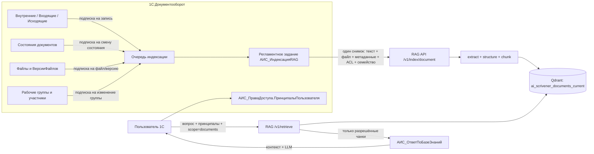

# План: семантический поиск по документам документооборота

Дата: 2026-11-06
Статус: в реализации
Связанные документы: `plans/2026-11-04-effective-rag.md`, `plans/2026-11-05-rag-quality-next.md`, `docs/data-model.md`, `docs/process-diagrams.md`, `docs/design-decisions.md`.

## 0. Статус реализации

Реализовано в текущей итерации:

- RAG: отдельная коллекция документов, `scope=knowledge|documents`, ACL-фильтры, `is_current`, `family_id`, `POST /v1/index/document`, `POST /v1/index/document/base64`, `POST /v1/index/metadata`, двухфазная активация с сохранением старых версий как `active=false`; тесты и проверки `ruff`/`mypy` проходят.
- 1С: перечисление типов документов, константы настроек и feature flag, регистр `АИС_СостоянияИндексации`, общие модули `АИС_ПраваДоступа` и `АИС_ИндексацияДокументов`, подписки на запись документов, файлов, версий файлов, рабочих групп и смену состояния (базовые объекты адаптированы в расширение), регламентное задание `АИС_ИндексацияRAG`, метод `АИС_ОтветПоБазеЗнаний.ОтветитьПоДокументам`, права сервисной роли.
- UI: в форме `АИС_ВопросПоБазеЗнаний` добавлен режим «Искать в документах документооборота»; для источников-документов команда «Открыть источник» открывает карточку 1С, для корпуса знаний — PDF.
- Сборка расширения через EDT проходит.
- 2026-11-07: добавлено удаление помеченных документов из коллекции документов (`АИС_ИнтеграцияСRAG.УдалитьДокумент`, `DELETE /v1/index/...?scope=documents`) и cleanup неактивных версий с `scope=documents`; добавлена пост-проверка прав в 1С (`АИС_ПраваДоступа.ПроверитьДоступность`) — недоступные документы удаляются из контекста до вызова LLM; карточка цитаты показывает вид, состояние, дату утверждения и версию; ежедневная полная сверка запускается из регламентного задания по отметке `system/full_reconcile`; `rag_service.eval` поддерживает `scope=documents` и метрики `stale_version_leak_rate`, `acl_leak_rate`, `current_version_accuracy`; добавлены unit-тесты метрик и документирован формат `documents.jsonl`.
- 2026-11-07: семейство документов строится по явным связям `СвязиДокументов` (`НеДействуетВСоответствии`, `ДелаетНедействующим`) с выбором ранней карточки компоненты; актуальной в семействе считается только последняя финальная карточка по дате (с UUID как детерминированный tie-break); для должностных инструкций более поздние черновики больше не вытесняют действующую инструкцию. Добавлена админ-обработка `АИС_ИндексацияДокументов`: очередь и ошибки, разбор очереди, постановка полной переиндексации, отчёт «Возможные версии»; обработка включена в `АИС_Сервис` и роль администратора.

Отклонения и уточнения:

- матрица финальных состояний пока хранится в константе `АИС_НастройкиИндексацииДокументов` (JSON), а не в отдельном справочнике; это позволяет менять правила без изменения кода и позже заменить на справочник без изменения модулей;
- добавлен JSON/base64-канал загрузки файла (`/v1/index/document/base64`) для 1С; multipart-канал также реализован и протестирован;
- все источники используют единый механизм подписок: документ, файл, версия файла, рабочая группа, состояние документа.
- ежедневная полная сверка остаётся страховкой от пропущенных событий и изменений «в обход» подписок.

Следующие шаги:

- инвентаризация фактических состояний, связей версий и полей файлов на реальной базе;
- собрать `rag-service/eval/golden/documents.jsonl` после первичной индексации реальных документов и прогнать retrieval/answer eval с `stale_version_leak_rate=0` и `acl_leak_rate=0`;
- проверить на копии базы отчёт «Возможные версии» и сценарии семейства: замена карточки, `НеДействует`, несколько версий файлов, должностная инструкция, ACL.

## 1. Цель

Добавить к существующему RAG-контуру поиск по документам, которые уже обрабатываются в 1С:Документооборот:

- `Справочник.ВнутренниеДокументы`;
- `Справочник.ВходящиеДокументы`;
- `Справочник.ИсходящиеДокументы`;
- должностные инструкции — внутренние документы вида «Должностная инструкция» с реквизитом `АИС_Должность`.

Главное требование: по умолчанию искать только в финальных (утверждённых/подписанных/зарегистрированных) актуальных версиях. Черновики, согласования, отменённые и вытесненные версии не должны попадать в выдачу и не должны участвовать в ответе LLM.

Критерии успеха:

| Область | Метрика | Цель |
|---|---|---|
| Поиск по документам | Recall@10 / nDCG@10 | ≥ 0,85 / ≥ 0,70 |
| Актуальность версий | stale_version_leak_rate в top-10 | 0 |
| ACL | утечка недоступного документа | 0 |
| Ответы | citation_accuracy для `found=true` | ≥ 0,95 |
| «Не найдено» | no-answer precision | ≥ 0,90 |
| Задержка | p95 retrieval | < 1,5 с |
| Синхронизация | задержка появления нового финального документа | ≤ 5 мин |

Что входит в MVP:

- поиск и ответ по документам документооборота: внутренние, входящие, исходящие и должностные инструкции;
- отбор только финальных актуальных версий;
- строгий ACL по рабочим группам и участникам;
- автоматическая индексация новых и изменённых документов через очередь и регламентное задание;
- citations и переход к карточке документа в 1С;
- golden set и метрики, включая `stale_version_leak_rate` и `acl_leak_rate`.

Что не входит в MVP:

- симулятор предприятия не участвует в индексации и поиске; он лишь пополняет штатные справочники 1С, а индексация реагирует на штатные события;
- полный RLS/ACL сверх модели «рабочие группы + участники»;
- поиск по старым версиям в пользовательском UI; архив доступен только администратору/аудитору;
- OCR сканов как обязательный сценарий; сканы без текстового слоя помечаются и обрабатываются отдельным этапом;
- замена корпуса знаний и его коллекции;
- единый режим «Везде» (документы + корпус знаний): корпус знаний остаётся в существующем Q&A, документы — в новом режиме;
- новый endpoint `/v1/answer` и генерация ответа внутри RAG-сервиса. Ответ, как и сейчас, генерирует 1С: `АИС_ОтветПоБазеЗнаний` получает фрагменты через `/v1/retrieve`, собирает контекст и вызывает LLM. RAG остаётся retrieval-only.

## 2. Принятые решения

| № | Решение |
|---|---|
| D1 | Финальность документа задаётся настраиваемой матрицей по типу документа; перед реализацией проводится инвентаризация фактических состояний в базе. |
| D2 | Версии представлены и отдельными карточками, и версиями файлов. Для карточек вводится «семейство документа»; для файлов индексируется только текущая версия. |
| D3 | Семейство строится по явным связям `СвязиДокументов`, `НеДействует` и явным реквизитам версии. Похожие карточки без явной связи попадают в отчёт «возможные версии» и не скрываются автоматически. |
| D4 | Текст берётся из `Содержание` и из текущих версий приложенных файлов; файл считается основным для крупных документов, `Содержание` — fallback/дополнение. |
| D5 | ACL строится из штатных рабочих групп и участников документа; в Qdrant хранятся allow/deny-принципалы, поиск фильтрует по ним. Дополнительно 1С делает пост-проверку прав как защиту от рассинхронизации. |
| D6 | Документы хранятся в отдельной коллекции Qdrant `ai_scrivener_documents_current`; корпус знаний остаётся в `ai_scrivener_knowledge_current`. |
| D7 | Индексация запускается очередью и регламентным заданием: подписки ставят документ в очередь, задание разбирает очередь каждые 5 минут, раз в сутки выполняется полная сверка. |
| D8 | Файлы передаются в RAG по HTTP; основной канал — multipart-загрузка текущей версии файла. |
| D9 | Индексация двухфазная: чанки пишутся с `active=false`, после успешной загрузки версия активируется; старая версия остаётся рабочей при сбое. |
| D10 | Старые версии по умолчанию не удаляются сразу: остаются в индексе с `active=false` и `superseded_by` на 90 дней, затем очищаются. |
| D11 | RAG остаётся retrieval-only; ответ, citations и переход к документу формирует 1С. |
| D12 | Новые документы от симулятора попадают в индекс через штатную запись 1С и подписки, без вызовов симулятора из RAG. |
| D13 | Для документов без явной финальности действует fail-closed: документ не индексируется как финальный, пока правило не настроено. |
| D14 | При пустом ACL документ не индексируется в общий поиск и попадает в отчёт ошибок; это лучше, чем молча показать его всем. |
| D15 | В первой версии два раздельных scope: `knowledge` (существующий Q&A) и `documents` (новый поиск); объединённый `all` не реализуется. |
| D16 | Ответ генерирует 1С (`АИС_ОтветПоБазеЗнаний`); RAG-сервис не вызывает LLM и не получает новый `/v1/answer`. |

## 3. Целевая архитектура



Ключевые границы:

- 1С владеет бизнес-актуальностью, семейством версий и ACL; RAG не пытается угадать права или версии.
- RAG владеет извлечением, чанкингом, векторами и фильтрацией по payload.
- Симулятор не является участником контура: он пишет документы штатно, дальше работают подписки и задание.

## 4. Модель данных 1С

### 4.1. Новые объекты расширения

| Объект | Тип | Назначение |
|---|---|---|
| `АИС_ТипыИндексируемыхДокументов` | перечисление | `Внутренний`, `Входящий`, `Исходящий`, `ДолжностнаяИнструкция` |
| `АИС_ПравилаИндексацииДокументов` | справочник | настраиваемая матрица: тип, вид документа, финальные состояния, исключать ли `НеДействует`, индексировать ли только текущую версию файла, приоритет, активность |
| `АИС_СостоянияИндексации` | регистр сведений | техническое состояние и очередь: измерение `ТипИсточника` + `Идентификатор`; ресурсы `Семейство`, `ВерсияСодержимого`, `ХешСодержимого`, `ХешACL`, `Состояние`, `ДатаПостановки`, `ДатаИндексации`, `Попытки`, `Ошибка`, `Заблокировано` |
| `АИС_ПраваДоступа` | общий модуль | построение allow/deny-принципалов документа и текущего пользователя |
| `АИС_ИндексацияДокументов` | общий модуль | выбор финальных документов, семейство, снимок, вызовы RAG, сверка |
| `АИС_ИндексацияRAG` | регламентное задание | разбор очереди и ежедневная полная сверка |
| `АИС_ИндексацияДокументов` | обработка | админ-форма: очередь, ошибки, правила, полная переиндексация, отчёт кандидатов в версии |
| `Справочник.Файлы`, `Справочник.ВерсииФайлов`, `РегистрСведений.РабочиеГруппы`, `РегистрСведений.СостоянияДокументов` | адаптированные базовые объекты | источники подписок на файлы, версии, рабочие группы и состояния |

Расширение базовых объектов:

- `Справочник.ВнутренниеДокументы` уже имеет `АИС_Должность`; используем его для должностных инструкций.
- Должностная инструкция остаётся `source_type=document_internal`, но получает `doc_kind="ДолжностнаяИнструкция"` и `family_id=job_description:<uuid должности>`.
- Новые реквизиты в базовых документах не добавляются, если можно использовать существующие `НеДействует`, состояния и `СвязиДокументов`.

### 4.2. Очередь и состояния

Одна запись `АИС_СостоянияИндексации` на документ:

- `ТипИсточника = "document_internal" | "document_incoming" | "document_outgoing"`;
- `Идентификатор = Строка(УникальныйИдентификатор документа)`;
- `Состояние = Ожидает | Индексируется | Актуален | Архив | Исключён | Ошибка`;
- `Семейство` — стабильный ключ семейства;
- `ВерсияСодержимого` — SHA-256 от нормализованного текста, хеша файла и ключевых реквизитов;
- `ХешACL` — SHA-256 от allow/deny-принципалов;
- `Заблокировано` — владелец/время захвата для защиты от параллельных запусков.

Подписки:

- `АИС_ДокументВОчередьИндексацииПриЗаписи` — `Catalog.ВнутренниеДокументы`, `Catalog.ВходящиеДокументы`, `Catalog.ИсходящиеДокументы`;
- `АИС_СостояниеДокументаВОчередь` — на `РегистрСведений.СостоянияДокументов`; ставит документ в очередь при смене состояния. Базовый регистр адаптирован в расширение.
- `АИС_ФайлВОчередьИндексации` — на `Catalog.Файлы` и `Catalog.ВерсииФайлов`; по владельцу файла ставит в очередь документ. Базовые справочники адаптированы в расширение;
- `АИС_РабочаяГруппаВОчередь` — на `РегистрСведений.РабочиеГруппы`; ставит в очередь документ, у которого изменилась группа. Базовый регистр адаптирован в расширение.

Подписки только помечают запись `Ожидает`; тяжёлую работу выполняет задание. Ошибка RAG не откатывает запись документа.

### 4.3. Матрица финальности

Значения по умолчанию (уточняются этапом 0 по фактическим данным):

| Тип | Финальные состояния | Исключения |
|---|---|---|
| Внутренний документ | `Утвержден` | `НеДействует`, пометка удаления, `Черновик`, `НаСогласовании`, `Отменен`, `Устарел` |
| Исходящий документ | `Подписан`, `Отправлен` | `Проект`, `НаСогласовании`, `НеДействует`, пометка удаления |
| Входящий документ | `Зарегистрирован`, `Исполнен` | не зарегистрирован, `НеДействует`, пометка удаления |
| Должностная инструкция | `Утвержден`, `НеДействует = Ложь` | все остальные; дополнительно одна актуальная инструкция на `АИС_Должность` |

Правила хранятся в `АИС_ПравилаИндексацииДокументов`; код не содержит жёстких списков состояний, кроме безопасного значения по умолчанию «не индексировать».

### 4.4. Семейство документа и выбор актуальной версии

Порядок определения:

1. Явные связи `СвязиДокументов`, типы которых означают «заменяет», «не действует в соответствии», «является версией»; точный перечень типов фиксируется этапом 0.
2. `НеДействует = Истина` — документ не может быть актуальным.
3. Для должностных инструкций — `АИС_Должность`; актуальная инструкция выбирается среди утверждённых и недействующих по дате утверждения/создания.
4. Для переписки — явные связи «ответ на»/«основание», если они есть; иначе каждый документ считается самостоятельным.
5. Если явных связей нет, карточка не скрывается автоматически. Она попадает в отчёт «возможные версии» по совпадению вида, номера, нормализованного заголовка и даты; решение принимает администратор.

Внутри одной карточки:

- индексируется только текущая версия каждого приложенного файла (`ТекущаяВерсия`/максимальный `НомерВерсии` — точное поле фиксируется этапом 0);
- старые версии файлов не индексируются вообще;
- если несколько файлов дают одинаковый нормализованный текст, дубликаты отбрасываются по хешу.

Старые карточки семейства:

- переводятся в `active=false`, получают `superseded_by` и `superseded_at`;
- остаются доступны только администратору/аудитору;
- очищаются через 90 дней заданием cleanup.

Формат `family_id`:

- для должностной инструкции — `job_description:<uuid должности>`;
- для карточки с явными связями — UUID корневой (самой ранней) карточки семейства; связь новой карточки с предыдущей даёт тот же `family_id`;
- для самостоятельного документа — `source_id`;
- `family_id` кэшируется в `АИС_СостоянияИндексации.Семейство`, чтобы не пересчитывать цепочку связей при каждом запуске.

### 4.5. ACL

Формат принципалов:

- `user:<uuid>`;
- `position:<uuid>`;
- `department:<uuid>`;
- `group:<uuid>`;
- `role:<имя>`;
- `all` — только для явно публичных документов.

ACL документа собирается как объединение:

- участники штатных рабочих групп документа;
- автор/подготовил/создал;
- адресат/подписал/утвердил;
- участники бизнес-процессов согласования/утверждения/исполнения;
- исполнители задач, где документ является предметом;
- для должностной инструкции — должность `АИС_Должность` (принципал `position:<uuid>`);
- для должностной инструкции дополнительно — руководитель этой должности по `АИС_ПодчиненностьДолжностей` и роль кадровой службы; это безопасный дефолт, который нужно подтвердить на этапе 0;
- для подразделения-владельца — `department:<uuid>`, если это явно задано в карточке/рабочей группе.

Запросный ACL пользователя:

- `user:<uuid>` текущего пользователя;
- активные должности на дату, включая замещение по `ДелегированиеПрав`;
- подразделение и родительские подразделения;
- роли расширения;
- рабочие группы, если они используются как принципалы;
- `all` — чтобы публичные документы находились фильтром `acl_principals MatchAny`. Документ попадает в публичные только если его ACL явно содержит `all`.

Правила:

- deny-принципалы имеют приоритет над allow;
- пустой allow = fail closed, документ не индексируется, пишется ошибка;
- при изменении состава рабочей группы все её документы ставятся в очередь на обновление ACL;
- изменение должности/подразделения пользователя не требует переиндексации: его принципалы вычисляются в момент запроса;
- 1С дополнительно проверяет штатные права перед формированием ответа; это защита от рассинхронизации, а не замена ACL в Qdrant.

## 5. Контракт снимка документа

1С формирует снимок и передаёт его в RAG. Текстовый документ:

```json
{
  "source_type": "document_internal",
  "document": {
    "source_id": "uuid",
    "family_id": "uuid-or-stable-key",
    "version": "sha256-content",
    "title": "Акт обследования ...",
    "doc_type": "Акт",
    "doc_kind": "Внутренний",
    "registration_number": "12",
    "document_date": "2026-10-25",
    "status": "approved",
    "approved_at": "2026-10-26",
    "effective_from": "2026-10-27",
    "is_current": true,
    "content_hash": "sha256-content",
    "acl": {
      "allow": ["user:...", "position:...", "department:...", "group:..."],
      "deny": [],
      "version": "sha256-acl"
    },
    "metadata": {
      "positions": ["uuid"],
      "departments": ["uuid"],
      "authors": ["uuid"],
      "addressees": ["uuid"],
      "folders": ["..."],
      "employees": ["..."]
    }
  },
  "text": "Заголовок\n\nСодержание документа..."
}
```

Файл и текст передаются одним запросом, чтобы не получить частично проиндексированный документ:

- `POST /v1/index/document` — `multipart/form-data`;
- поле `document` — JSON-снимок;
- поле `text` — необязательный текст `Содержание`;
- поле `file` — необязательный текущий файл;
- RAG объединяет `text` и текст, извлечённый из файла, в один `ExtractedDocument`, чанкует один раз и индексирует одну версию;
- ограничение размера (например, 50 МБ), allowlist MIME, таймаут загрузки;
- временный файл удаляется после извлечения;
- для PDF без текстового слоя возвращается `requires_ocr=true`, документ помечается в очереди, но не блокирует остальные.

## 6. Изменения RAG-сервиса

### 6.1. Коллекция

- Новая версионированная коллекция `ai_scrivener_documents_v1_<timestamp>`, alias `ai_scrivener_documents_current`.
- Корпус знаний не меняется: `ai_scrivener_knowledge_current`.
- В `ServiceSettings` добавить `qdrant_documents_collection` (env `RAG_QDRANT_DOCUMENTS_COLLECTION`).
- `Retriever` получает два store и маршрутизирует по `scope`: `knowledge` → существующий store, `documents` → новый store. Общего `all` нет.
- `/health` показывает обе коллекции и их alias-target.

### 6.2. API

Новые endpoint-ы:

- `POST /v1/index/document` — единый вход: `multipart/form-data` с JSON-снимком, необязательным `text` и необязательным `file`; RAG извлекает, объединяет, чанкует и индексирует одну версию;
- `POST /v1/index/metadata` — обновление payload без переэмбеддинга: `status`, `active`, `is_current`, `family_id`, `superseded_by`, `acl`, `acl_version`;
- `POST /v1/index/deactivate` — мягкое выключение версии/документа без удаления (если metadata недостаточно);
- `POST /v1/index/cleanup` — уже есть, использовать для старых `active=false`.

Изменения `/v1/retrieve`:

- `scope: "knowledge" | "documents"`; `knowledge` — существующий корпус и обратная совместимость, `documents` — новая коллекция; `all` не реализуется;
- фильтры `acl_principals`, `acl_deny_principals`, `statuses`, `is_current`, `family_ids`, `source_types`.

Правила индексации:

- `version` = SHA-256 содержимого, а не номер редакции; это делает повторную индексацию идемпотентной;
- point ID = `uuid5("ai-scrivener:{source_type}:{source_id}:{version}:{chunk_index}")`;
- `document_key` для документов = `"{source_type}:{family_id}"`, чтобы группировка не смешивала разные карточки одного семейства; если `family_id` не задан — прежнее `"{source_type}:{source_id}"`;
- двухфазная активация: батчи с `active=false`, затем `activate_document` для текущей версии;
- `activate_document` деактивирует другие версии того же `source_id`; старые карточки семейства деактивируются отдельным вызовом по их `source_id`;
- при изменении только статуса/ACL/семейства — `metadata`, без повторного эмбеддинга;
- при изменении содержимого — новая версия, старая деактивируется после успешной активации новой;
- при исключении документа — `active=false`; при пометке удаления — `DELETE`.

### 6.3. Payload и индексы

Добавить в payload:

- `family_id`, `is_current`, `superseded_by`, `superseded_at`;
- `doc_kind`, `registration_number`, `document_date`, `approved_at`, `effective_from`;
- `acl_principals`, `acl_deny_principals`, `acl_version`;
- `content_hash`, `file_hash`, `extractor_version`, `chunker_version`.

Payload-индексы:

- `family_id`, `is_current`, `doc_kind`, `registration_number`;
- `acl_principals`, `acl_deny_principals` — KEYWORD;
- `document_date`, `approved_at`, `effective_from` — DATETIME;
- `content_hash`, `source_type`, `status`, `active` — уже есть/добавить.

### 6.4. Поиск и ACL

Фильтр по умолчанию для документов:

```json
{
  "scope": "documents",
  "filters": {
    "source_types": ["document_internal", "document_incoming", "document_outgoing"],
    "statuses": ["approved", "signed", "sent", "registered", "executed"],
    "is_current": true,
    "active": true,
    "acl_principals": ["user:...", "position:...", "department:...", "role:...", "all"],
    "acl_deny_principals": []
  }
}
```

В Qdrant:

- `must` — `active=true`, `is_current=true`, `status` MatchAny, `acl_principals` MatchAny;
- `must_not` — `acl_deny_principals` MatchAny;
- корпус знаний в этой коллекции отсутствует и этот ACL-фильтр не затрагивает.

Канонические статусы payload (1С маппит фактические состояния на них):

| Канонический статус | Смысл |
|---|---|
| `approved` | утверждён |
| `signed` | подписан |
| `sent` | отправлен |
| `registered` | зарегистрирован |
| `executed` | исполнен |
| `draft` | черновик |
| `in_review` | на согласовании/утверждении |
| `superseded` | вытеснен новой версией |
| `cancelled` | отменён/не действует |
| `archived` | архив |

В поиск по умолчанию попадают только первые пять.

Пост-проверка в 1С:

- для каждого `source_id` проверить `ПравоДоступа`/штатную доступность каталожной ссылки;
- недоступные источники удалить из контекста до вызова LLM;
- если после фильтрации не осталось источников — «в документах не найдено».

### 6.5. Извлечение и чанкинг

- Для `Содержание`: новый `PlainTextDocumentBuilder`, который делит текст на абзацы, определяет заголовки и пункты; далее используется `StructureBuilder`/`ClauseAwareChunker` из `rag_indexer.chunking`.
- Для DOCX/PDF/HTML/TXT: `DocumentExtractor` и существующие экстракторы; для PDF — текстовый слой и таблицы; OCR сканов — отдельный этап.
- Дубликаты текста между `Содержание` и файлом удаляются по нормализованному хешу чанка в пределах одного `source_id`.
- Таблицы сохраняются как `kind=table`; для актов инвентаризации и планов это критично.
- Маленькие документы (переписка) не дробятся искусственно: минимальный чанк и merge tail уже есть в чанкере.

### 6.6. Зависимости и конфигурация

- В основной образ RAG добавить optional-группу `indexer` при сборке: `uv sync --frozen --no-dev --extra indexer`; это даёт `python-docx`, `pypdfium2`, `pdfplumber`, `trafilatura`.
- Добавить `python-multipart` для приёма `multipart/form-data`.
- OCR (Paddle) остаётся в отдельном образе `Dockerfile.indexer`; документы, требующие OCR, получают `requires_ocr=true` и обрабатываются отдельно.
- Новые параметры в `config/parameters.yaml` и `parameters.schema.json`:
  - `documents_collection_alias` — `ai_scrivener_documents_current`;
  - `documents_file_max_mb` — 50;
  - `documents_upload_timeout_seconds` — 120;
  - `documents_allowed_mime` — PDF/DOCX/HTML/TXT;
  - `documents_index_batch_size` — 64;
  - `documents_cleanup_retention_days` — 90;
  - `documents_scope_enabled` — true.

## 7. Интеграция 1С

### 7.1. Модули и задания

- `АИС_ИнтеграцияСRAG`:
  - `ПоискДокументов(Запрос, Пользователь, Дата, Фильтры)`;
  - `ЗагрузитьДокумент(Снимок, Текст, Файл)` — один multipart-запрос: текст и/или текущая версия файла;
  - `ОбновитьМетаданныеИндекса(Снимок)`;
  - `ДеактивироватьДокумент(ТипИсточника, Идентификатор, Версия)`.
- `АИС_ИндексацияДокументов`:
  - `ПоставитьВОчередь(Документ, Причина)`;
  - `ФинальноеСостояние(Документ)`;
  - `ОпределитьСемейство(Документ)`;
  - `СобратьСнимок(Документ)` — текст, файлы, метаданные, ACL, хеши;
  - `РазобратьОчередь(МаксимумЗаписей)`;
  - `ПолнаяСверка()`;
  - `ОтчетВозможныхВерсий()`.
- `АИС_ПраваДоступа`:
  - `ПринципалыДокумента(Документ, Дата)`;
  - `ПринципалыПользователя(Пользователь, Дата)`;
  - `ПроверитьДоступность(Документ, Пользователь)`.
- Регламентное задание `АИС_ИндексацияRAG`:
  - каждые 5 минут — до N записей из очереди;
  - раз в сутки — полная сверка;
  - при `АИС_RAGДокументыВключён = false` — завершение без вызовов.

### 7.2. Алгоритм обработки очереди

1. Захватить пачку `Ожидает` с блокировкой и ограничением по времени.
2. Для каждого документа:
   - проверить пометку удаления;
   - определить финальность по матрице;
   - определить семейство и актуальность;
   - если не финальный/не актуальный — `metadata(active=false)` или `DELETE`, состояние `Исключён`/`Архив`;
   - собрать ACL и хеши;
   - если `ХешСодержимого` и `ХешACL` не изменились — состояние `Актуален`;
   - если изменился только ACL/статус/семейство — `metadata`;
   - если изменился текст/файл — загрузить чанки `active=false`, активировать, затем деактивировать старую версию;
   - обновить состояние, попытки и ошибку.
3. При ошибке RAG: состояние `Ошибка`, exponential backoff, старая версия остаётся активной; повтор при следующем запуске.
4. Полная сверка: перечислить все документы, включая не финальные, сравнить с индексом, удалить/деактивировать лишнее, обновить ACL и семейства.

### 7.3. Поиск и UI

- Расширить `АИС_ВопросПоБазеЗнаний`:
  - переключатель области: «Документы» (новая область) и «База знаний» (существующий режим); режим «Везде» в первой версии отсутствует;
  - для документов — фильтры по типу/виду/должности, чекбокс «Показать старые версии» только для администратора/аудитора;
  - источники: заголовок, вид, состояние, дата утверждения, версия, раздел/пункт, страница;
  - кнопка «Открыть документ»: для `document_*` — `ОткрытьФорму("Справочник.<...>.Форма.ФормаЭлемента", Ссылка)`, для `knowledge_material` — существующий PDF.
- `АИС_ОтветПоБазеЗнаний`:
  - новый режим `ОтветитьПоДокументам(Вопрос, Пользователь, Фильтры)`;
  - контекст `[S1]` включает вид, состояние, дату утверждения и версию;
  - citations валидируются по `source_id` и пункту, как сейчас;
  - при отсутствии доступных источников — «в документах не найдено».
- `АИС_ИндексацияДокументов` (обработка):
  - очередь и ошибки;
  - кнопка «Переиндексировать документы»;
  - отчёт «возможные версии»;
  - настройка правил финальности.

## 8. Этапы реализации

### Этап 0. Инвентаризация и фиксация контрактов

- [ ] Собрать отчёт по реальной базе: фактические состояния документов по типам, используемые `ТипыСвязей`, `НеДействует`, поля текущей версии файла, связь `Файлы`/`ВерсииФайлов` с документом, состав рабочих групп, количество финальных/старых документов.
- [ ] Зафиксировать точные имена объектов/полей для состояний, версий файлов и рабочих групп, включая способ найти документ по изменённому файлу.
- [ ] Зафиксировать контракт снимка документа и payload в `docs/design-decisions.md`.
- [ ] Зафиксировать матрицу финальности в `АИС_ПравилаИндексацииДокументов` (данные).
- [ ] Снять snapshot Qdrant и backup индекса корпуса знаний; документы пока не индексируются.
- [ ] Добавить feature flag `АИС_RAGДокументыВключён = false`.

**Готово, когда:** есть отчёт инвентаризации, точные имена полей, согласованный контракт и выключенный флаг.

### Этап 1. 1С: выборка, семейство, ACL, очередь

- [ ] Создать перечисление, справочник правил, регистр состояний, общие модули и обработку.
- [ ] Реализовать `ФинальноеСостояние`, `ОпределитьСемейство`, `СобратьСнимок`, `ПринципалыДокумента`, `ПринципалыПользователя`.
- [ ] Реализовать постановку в очередь и подписки на документы/состояния/файлы/рабочие группы.
- [ ] Реализовать сухой прогон: отчёт «что будет проиндексировано / что исключено / возможные версии» без вызовов RAG.
- [ ] Тесты на копии базы: старые версии, `НеДействует`, черновики, должностные инструкции, ACL.

**Готово, когда:** сухой прогон на реальных данных даёт ожидаемый набор финальных документов и не скрывает лишнее.

### Этап 2. RAG: коллекция документов, текстовый индекс, ACL-фильтры

- [ ] Добавить настройку второй коллекции и alias `ai_scrivener_documents_current`.
- [ ] Создать коллекцию с payload-индексами и названными векторами `dense`/`sparse`.
- [ ] Добавить `scope` в `/v1/retrieve` и фильтры `acl_principals`/`acl_deny_principals`/`is_current`/`family_ids`.
- [ ] Реализовать `POST /v1/index/document` для текстового снимка и `POST /v1/index/metadata`.
- [ ] Реализовать чанкинг `Содержание` через `PlainTextDocumentBuilder` + существующий clause-aware чанкер.
- [ ] Тесты: ACL allow/deny, `is_current`, старые версии, метаданные без переэмбеддинга, пустой результат.

**Готово, когда:** текстовые документы индексируются, поиск с ACL не отдаёт чужие фрагменты, старые версии не попадают в выдачу.

### Этап 3. RAG: файлы, извлечение, двухфазная активация

- [ ] Расширить `POST /v1/index/document` приёмом файла (multipart) с ограничениями размера и MIME; текст и файл индексируются одной версией.
- [ ] Подключить `DocumentExtractor` для DOCX/PDF/HTML/TXT; для PDF — текстовый слой и таблицы.
- [ ] Реализовать двухфазную активацию и деактивацию старой версии.
- [ ] Реализовать `requires_ocr` и очередь на OCR-этап.
- [ ] Тесты: DOCX с таблицами, PDF с текстом, PDF без слоя, битый файл, превышение размера, сбой активации.

**Готово, когда:** текущая версия файла индексируется, старые версии файлов не попадают в индекс, сбой не ломает активную версию.

### Этап 4. 1С: интеграция и регламентная индексация

- [ ] Реализовать HTTP-клиент RAG для новых endpoint-ов, включая multipart.
- [ ] Реализовать `РазобратьОчередь` и `ПолнаяСверка`.
- [ ] Реализовать первичный backfill всех финальных документов батчами, с ограничением частоты и возобновлением по регистру состояний; backfill не блокирует работу пользователей.
- [ ] Подключить регламентное задание и feature flag.
- [ ] Реализовать админ-обработку: очередь, ошибки, полная переиндексация, отчёт кандидатов.
- [ ] Тесты на копии: новый документ появляется в индексе, старый уходит, RAG down не ломает запись, повторный запуск без дублей.

**Готово, когда:** новые финальные документы автоматически появляются в индексе, старые деактивируются, полная сверка идемпотентна.

### Этап 5. Поиск, ответы и UI

- [ ] Расширить `АИС_ИнтеграцияСRAG.Поиск` и `АИС_ОтветПоБазеЗнаний` режимом документов.
- [ ] Добавить scope, фильтры и «Показать старые версии» в форму.
- [ ] Реализовать переход к карточке документа 1С.
- [ ] Реализовать citations с видом, состоянием, датой утверждения и версией.
- [ ] Пост-проверка прав в 1С перед ответом.
- [ ] Ручной e2e: 10–15 вопросов по реальным документам, включая вопрос про старую и новую редакцию.

**Готово, когда:** пользователь задаёт вопрос, получает ответ только по доступным финальным документам и открывает исходную карточку.

### Этап 6. Golden set, метрики, раскатка

- [ ] Собрать `rag-service/eval/golden/documents.jsonl`: 60–100 вопросов, включая ловушки старых версий, ACL-кейсы, «не найдено».
- [ ] Добавить метрики `stale_version_leak_rate`, `acl_leak_rate`, `current_version_accuracy`.
- [ ] Прогнать retrieval/answer eval до и после включения ACL/фильтров.
- [ ] Включить пилотную группу; собрать ошибки и ложные отказы.
- [ ] Обновить `README.md`, `guides/runbook.md`, `docs/rag-evaluation.md`, `docs/data-model.md`, `docs/design-decisions.md`.

**Готово, когда:** целевые метрики достигнуты, утечек ACL и старых версий нет, есть инструкция переиндексации и rollback.

## 9. Валидация

Python:

```bash
uv run --project rag-service pytest
uv run --project rag-service ruff check .
uv run --project rag-service mypy src
```

Обязательные тесты RAG:

- unit: ACL-фильтры, `is_current`, `family_id`, `metadata` без переэмбеддинга, чанкинг `Содержание`, дедупликация;
- integration: коллекция документов, `scope=documents`, двухфазная активация, деактивация старой версии;
- failure: RAG/Qdrant/embedding down, битый файл, превышение размера, отсутствие ACL, пустой результат;
- eval: golden set, `stale_version_leak_rate=0`, `acl_leak_rate=0`.

1С:

- EDT build/validate и `CheckModules`;
- на копии базы: старый/новый документ, `НеДействует`, смена состояния, смена рабочей группы, должностная инструкция, удаление, RAG down, повторный запуск без дублей;
- проверка, что запись документа не блокируется и не откатывается при ошибке RAG;
- проверка, что недоступный документ не попадает в контекст LLM;
- проверка, что `Содержание` и файл не дают дублирующих citations.

Приёмка:

- в выдаче по умолчанию нет старых версий и черновиков;
- старый документ после замены исчезает из выдачи в течение 5 минут;
- новый финальный документ появляется в течение 5 минут;
- пользователь не видит чужие документы;
- ответ содержит валидные citations и открывает карточку 1С;
- полная переиндексация не создаёт дублей;
- отключение feature flag мгновенно возвращает поиск только по корпусу знаний.

## 10. Риски и меры

| Риск | Мера |
|---|---|
| Фактические состояния/связи в базе отличаются от ожидаемых | Этап 0: инвентаризация и отчёт; правила в данных, а не в коде |
| Ложное определение семейства и скрытие нужного документа | Только явные связи; кандидаты — в отчёт, без автоскрытия |
| ACL в Qdrant рассинхронизирован со штатными правами | Пост-проверка прав в 1С; подписки на рабочие группы; ежедневная сверка ACL |
| Утечка конфиденциального документа | Fail closed при пустом ACL; тесты `acl_leak_rate=0`; ACL-фильтр обязателен для коллекции документов |
| Старые версии файлов попадают в индекс | Индексировать только текущую версию; тест на несколько `ВерсииФайлов` |
| Дубли текста из `Содержание` и файла | Дедупликация по нормализованному хешу в пределах `source_id` |
| Сканы PDF без текста | `requires_ocr`, отдельная очередь OCR; не блокирует остальные документы |
| Долгая индексация крупных актов и планов | Батчи, лимит размера, таймауты, двухфазная активация, фоновая очередь |
| RAG/LLM недоступны | Документ остаётся в очереди/ошибке; запись в 1С не страдает; поиск показывает явную ошибку |
| Полная переиндексация корпуса знаний затрагивает документы | Отдельная коллекция и отдельный alias |
| Симулятор начнёт писать документы иначе | Контур не зависит от симулятора: работают штатные подписки и регламентное задание |
| Изменение статуса не вызывает запись документа | Подписка на механизм состояний + ежедневная полная сверка |

## 11. Открытые вопросы этапа 0

- Точные имена регистра/механизма состояний документов и полей текущей версии файла.
- Какие `ТипыСвязей` фактически означают «заменяет»/«не действует» и как они заполняются.
- Полный состав принципалов, который считается достаточным для ACL (рабочие группы, участники процессов, задачи).
- Подтвердить правило ACL должностных инструкций: должность + руководитель должности + HR (безопасный дефолт) или иной состав.
- Нужен ли архивный поиск по старым версиям в UI или достаточно административного отчёта.
- Есть ли документы, которые должны быть доступны всем (`all`), и кто их помечает.
- Точный способ связи `Файлы`/`ВерсииФайлов` с документом для подписки на изменение файла.
